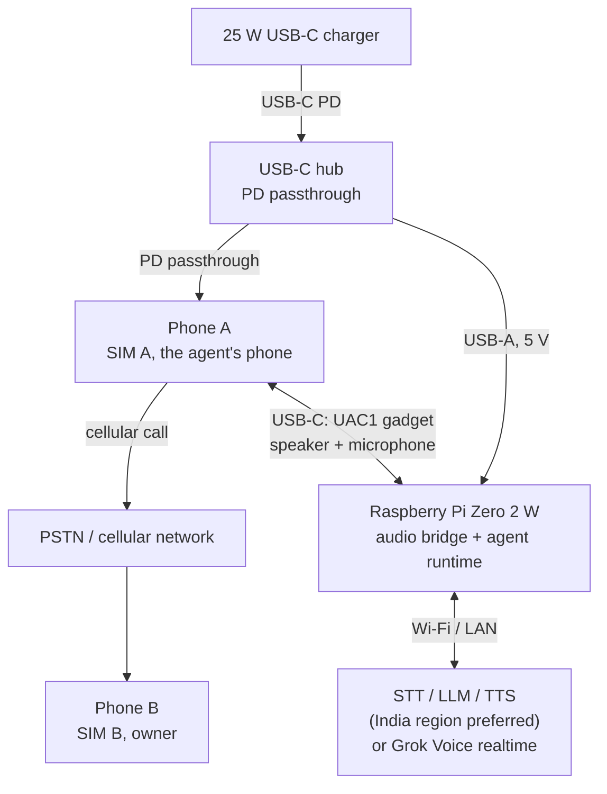

# android-telephone-agent

A programmable voice agent that calls you on a schedule over a real SIM, using a spare
Android phone and a Raspberry Pi.

[](LICENSE)


> Status: alpha. Reference implementation and design documentation; not a finished
> product.

## What this is

This project places a scheduled outbound telephone call over the public switched
telephone network (PSTN) to its owner's mobile phone, holds a natural spoken
conversation, and hangs up. The call originates from a real SIM card in a spare Android
phone. The agent runs on a Raspberry Pi Zero 2 W, which presents itself to that phone as
a USB-C audio headset using the USB Audio Class 1 (UAC1) gadget interface. The called
party answers on an ordinary phone: no app, no data connection, and no root are required
on the receiving side. Caller ID is the agent SIM's number.

The repository contains a design document, a hardware build guide, and a reference
software scaffold. The [design brief](docs/design-brief.md) is the source of truth.

Bluetooth HFP is supported as an alternative audio transport when USB device mode is
unavailable or inconvenient; USB remains the default and canonical path. See the
[Bluetooth HFP guide](docs/bluetooth-hfp.md) and
[ADR 0006](docs/decisions/0006-use-bluetooth-hfp-audio.md).

Other agents can delegate calls to the runtime over MCP and A2A; one process serves both
endpoints from a single call queue. The control plane uses one shared admin-level bearer
token and does not yet enforce a
destination allowlist, per-requester budgets, or requester identity, so keep it on a
trusted network. See the [interoperability guide](docs/interop.md).

## What this is not

- Not an interception or injection tool for a call already in progress on your phone.
- Not a root, Magisk, or Xposed project. Root is explicitly out of scope.
- Not a call recorder or surveillance product. Audio persistence is off by default.
- Not a VoIP or SIP client. The call leg is a genuine cellular call.
- Not a finished product. APIs, file layout, and hardware guidance may change.

## Why the naive approach fails

The obvious approach, running an app on the phone and feeding audio into the call, does
not work: the modem's transmit path lives inside the modem, baseband, and DSP firmware,
and Android exposes no userspace PCM endpoint for the cellular uplink. Root does not
create one either, because root only removes permission checks; if the vendor audio HAL
does not expose the voice path, privileged capture and injection produce silence. VoLTE
does not help, since speech is encoded by the modem and carried as RTP inside the modem's
packet data network, invisible to the application processor's network stack; the
Qualcomm `Incall_Music` mixer is device-specific and frequently broken. The architecture
therefore makes the Pi the phone's headset, which owns both directions of the call audio;
see [docs/architecture.md](docs/architecture.md).

## Architecture



Phone A is a USB data host but a power sink; it does not source VBUS to the gadget. The
hub accepts charger power and passes data and power downstream to the phone and the Pi.
During a power cut, the phone survives on its battery, but the Pi and router do not, so
the UPS must cover the hub and the router.

The diagram shows the canonical USB path. In the Bluetooth HFP variant, the USB-C audio
edge is replaced by an SCO link, and Phone A can charge from a separate supply; the
helper, LAN, and cloud paths are unchanged.

## How it works

1. **Scheduled dial.** A scheduler on the Pi decides that a call slot is due and sends a
   request to a small helper app on Phone A over the LAN, authenticated with a bearer
   token. The helper places the call with `TelecomManager.placeCall()` on the agent SIM,
   so Phone B rings with SIM A's number. Wireless `adb` is a development-only
   alternative and is not suitable for unattended use.
2. **USB audio gadget.** Phone A enumerates the Pi as a USB-C headset and routes call
   audio to it. ALSA direction is inverted relative to a normal sound card: playback to
   the gadget feeds Phone A's microphone input, and capture from the gadget receives the
   remote party's speech. A loopback test verifies this before the agent is connected.
3. **Speech pipeline.** The Pi captures 48 kHz stereo, downmixes and resamples to 16 kHz
   mono, runs voice activity detection, and streams audio to a speech-to-text provider.
   The transcript goes to a streaming LLM, and the reply is synthesized sentence by
   sentence and played back into the call. Barge-in stops playback when the callee
   speaks; endpointing and timeouts keep the conversation from stalling. Alternatively,
   `realtime.kind = "grok"` uses xAI's Grok Voice speech-to-speech WebSocket in one
   full-duplex session; that adapter is independent of the STT/LLM/TTS seams. Its
   documented realtime languages do not include Malayalam yet.
4. **Hangup.** The agent stops audio, requests call termination through the helper where
   Android permits it, and otherwise relies on the remote party or the hard call-duration
   limit to end the call. The outcome is logged locally and summarized in a heartbeat.

The network codec (AMR-NB, AMR-WB, or EVS) caps audio fidelity regardless of the
gadget's 48 kHz rate. The target is latency and turn-taking, not hi-fi.

## Hardware at a glance

| Role | Device | Notes | Indicative cost (INR) |
|---|---|---|---|
| Phone A | Samsung Galaxy A23 4G (SM-A235F) | 5000 mAh, 25 W charging, USB-C 2.0, OTG supported | Excluded from budget |
| Gadget and runtime | Raspberry Pi Zero 2 W | Quad Cortex-A53, 512 MB RAM, 2.4 GHz Wi-Fi | 1,800–2,400 |
| Power and data | USB-C hub with PD passthrough and USB-A | Must pass data downstream while accepting charger power | 800–2,000 |
| Power backup | Mini UPS with 5 V output | Router-UPS class; covers the hub and the Wi-Fi router | 1,200–2,500 |
| Storage | 32 GB microSD, A1/A2 | Raspberry Pi OS Lite 64-bit, Bookworm or later | 400–800 |
| Cables | USB-C to USB-C 60 W; USB-A to micro-USB | Short and strain-relieved | 400–950 |
| Mounting | Phone stand | Holds Phone A upright with the port clear | 150–500 |
| **Total** | | **Excludes phone, SIM, and charger** | **Approx. ₹7,000** |

Prices are indicative ranges for India and change frequently; verify current prices
before buying. A Pi 4 Model B 2 GB is a supported alternative at roughly ₹3,000 more,
with Ethernet and more headroom for local speech models; power it through the GPIO
header so the USB-C port remains available for gadget mode. The Pi 5 cannot act as a USB
device. See [hardware](docs/hardware.md) and [BOM](docs/bom.csv).

## Repository map

```text
README.md
LICENSE
CONTRIBUTING.md
CODE_OF_CONDUCT.md
SECURITY.md
CHANGELOG.md
Makefile
.env.example
config/config.example.toml
config/wireplumber/51-bt-headset.conf
docs/
  README.md
  design-brief.md
  architecture.md
  hardware.md
  bom.csv
  power-and-thermal.md
  raspberry-pi-setup.md
  bluetooth-hfp.md
  android-setup.md
  dial-helper.md
  voice-agent.md
  interop.md
  latency-budget.md
  prompts.md
  operations.md
  runbook.md
  troubleshooting.md
  faq.md
  glossary.md
  decisions/0001-...md .. 0008-...md
scripts/
  README.md
  uac-gadget.sh
  install.sh
  audio-loopback-test.sh
  bluetooth-setup.sh
  bluetooth-check.sh
  bluetooth-audio-test.sh
  dial.sh
  systemd/uac-gadget.service
  systemd/telephone-agent.service
  systemd/telephone-agent.timer
  systemd/telephone-agent-bluetooth.service
  systemd/telephone-agent-bluetooth.timer
agent/
  pyproject.toml
  README.md
  telephone_agent/*.py
  tests/*.py
android-helper/
  README.md
  settings.gradle.kts
  build.gradle.kts
  gradle.properties
  gradlew
  gradlew.bat
  gradle/wrapper/*
  app/
    build.gradle.kts
    proguard-rules.pro
    src/main/AndroidManifest.xml
    src/main/java/dev/example/dialhelper/
      DialService.kt
      MainActivity.kt
    src/main/res/values/strings.xml
.github/
  ISSUE_TEMPLATE/*
  PULL_REQUEST_TEMPLATE.md
  workflows/docs.yml
  workflows/python.yml
```

The map matches the layout described in section 14 of the design brief.

## Roadmap

| Milestone | Scope | Status |
|---|---|---|
| v0 | Manual dial, USB gadget enumeration, and loopback audio verification | In progress: helper builds and installs; hardware validation pending |
| v0.1 | Scheduler, one call per slot, bounded retries, heartbeat and alerting | Planned |
| v0.2 | Barge-in, endpointing, streaming STT/LLM/TTS, latency measurement against the budget | Planned |
| v0.3 | Inbound calls | Exploratory |

The Android helper now builds from `android-helper/` with Gradle and produces an
installable APK. No physical phone, SIM, USB-audio, or end-to-end hardware validation has
been recorded yet, so v0 remains in progress.

Milestones are sequential. v0.3 depends on open questions about call control and is not
committed. See [docs/design-brief.md](docs/design-brief.md) section 15.

## Safety, privacy, and legal

This is a personal-use project. It is intended to call its owner, not third parties.
Outbound calling is regulated: in India, TRAI's TCCCPR rules apply to commercial and
unsolicited calls; in the US, the TCPA and FCC rules on AI-generated voices apply. Do not
use this project for spam, impersonation, or evasion of caller-ID rules, and do not call
people who have not consented. Recording calls requires consent that varies by
jurisdiction; call recording is out of scope.

Call audio is sent to third-party speech-to-text and text-to-speech providers, so those
providers see the conversation audio. Choose providers and regions accordingly, do not
persist audio, and keep phone numbers, SIM identifiers, API keys, and helper tokens out
of the repository. The helper endpoint binds to a private interface, requires a bearer
token, and must not be port-forwarded. See [SECURITY.md](SECURITY.md).

## Status and limitations

- Alpha. The voice runtime is a reference scaffold; there is no stable release.
- UAC1 behavior must be verified on each phone and Android build. Android compatibility
  is likely but not guaranteed, and vendor audio routing can differ.
- The Android helper app is a reference, not a supported product. Ending a call through
  `TelecomManager.endCall()` requires privileged access on modern Android, so the
  fallback path may be the only option on some devices.
- The latency budget is a target, not a measurement on this hardware.
- One phone, one SIM, and one call at a time. Local speech models remain a stretch goal;
  the Pi Zero 2 W is not expected to run them comfortably.

## Documentation and contributing

- [Documentation index](docs/README.md)
- [Contributing](CONTRIBUTING.md)
- [Code of conduct](CODE_OF_CONDUCT.md)
- [Security policy](SECURITY.md)
- [Changelog](CHANGELOG.md)
- [License](LICENSE)
