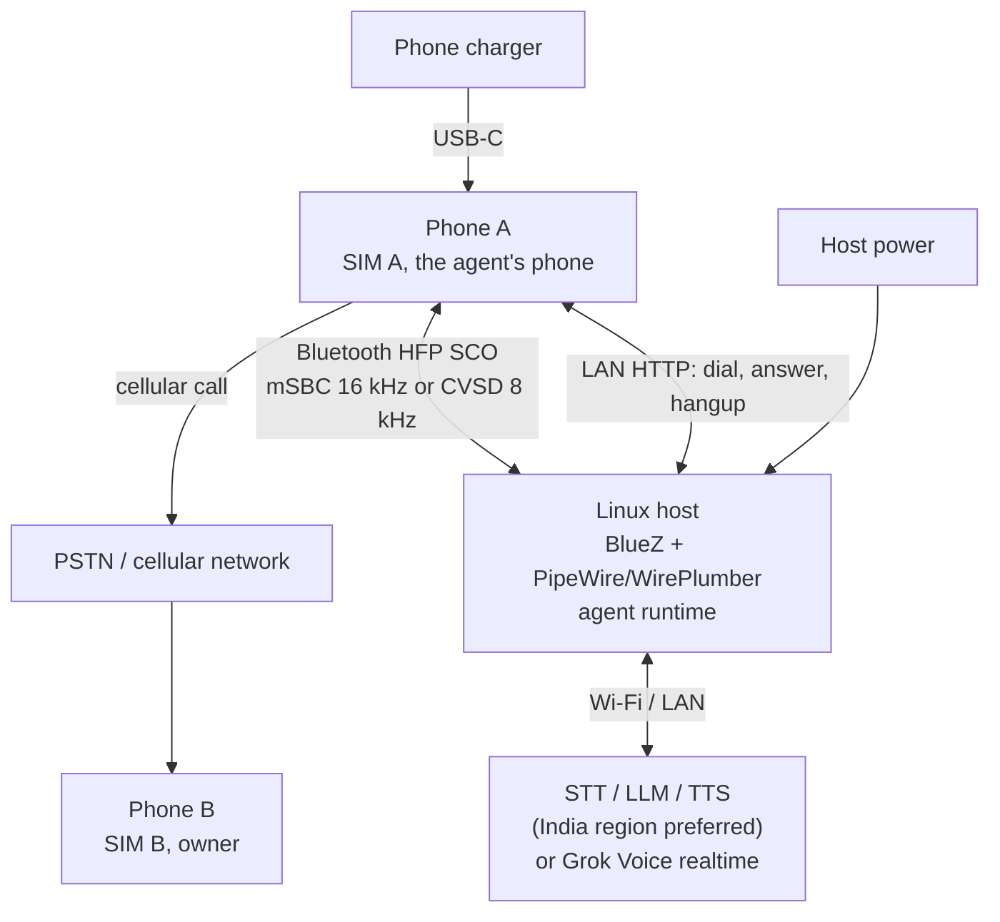

# android-telephone-agent

A programmable voice agent that calls you on a schedule over a real SIM, using a spare
Android phone and a Linux host over Bluetooth HFP.

[](LICENSE)


> Status: alpha. Reference implementation and design documentation; not a finished
> product.

## What this is

This project places a scheduled outbound telephone call over the public switched
telephone network (PSTN) to its owner's mobile phone, holds a natural spoken
conversation, and hangs up. The call originates from a real SIM card in a spare Android
phone. A Linux host runs the agent and presents itself to that phone as a Bluetooth
Hands-Free Profile (HFP) headset: the host is the hands-free unit (HF) and Phone A is the
audio gateway (AG). Call audio travels over a synchronous SCO link. The called party
answers on an ordinary phone: no app, no data connection, and no root are required on the
receiving side. Caller ID is the agent SIM's number.

The repository contains a design document and a reference software scaffold. The
[design brief](docs/design-brief.md) is the source of truth. The Bluetooth HFP path is
the only supported audio transport; see the [Bluetooth HFP guide](docs/bluetooth-hfp.md)
and [ADR 0009](docs/decisions/0009-bluetooth-only-linux-host.md).

An opt-in inbound mode can also answer calls to the agent SIM and connect them to the
Grok Voice realtime adapter. It is implemented and unit-tested but has not yet been
validated on a live inbound PSTN call; see [Inbound calls](docs/inbound.md).

Other agents can delegate calls to the runtime over MCP and A2A; one process serves both
endpoints from a single call queue. The control plane uses one shared admin-level bearer
token and does not yet enforce a destination allowlist, per-requester budgets, or
requester identity, so keep it on a trusted network. See the
[interoperability guide](docs/interop.md).

## What this is not

- Not an interception or injection tool for a call already in progress on your phone.
- Not a root, Magisk, or Xposed project. Root is explicitly out of scope.
- Not a call recorder or surveillance product. Call audio is not persisted; the optional
  local transcript is an opt-in text file.
- Not a call screener. The opt-in inbound mode answers every ringing call on the agent
  SIM; there is no caller-ID filter, allowlist, or screening.
- Not a VoIP or SIP client. The call leg is a genuine cellular call.
- Not a finished product. APIs and file layout may change.

## Why the naive approach fails

The obvious approach, running an app on the phone and feeding audio into the call, does
not work: the modem's transmit path lives inside the modem, baseband, and DSP firmware,
and Android exposes no userspace PCM endpoint for the cellular uplink. Root does not
create one either, because root only removes permission checks; if the vendor audio HAL
does not expose the voice path, privileged capture and injection produce silence. VoLTE
does not help, since speech is encoded by the modem and carried as RTP inside the modem's
packet data network, invisible to the application processor's network stack; the
Qualcomm `Incall_Music` mixer is device-specific and frequently broken. The architecture
therefore makes the Linux host the phone's Bluetooth headset, which owns both directions
of the call audio; see [docs/architecture.md](docs/architecture.md).

## Architecture



Phone A routes call audio to the host because Android already does that for a Bluetooth
headset. Dialing, answering, and hangup remain in Android; the host asks the LAN helper to
perform them. The host and phone must be on the same private LAN for that control path,
and the host must run in the user session that owns PipeWire and WirePlumber.

## How it works

1. **Scheduled dial.** A scheduler on the host decides that a call slot is due and sends
   a request to a small helper app on Phone A over the LAN, authenticated with a bearer
   token. The helper places the call with `TelecomManager.placeCall()` on the agent SIM,
   so Phone B rings with SIM A's number. Wireless `adb` is a development-only
   alternative and is not suitable for unattended use.
2. **Bluetooth HFP audio.** The host advertises the HFP hands-free (HF) role; Phone A is
   the audio gateway (AG). Pair the phone, trust the host, and enable **Calls and audio**
   for it. During a call PipeWire creates a SCO source for the downlink and a SCO sink for
   the uplink. The codec is mSBC at 16 kHz when both sides negotiate it and CVSD at 8 kHz
   otherwise. SCO nodes exist only while a call is active, so verify the adapter roles,
   the phone connection, and both nodes with the Bluetooth check and audio-test scripts
   before connecting the agent.
3. **Speech pipeline.** The host captures the SCO source, resamples to 16 kHz mono, runs
   voice activity detection, and streams audio to a speech-to-text provider. The
   transcript goes to a streaming LLM, and the reply is synthesized sentence by sentence,
   resampled to the SCO rate, and played to the SCO sink. Barge-in stops playback when the
   callee speaks; endpointing and timeouts keep the conversation from stalling.
   Alternatively, `realtime.kind = "grok"` uses xAI's Grok Voice speech-to-speech
   WebSocket in one full-duplex session; that adapter is independent of the STT/LLM/TTS
   seams. Its documented realtime languages do not include Malayalam yet.
4. **Hangup.** The agent stops audio, requests call termination through the helper where
   Android permits it, and otherwise relies on the remote party or the hard call-duration
   limit to end the call. The outcome is logged locally and summarized in a heartbeat.

The network codec (AMR-NB, AMR-WB, or EVS) caps audio fidelity regardless of the SCO
rate. mSBC gives a 16 kHz link between the phone and the host, but an AMR-NB network leg
remains 8 kHz. The target is latency and turn-taking, not hi-fi.

## Hardware at a glance

| Role | Requirement | Notes |
|---|---|---|
| Host | Linux with BlueZ, PipeWire, and WirePlumber in the same user session | Onboard Bluetooth is sufficient for the validated setup; a desktop or laptop works. |
| Phone A | Spare Android phone with Bluetooth HFP and the **Calls and audio** setting | Samsung Galaxy A23 4G (SM-A235F) is the validated device. |
| SIM | Voice-capable SIM with credit and a known number | Use a SIM dedicated to the agent, especially for inbound. |
| Network | Private LAN shared by the phone and host, with internet access | The helper is LAN-only; do not port-forward it. |
| Power | Phone charger and mains power for the host | The phone can charge from any USB charger because its port is not the audio link. |

No single-board computer, USB audio device, hub, UPS, or bill of materials is required. The host
may be a laptop, desktop, or small Linux machine with a working Bluetooth adapter. Local
speech models are a stretch goal on a larger host, not part of the reference
configuration.

## Repository map

```text
README.md
LICENSE
CONTRIBUTING.md
CODE_OF_CONDUCT.md
SECURITY.md
CHANGELOG.md
Makefile
.env.example
config/config.example.toml
config/wireplumber/51-bt-headset.conf
docs/
  README.md
  design-brief.md
  architecture.md
  bluetooth-hfp.md
  inbound.md
  android-setup.md
  dial-helper.md
  voice-agent.md
  interop.md
  latency-budget.md
  prompts.md
  operations.md
  runbook.md
  troubleshooting.md
  faq.md
  glossary.md
  decisions/0001-...md .. 0009-...md
scripts/
  README.md
  bluetooth-setup.sh
  bluetooth-check.sh
  bluetooth-audio-test.sh
  dial.sh
  build-helper.sh
  install-helper.sh
  helper-smoke-test.sh
  systemd/telephone-agent-bluetooth.service
  systemd/telephone-agent-bluetooth.timer
  systemd/telephone-agent-inbound.service
agent/
  pyproject.toml
  README.md
  telephone_agent/*.py
  tests/*.py
android-helper/
  README.md
  settings.gradle.kts
  build.gradle.kts
  gradle.properties
  gradlew
  gradlew.bat
  gradle/wrapper/*
  app/
    build.gradle.kts
    proguard-rules.pro
    src/main/AndroidManifest.xml
    src/main/java/dev/example/dialhelper/
      DialService.kt
      MainActivity.kt
    src/main/res/values/strings.xml
.github/
  ISSUE_TEMPLATE/*
  PULL_REQUEST_TEMPLATE.md
  workflows/docs.yml
  workflows/python.yml
```

The map matches the layout described in section 14 of the design brief.

## Roadmap

| Milestone | Scope | Status |
|---|---|---|
| v0 | Manual dial and Bluetooth HFP SCO verification | Done on a Linux laptop: adapter roles, pairing, mSBC 16 kHz SCO, and a real outbound conversation; no USB audio route |
| v0.1 | Scheduler, one call per slot, bounded retries, heartbeat and alerting | Planned |
| v0.2 | Barge-in, endpointing, streaming STT/LLM/TTS, latency measurement against the budget | Planned |
| v0.3 | Inbound calls | Implemented; daemon unit-tested; live inbound PSTN validation pending |

The Android helper builds from `android-helper/` with Gradle and produces an
installable APK. On 2026-10-24 the Bluetooth HFP path was validated end to end on a Linux
laptop (BlueZ 5.85, PipeWire 1.6.2, WirePlumber 0.5.13) with a Samsung Galaxy A23 4G
(SM-A235F) and its onboard adapter. Outbound PSTN calls were placed through the LAN
helper, audio ran over HFP SCO at mSBC 16 kHz in both directions, and the Grok Voice
realtime adapter held a real conversation. One recorded run completed five turns in
68.1 s: the model requested `end_call` and the helper accepted `/hangup` with `202`.
The run also exposed a stale ten-minute call window in the helper, which now checks
Telecom call state before rejecting `/call`.

The Bluetooth link was weak (RSSI about -87 dBm), and the first call dropped the link
during setup and needed a manual reconnect; later calls were stable. The run validates
the Bluetooth path on a laptop. It does not validate live inbound PSTN calls or latency.

Milestones are sequential in the plan. Inbound (v0.3) now has an implementation, but it
depends on the helper's call-state API and has not been exercised on a live inbound call.
See [docs/design-brief.md](docs/design-brief.md) section 15 and
[docs/inbound.md](docs/inbound.md).

## Safety, privacy, and legal

This is a personal-use project. It is intended to call its owner, not third parties.
Outbound calling is regulated: in India, TRAI's TCCCPR rules apply to commercial and
unsolicited calls; in the US, the TCPA and FCC rules on AI-generated voices apply. Do not
use this project for spam, impersonation, or evasion of caller-ID rules, and do not call
people who have not consented. Recording calls requires consent that varies by
jurisdiction; call recording is out of scope.

Call audio is sent to third-party speech-to-text and text-to-speech providers, so those
providers see the conversation audio. Choose providers and regions accordingly, do not
persist audio, and keep phone numbers, SIM identifiers, API keys, and helper tokens out
of the repository. The helper endpoint binds to a private interface, requires a bearer
token, and must not be port-forwarded. See [SECURITY.md](SECURITY.md).

Local transcripts are opt-in with `[transcript].enabled = true`. When enabled, the agent
writes one timestamped JSONL file per call under `runtime/transcripts` by default. These
files contain the full E.164 number when one is known (inbound calls have no caller ID),
the verbatim callee and agent text, and call metadata: direction, objective, audio backend,
realtime model and voice, duration, and result. They are created with mode `0600` in a
directory with mode `0700` and stay on the device. They are intentionally **not** masked and
are not the same as the operational stdout and journald logs, which remain masked. Treat
them as personal data, keep them out of backups you do not control, and delete them on a
retention schedule. Call audio itself is not written to disk.

## Status and limitations

- Alpha. The voice runtime is a reference scaffold; there is no stable release.
- Bluetooth HFP is the only supported audio transport. The host must run BlueZ, PipeWire,
  and WirePlumber in the user session that runs the agent; a system service that does not
  share that session cannot see the SCO nodes.
- The HFP path is validated on a Linux laptop with a Galaxy A23, not with live inbound
  calls. The validated link was weak (RSSI about -87 dBm), and the first call dropped
  Bluetooth during setup and needed a manual reconnect.
- The earlier Pi-based and USB audio route was removed on 2026-10-24. This project no
  longer supports a Pi, a USB audio device, a USB hub, or a UPS. See
  [ADR 0009](docs/decisions/0009-bluetooth-only-linux-host.md).
- Inbound answering is opt-in and answers every ringing call on the agent SIM. The helper
  does not request `READ_CALL_LOG`, so there is no caller-ID filter, allowlist, or
  screening. Use a SIM dedicated to the agent.
- `acceptRingingCall()` is best effort for a non-default dialer. Android may deny or
  ignore the answer on a locked screen or a vendor build; the helper reports `403` or
  `500`, and the daemon keeps polling.
- The Android helper app is a reference, not a supported product. Ending a call through
  `TelecomManager.endCall()` requires privileged access on modern Android, so the
  fallback path may be the only option on some devices.
- The latency budget is a target, not a measurement, including on the Bluetooth run.
- Bluetooth carries audio only. HFP has no ringing signal or caller ID, so the LAN helper
  answers an inbound call before the SCO nodes exist.
- Local transcripts are opt-in and contain full personal data: full phone numbers where
  known, verbatim conversation text, and call metadata, with mode `0600` in a `0700`
  directory. Operational logs are masked. Treat transcript files as PII and apply a
  retention policy.
- One phone, one host, and one call at a time. Inbound and outbound calls share that slot
  and are serialized. Local speech models remain a stretch goal on a host with more CPU
  and RAM than the validated laptop requires.

## Documentation and contributing

- [Documentation index](docs/README.md)
- [Bluetooth HFP guide](docs/bluetooth-hfp.md)
- [Inbound calls](docs/inbound.md)
- [ADR 0009: Bluetooth-only Linux host](docs/decisions/0009-bluetooth-only-linux-host.md)
- [Contributing](CONTRIBUTING.md)
- [Code of conduct](CODE_OF_CONDUCT.md)
- [Security policy](SECURITY.md)
- [Changelog](CHANGELOG.md)
- [License](LICENSE)
