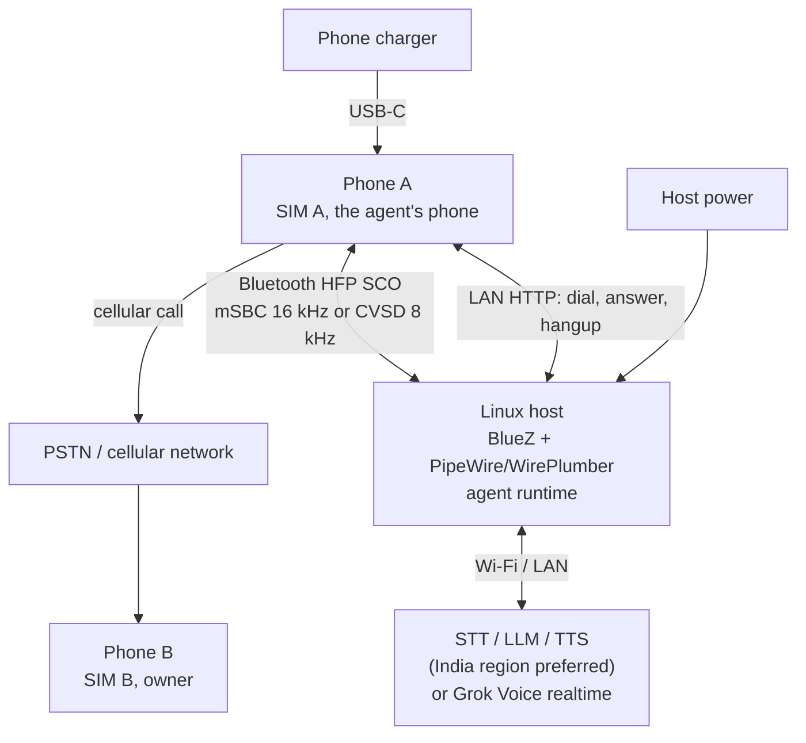

# android-telephone-agent

A programmable voice agent that calls you on a schedule over a real SIM, using a spare
Android phone and a Linux host over Bluetooth HFP.

[](LICENSE)


> Status: alpha. Reference implementation and design documentation; not a finished
> product.

## What this is

This project places a scheduled outbound telephone call over the public switched
telephone network (PSTN) to its owner's mobile phone, holds a natural spoken
conversation, and hangs up. The call originates from a real SIM card in a spare Android
phone. A Linux host runs the agent and presents itself to that phone as a Bluetooth
Hands-Free Profile (HFP) headset: the host is the hands-free unit (HF) and Phone A is the
audio gateway (AG). Call audio travels over a synchronous SCO link. The called party
answers on an ordinary phone: no app, no data connection, and no root are required on the
receiving side. Caller ID is the agent SIM's number.

The repository contains design documentation and a reference implementation. The
[design brief](docs/design-brief.md) is the source of truth. The Bluetooth HFP path is
the only supported audio transport; see the [Bluetooth HFP guide](docs/bluetooth-hfp.md)
and [ADR 0009](docs/decisions/0009-bluetooth-only-linux-host.md).

An opt-in inbound mode can also answer calls to the agent SIM and connect them to the
Grok Voice realtime adapter. One long-lived daemon serves inbound and outbound calls, and
inbound has been validated once on a live inbound PSTN call over Bluetooth HFP; see
[Inbound calls](docs/inbound.md).

Other agents can delegate calls to the runtime over MCP and A2A; one process serves both
endpoints from a single call queue. `serve` is a separate control plane from the daemon.
Both own the Bluetooth audio path, so do not run them at the same time. The control plane
uses one shared admin-level bearer token and does not yet enforce a destination allowlist,
per-requester budgets, or requester identity, so keep it on a trusted network. See the
[interoperability guide](docs/interop.md).

## Quick start

The full setup is in the [Bluetooth HFP guide](docs/bluetooth-hfp.md) and
[Android setup](docs/android-setup.md). The short version:

1. **Prepare the host.** Install BlueZ, PipeWire, WirePlumber, and the PipeWire CLI
   tools. Run the agent as the user who owns the PipeWire session, not as root or from a
   system service.

   ```bash
   ./scripts/bluetooth-setup.sh
   bluetoothctl
   # power on; agent on; default-agent; scan on
   # pair <phone-mac>; trust <phone-mac>; connect <phone-mac>
   ```

   On Phone A, enable **Calls and audio** for the host.

2. **Build and install the helper.** This is a bench step: the install uses adb over USB
   or Wi-Fi. Configure the release keystore and `dialHelperToken` as described in the
   [helper README](android-helper/README.md), then:

   ```bash
   ./scripts/build-helper.sh
   ./scripts/install-helper.sh --health http://<phone-ip>:8765
   ```

3. **Configure the agent.** Copy the example, fill in the phone's Bluetooth address, the
   helper URL, and the same helper token, then lock the file down. For Grok Voice, set
   `[realtime].api_key` or export `XAI_API_KEY` instead of storing the key in the file.

   ```bash
   cp config/config.example.toml config/config.toml
   chmod 600 config/config.toml
   # edit config/config.toml
   ```

4. **Check the path.**

   ```bash
   make doctor
   ```

   With no call active, the SCO nodes are absent. That is expected; the check verifies the
   host tools, configuration, and helper reachability.

5. **Start the daemon and place a call.**

   ```bash
   .venv/bin/telephone-agent --config config/config.toml daemon
   # in a second terminal
   .venv/bin/telephone-agent --config config/config.toml run --number +91XXXXXXXXXX
   ```

   `run` submits the outbound call to the daemon and waits for the result. The same
   daemon answers inbound calls. The daemon requires `[realtime].kind = "grok"`; use
   `run --direct` for the text pipeline or other foreground debugging, or `dial` for a
   one-shot call with no conversation loop. `inbound` remains a foreground debug command.
   See [Inbound calls](docs/inbound.md).

6. **Run it as a service.** Install the daemon and outbound client systemd *user* units
   from `scripts/systemd/`. The daemon owns inbound and outbound calls; the timer triggers
   a one-shot client that submits one call. The agent must share the
   PipeWire/WirePlumber session; see the
   [Bluetooth guide](docs/bluetooth-hfp.md#10-run-in-the-pipewire-user-session).

## What this is not

- Not an interception or injection tool for a call already in progress on your phone.
- Not a root, Magisk, or Xposed project. Root is explicitly out of scope.
- Not a call recorder or surveillance product. Call audio is not persisted; the optional
  local transcript is an opt-in text file.
- Not a call screener. The opt-in inbound mode answers every ringing call on the agent
  SIM; there is no caller-ID filter, allowlist, or screening.
- Not a VoIP or SIP client. The call leg is a genuine cellular call.
- Not a finished product. APIs and file layout may change.

## Why app-side audio injection fails

The obvious approach, running an app on the phone and feeding audio into the call, does
not work: the modem's transmit path lives inside the modem, baseband, and DSP firmware,
and Android exposes no userspace PCM endpoint for the cellular uplink. Root does not
create one either, because root only removes permission checks; if the vendor audio HAL
does not expose the voice path, privileged capture and injection produce silence. VoLTE
does not help, since speech is encoded by the modem and carried as RTP inside the modem's
packet data network, invisible to the application processor's network stack; the
Qualcomm `Incall_Music` mixer is device-specific and frequently broken. The architecture
therefore makes the Linux host the phone's Bluetooth headset, which owns both directions
of the call audio; see [docs/architecture.md](docs/architecture.md).

## Architecture



Phone A routes call audio to the host because Android already does that for a Bluetooth
headset. Dialing, answering, and hangup remain in Android; the host asks the LAN helper to
perform them. The host and phone must be on the same private LAN for that control path,
and the host must run in the user session that owns PipeWire and WirePlumber.

## How it works

1. **Scheduled dial.** A scheduler on the host decides that a call slot is due and sends
   a request to a small helper app on Phone A over the LAN, authenticated with a bearer
   token. The helper places the call with `TelecomManager.placeCall()` on the agent SIM,
   so Phone B rings with SIM A's number. The scheduler is the v0.1 milestone. In v0 a
   systemd timer triggers a client that submits `run` to the long-lived daemon; `dial`
   remains a one-shot helper call. Wireless `adb` is a development-only alternative and
   is not suitable for unattended use.
2. **Bluetooth HFP audio.** The host advertises the HFP hands-free (HF) role; Phone A is
   the audio gateway (AG). Pair the phone, trust the host, and enable **Calls and audio**
   for it. During a call PipeWire creates a SCO source for the downlink and a SCO sink for
   the uplink. The codec is mSBC at 16 kHz when both sides negotiate it and CVSD at 8 kHz
   otherwise. SCO nodes exist only while a call is active, so verify the adapter roles,
   the phone connection, and both nodes with the Bluetooth check and audio-test scripts
   before connecting the agent.
3. **Speech pipeline.** The bundled conversational path is `realtime.kind = "grok"`: the
   host captures the SCO source, streams 16 kHz PCM to xAI's Grok Voice WebSocket, and
   plays the returned audio to the SCO sink. Server-side VAD handles barge-in and
   turn-taking. The text pipeline remains a seam for custom providers: it provides VAD and
   endpointing, but no STT or TTS adapter is bundled, and `[brain]` can target an
   OpenAI-compatible endpoint for text-only testing. Grok's documented realtime languages
   do not include Malayalam yet.
4. **Hangup.** The agent stops audio, requests call termination through the helper where
   Android permits it, and otherwise relies on the remote party or the hard call-duration
   limit to end the call. The outcome is logged locally; a heartbeat is planned for v0.1.

The network codec (AMR-NB, AMR-WB, or EVS) caps audio fidelity regardless of the SCO
rate. mSBC gives a 16 kHz link between the phone and the host, but an AMR-NB network leg
remains 8 kHz. The target is latency and turn-taking, not hi-fi.

## Requirements

| Role | Requirement | Notes |
|---|---|---|
| Host | Linux with BlueZ, PipeWire, and WirePlumber in the same user session | The validated setup used a laptop's onboard adapter; a laptop, desktop, or mini PC works. |
| Phone A | Spare Android phone with Bluetooth HFP and the **Calls and audio** setting | Samsung Galaxy A23 4G (SM-A235F) is the validated device. |
| SIM | Voice-capable SIM with credit and a known number | Use a SIM dedicated to the agent, especially for inbound. |
| Network | Private LAN shared by the phone and host, with internet access | The helper is LAN-only; do not port-forward it. |
| Power | Phone charger and mains power for the host | The phone charges from its own charger; Bluetooth is the audio link. |

Local speech models are a stretch goal on a larger host, not part of the reference
configuration.

## Repository map

```text
README.md
LICENSE
CONTRIBUTING.md
CODE_OF_CONDUCT.md
SECURITY.md
CHANGELOG.md
Makefile
.env.example
config/config.example.toml
config/wireplumber/51-bt-headset.conf
docs/
  README.md
  design-brief.md
  architecture.md
  bluetooth-hfp.md
  inbound.md
  android-setup.md
  dial-helper.md
  voice-agent.md
  interop.md
  latency-budget.md
  prompts.md
  operations.md
  runbook.md
  troubleshooting.md
  faq.md
  glossary.md
  decisions/0001-...md .. 0009-...md
scripts/
  README.md
  bluetooth-setup.sh
  bluetooth-check.sh
  bluetooth-audio-test.sh
  dial.sh
  build-helper.sh
  install-helper.sh
  helper-smoke-test.sh
  systemd/telephone-agent-daemon.service
  systemd/telephone-agent-bluetooth.service
  systemd/telephone-agent-bluetooth.timer
agent/
  pyproject.toml
  README.md
  telephone_agent/*.py
  tests/*.py
android-helper/
  README.md
  settings.gradle.kts
  build.gradle.kts
  gradle.properties
  gradlew
  gradlew.bat
  gradle/wrapper/*
  app/
    build.gradle.kts
    proguard-rules.pro
    src/main/AndroidManifest.xml
    src/main/java/dev/example/dialhelper/
      DialService.kt
      MainActivity.kt
    src/main/res/values/strings.xml
.github/
  ISSUE_TEMPLATE/*
  PULL_REQUEST_TEMPLATE.md
  workflows/docs.yml
  workflows/python.yml
```

The map matches the layout described in section 14 of the design brief.

## Roadmap

| Milestone | Scope | Status |
|---|---|---|
| v0 | Manual dial and Bluetooth HFP SCO verification | Validated on a Linux laptop: helper dial, mSBC 16 kHz SCO, Grok conversation, agent-initiated hangup |
| v0.1 | Scheduler, one call per slot, bounded retries, heartbeat and alerting | Planned |
| v0.2 | Latency measurement; bundled STT/TTS adapters for the text pipeline | Planned; Grok supplies barge-in and endpointing |
| v0.3 | Inbound calls and unified daemon | Implemented; one long-lived daemon serves inbound and outbound calls, and inbound was validated on one live inbound PSTN call over Bluetooth HFP |

### Validation

The Android helper builds from `android-helper/` with Gradle and produces an
installable APK. On 2026-10-24 the Bluetooth HFP path was validated end to end on a Linux
laptop (BlueZ 5.85, PipeWire 1.6.2, WirePlumber 0.5.13) with a Samsung Galaxy A23 4G
(SM-A235F) and its onboard adapter. Outbound PSTN calls were placed through the LAN
helper, audio ran over HFP SCO at mSBC 16 kHz in both directions, and the Grok Voice
realtime adapter held a real conversation. One recorded run completed five turns in
68.1 s: the model requested `end_call` and the helper accepted `/hangup` with `202`.
The run also exposed a stale ten-minute call window in the helper, which now checks
Telecom call state before rejecting `/call`.

The Bluetooth link was weak (RSSI about -87 dBm), and the first call dropped the link
during setup and needed a manual reconnect; later calls were stable. The outbound run
validates the Bluetooth path on a laptop; latency remains unmeasured.

Inbound was validated separately, once, on the same laptop and phone on 2026-10-24. At
22:01:26 the helper answered a ringing inbound PSTN call after the watcher's 1 s delay,
and the Grok Voice session opened and requested the configured opening greeting at
22:01:27. The
call ran four turns in 39.0 s and ended `completed`: the model requested hangup at
22:01:59 ("Caller said goodbye and ended the conversation."), the helper accepted
`/hangup`, and the call returned to idle at 22:02:05. The local transcript recorded ten
timestamped JSONL events in a mode-0600 file: `call_start` with `direction=inbound` and an
empty number, four callee transcripts, four agent replies, and `call_end` with `state=idle`,
`reason=completed`, `turns=4`, and `duration_s≈39.0`. Caller ID remains unavailable
because the helper does not request `READ_CALL_LOG`.

Milestones are sequential in the plan. Inbound (v0.3) is implemented and has been
exercised once on a live inbound PSTN call through the helper's call-state API.
Locked-screen answering and vendor restrictions on `acceptRingingCall()` remain
unverified, and answering still depends on the helper rather than HFP call control. See
[docs/design-brief.md](docs/design-brief.md) section 15 and
[docs/inbound.md](docs/inbound.md).

## Safety, privacy, and legal

This is a personal-use project. It is intended to call its owner, not third parties.
Outbound calling is regulated: in India, TRAI's TCCCPR rules apply to commercial and
unsolicited calls; in the US, the TCPA and FCC rules on AI-generated voices apply. Do not
use this project for spam, impersonation, or evasion of caller-ID rules, and do not call
people who have not consented. Recording calls requires consent that varies by
jurisdiction; call recording is out of scope.

Call audio is sent to the configured speech provider: xAI for Grok Voice, or your own
STT/TTS adapters. Those providers see the conversation audio, so choose providers and
regions accordingly, do not persist audio, and keep phone numbers, SIM identifiers, API
keys, and helper tokens out of the repository. The helper endpoint listens on the phone's
LAN address, requires a bearer token, and must not be port-forwarded. The token is
compiled into the sideloaded APK and is extractable; treat the APK as a secret and rotate
the token if it leaks. See [SECURITY.md](SECURITY.md).

Local transcripts are opt-in with `[transcript].enabled = true`. When enabled, the agent
writes one timestamped JSONL file per call under `runtime/transcripts` by default. These
files contain the full E.164 number when one is known (inbound calls have no caller ID),
the verbatim callee and agent text, and call metadata: direction, objective, audio backend,
realtime model and voice, duration, and result. They are created with mode `0600` in a
directory with mode `0700` and stay on the device. They are intentionally **not** masked and
are not the same as the operational stdout and journald logs, which remain masked. Treat
them as personal data, keep them out of backups you do not control, and delete them on a
retention schedule. Call audio itself is not written to disk.

## Status and limitations

- Alpha. The voice runtime is a reference implementation; there is no stable release.
- Bluetooth HFP is the only supported audio transport. The host must run BlueZ, PipeWire,
  and WirePlumber in the user session that runs the agent; a system service that does not
  share that session cannot see the SCO nodes.
- The HFP path is validated on a Linux laptop with a Galaxy A23 for outbound calls and one
  live inbound call. The validated link was weak (RSSI about -87 dBm); the first outbound
  call dropped Bluetooth during setup and needed a manual reconnect, and Bluetooth was
  reconnected manually before the inbound test.
- Inbound answering is opt-in and answers every ringing call on the agent SIM. The helper
  does not request `READ_CALL_LOG`, so there is no caller-ID filter, allowlist, or
  screening. Use a SIM dedicated to the agent.
- `acceptRingingCall()` is best effort for a non-default dialer. Android may deny or
  ignore the answer on a locked screen or a vendor build; the helper reports `403` or
  `500`, and the daemon keeps polling.
- The Android helper app is a reference, not a supported product.
  `TelecomManager.endCall()` may be refused on modern Android for apps that are not the
  default dialer; the fallback is the remote party or the hard call-duration limit.
- The latency budget is a target, not a measurement, including on the Bluetooth run.
- Bluetooth carries audio only in this design. The reference host does not implement HFP
  call control, so ringing, answering, and hangup use the LAN helper. The helper also
  does not request `READ_CALL_LOG`, so inbound caller ID is unavailable; SCO nodes appear
  only after the call is answered.
- Local transcripts are opt-in and contain full personal data: full phone numbers where
  known, verbatim conversation text, and call metadata, with mode `0600` in a `0700`
  directory. Operational logs are masked. Treat transcript files as PII and apply a
  retention policy.
- One phone, one host, and one call at a time. Inbound and outbound calls share that slot
  and are serialized. Local speech models remain a stretch goal and are not part of the
  reference configuration.

## Documentation and contributing

- [Documentation index](docs/README.md)
- [Bluetooth HFP guide](docs/bluetooth-hfp.md)
- [Inbound calls](docs/inbound.md)
- [ADR 0009: Bluetooth-only Linux host](docs/decisions/0009-bluetooth-only-linux-host.md)
- [Contributing](CONTRIBUTING.md)
- [Code of conduct](CODE_OF_CONDUCT.md)
- [Security policy](SECURITY.md)
- [Changelog](CHANGELOG.md)
- [License](LICENSE)
