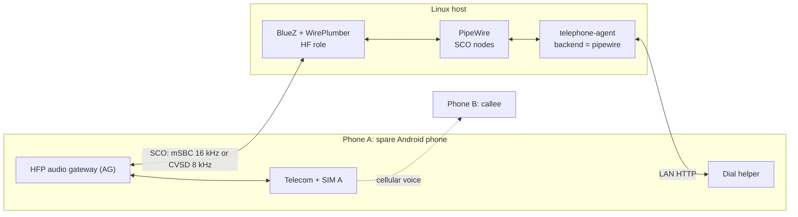
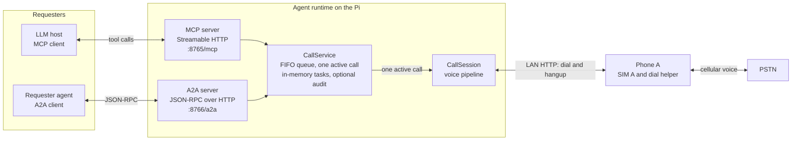
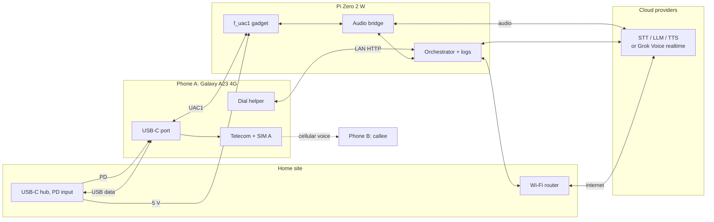
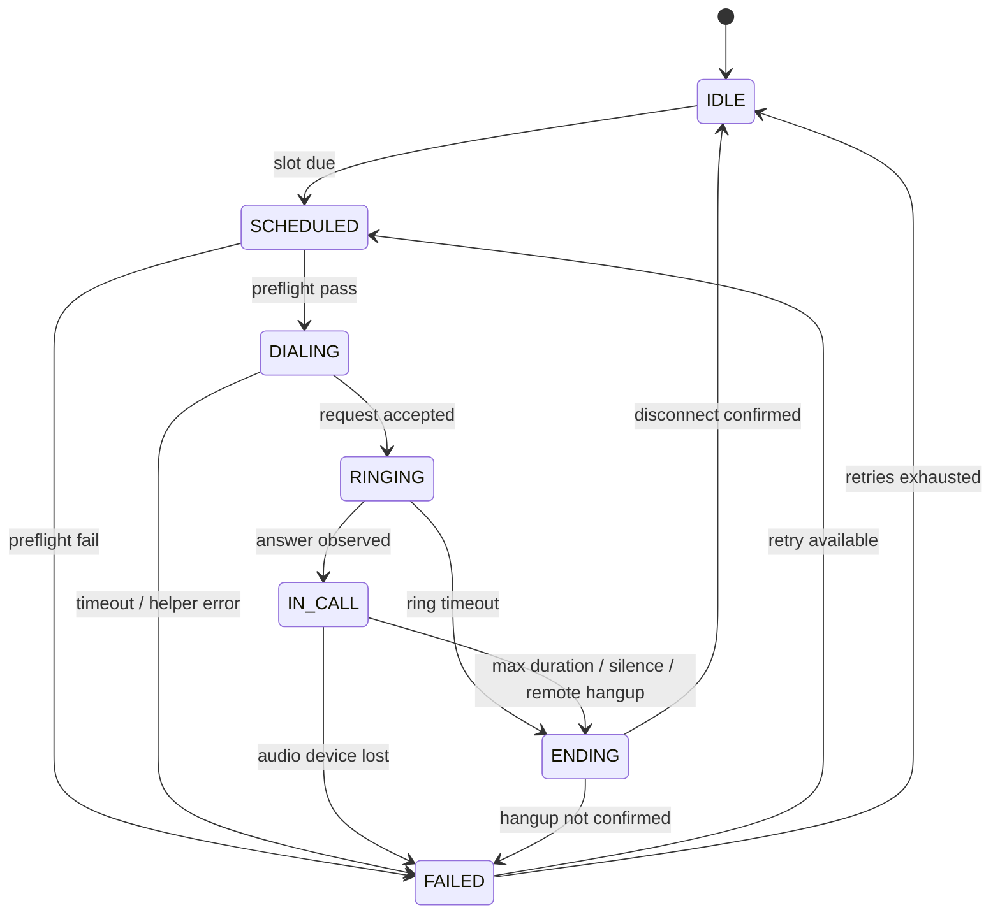

# Architecture

Status: alpha; control plane implemented, voice path scaffolded | Last updated: 2026-10-24

The [design brief](./design-brief.md) is authoritative. This document expands it and
does not add hardware requirements. Device-specific behavior is marked "verify on
your device".

## 1. Purpose

The system places a scheduled outbound call over the public switched telephone
network (PSTN), holds a short spoken conversation, and hangs up. The call originates
from a real SIM in a spare Android phone ("Phone A"). A Raspberry Pi Zero 2 W appears
to that phone as a USB-C audio headset. The callee ("Phone B") answers on an ordinary
phone with no app, no data connection, and no special configuration. The goals are a
genuine cellular call with a real mobile number as caller ID, no root or modem
modification, and unattended operation from a small, low-power device.

## 2. Scope

In scope:

- The USB audio path between Phone A and the Pi, in both directions, and the
  supported Bluetooth HFP alternative.
- Scheduling, dialing, call-progress tracking, and hangup.
- Capture, VAD, STT, LLM, TTS, and playback.
- Delegated outbound calls from other agents over MCP and A2A, as a control plane only.
- Power, cooling, network, failure handling, and observability.

Non-goals:

- Intercepting or recording a call already in progress on the owner's phone.
- Root, bootloader unlocking, custom firmware, or vendor HAL changes.
- VoIP or SIP; the call leg is cellular.
- Inbound PSTN calls in the first milestone. Inbound control-plane tasking over MCP and
  A2A is in scope.
- More than one concurrent call per phone and Pi pair.
- Local speech models on the Zero 2 W (stretch goal on a Pi 4 or Pi 5).
- A consumer product, enclosure design, or support contract.

## 3. The core constraint: the uplink lives in the modem

A call has a **downlink** (what the remote party says) and an **uplink** (what the
phone's microphone captures and the remote party hears). Apps can observe call metadata
and sometimes capture audio with privileged permissions, but they cannot write into
the uplink.

**Circuit-switched.** On 2G/3G, or LTE falling back to circuit-switched, the operator
allocates a dedicated circuit. The baseband digitizes the microphone, applies gain and
noise processing, encodes with a speech codec, and transmits. The application processor
is not in that path; there is no userspace PCM device for "audio to send to the far end".

**VoLTE.** Speech is RTP over an IMS packet data network. The modem runs the IMS stack
and terminates the RTP inside its own PDN, which is not the application processor's
network namespace. The packets never appear on `wlan0`, `rmnet*`, or a normal socket.
The modem still converts PCM to codec internally; VoLTE changes the transport, not the
ownership of the uplink.

**Root.** Root removes permission checks for `CAPTURE_AUDIO_OUTPUT`, `VOICE_CALL`,
`VOICE_UPLINK`, and `VOICE_DOWNLINK`, so capture may work on some devices. It does not
create an uplink endpoint; if the vendor HAL does not expose the voice path, the result
is silence. `/dev/diag` can sometimes tap modem traffic on rooted Qualcomm devices but
cannot inject. Qualcomm `Incall_Music` is a lottery: an ADSP mixer on some older
platforms, device-specific, frequently broken, sometimes local-only, and absent on most
recent devices.

## 4. The inversion: become the phone's headset

Instead of entering the modem, the Pi becomes an accessory Android already routes
calls to. A headset has a microphone for the uplink and a speaker for the downlink; if
the Pi is the headset, it owns both directions.

**USB Audio Class.** UAC is a standard device class. The device describes streaming
interfaces and formats in USB descriptors; the host binds a class driver and exposes a
sound card. Android supports USB audio, and vendors route calls to wired headsets,
including USB-C. Routing policy is vendor-specific; verify on your device. The gadget
uses UAC1, 48 kHz, two channels, 16-bit, for broad compatibility; UAC2 (`f_uac2`) is
the fallback. It is built with configfs and `f_uac1`; see
[Raspberry Pi setup](./raspberry-pi-setup.md) and
[`uac-gadget.sh`](../scripts/uac-gadget.sh).

**Both directions.** Phone A sends the downlink out of USB, where the Pi receives it
with `arecord`; it takes the uplink from the headset microphone, supplied by `aplay`.
The phone still does vocoding, echo cancellation, noise suppression, and transmission.
The Pi sees PCM at the headset boundary, exactly where a human headset sits. This does
not intercept calls on the owner's primary phone, record calls, or bypass caller-ID
rules; it affects only calls active while the gadget is attached and selected.

**No telephony control.** Dialing, SIM selection, and hangup stay in Android. A helper
app on Phone A calls `TelecomManager.placeCall()` after a LAN request; on dual-SIM it
must pass the agent SIM's phone account handle or One UI may show a SIM picker. See
[Dial helper](./dial-helper.md). In the canonical USB topology, because the phone is the
USB host, `adb` over the cable is unavailable; wireless debugging does not survive
reboots reliably enough for unattended use. The helper is the reference path.

### 4.1 Bluetooth HFP variant

A second transport is supported when USB device mode is unavailable or unsuitable. The
Linux host advertises the Hands-Free Profile **hands-free unit (HF)** role and Phone A is
the **audio gateway (AG)**. Android already routes call audio to a Bluetooth headset, so no
root or vendor API is involved.



WirePlumber enables the HF role with the fragment in
[`config/wireplumber/51-bt-headset.conf`](../config/wireplumber/51-bt-headset.conf). While
a call is active, PipeWire creates two nodes for the phone's Bluetooth address:

| Direction | Node | Factory | Media class | Agent action |
|---|---|---|---|---|
| Callee to agent (downlink) | `bluez_input.<address>.<id>` | `api.bluez5.sco.source` | `Stream/Output/Audio` | Capture with `pw-record` |
| Agent to callee (uplink) | `bluez_output.<address>.<id>` | `api.bluez5.sco.sink` | `Stream/Input/Audio` | Play with `pw-play` |

The direction is not inverted as it is on the USB gadget: capture from the SCO source is
the remote party, and playback to the SCO sink is the agent's voice. The `.<id>` suffix is
a SPA object id and can change per connection, so the agent discovers nodes by
`api.bluez5.address` and `factory.name`. The nodes exist only during a call or SCO link;
the backend waits up to `node_timeout_s` for them.

HFP call control is not implemented. The LAN helper remains responsible for dialing and
hangup, and Phone A must be reachable on the LAN. The Bluetooth path therefore changes the
audio transport only.

The host must run the agent in the same user session as PipeWire and WirePlumber, normally
a systemd user service with lingering. The system-level one-shot unit used for the USB path
does not work unchanged. See [Bluetooth HFP](./bluetooth-hfp.md) and
[ADR 0006](./decisions/0006-use-bluetooth-hfp-audio.md).

This variant was validated on a Linux laptop with a Samsung Galaxy A23: mSBC at 16 kHz,
bidirectional audio during a Google Meet call, and both SCO directions confirmed with
`pw-record` and `pw-play`. A PSTN call over Bluetooth and the Pi Zero 2 W were not tested;
the Pi is expected to work but is unverified. The cellular codec still caps fidelity.

## Control plane: MCP and A2A

The voice path above is real-time. A separate asynchronous control plane lets other
agents and LLM hosts delegate outbound calls without blocking for the call. Both
protocol adapters are thin front ends over one `CallService`: a single FIFO task queue,
one active call (one SIM and one audio path), in-memory task state, and an optional JSONL
audit log. The control plane is implemented in the reference runtime. It is alpha: it
does not yet enforce a destination allowlist, budgets, per-requester identity, or rate
limits.



One process runs one `CallService` and two listeners. MCP over Streamable HTTP is at
`/mcp`; A2A JSON-RPC is at `/a2a`. The A2A Agent Card is at
`/.well-known/agent-card.json`, and both listeners expose `GET /health`. MCP exposes
`place_call`, `get_call`, `answer_call`, `cancel_call`, and `list_calls`; `place_call`
returns a task id immediately and never blocks for the call. A2A uses the `a2a-sdk`
protocol 1.0 methods `SendMessage`, `SendStreamingMessage`, `GetTask`, `CancelTask`,
and `SubscribeToTask` (the 0.3 aliases such as `message/send` are not enabled).

A2A maps one task to one call. The A2A task moves through `TASK_STATE_SUBMITTED` to
`TASK_STATE_WORKING` as the call is queued, dialing, or in conversation; it becomes
`TASK_STATE_INPUT_REQUIRED` during a mid-call consultation and finally
`TASK_STATE_COMPLETED`, `TASK_STATE_CANCELED`, or `TASK_STATE_FAILED`. A completed call
publishes one `call-summary` artifact with a JSON summary and transcript; raw audio is
never exposed.

Both listeners use one shared bearer token. `/health` and the A2A Agent Card are public;
the MCP and A2A RPC endpoints require the token. The listeners bind to loopback by
default; a non-loopback bind also requires `[server].public_url`. The token is
admin-level: there is no requester identity or per-token scoping, so any holder can
read, answer, or cancel any task. A remote objective is untrusted input, but no technical
policy boundary stops the model from acting on it yet. Tasks are in memory and do not
survive a restart. Without bundled STT/TTS adapters, delegated calls use placeholder
transcripts and log replies instead of speaking; the control plane is usable for call
control, not a natural voice conversation out of the box. See
[Interoperability](./interop.md) and
[ADR 0007](./decisions/0007-expose-agent-over-mcp-and-a2a.md).

## 5. Component view



The charger and hub power Phone A over USB-C PD and the Pi over a USB-A port. The
phone is the USB data host and a power sink; the Pi is the USB device and is
bus-powered. The hub carries both power and data, so it is a single point of failure.

For the Bluetooth HFP variant, replace the USB audio edge with the SCO link in section
4.1. The helper, LAN, and cloud paths are unchanged; Phone A can charge from any USB
charger because its port is no longer the audio link.

## 6. A scheduled call, end to end

```mermaid
sequenceDiagram
    participant SCH as Cron / timer
    participant DIA as Dialer
    participant HLP as Helper app
    participant TEL as TelecomManager
    participant MOD as Modem / PSTN
    participant CAL as Callee
    participant AGE as Agent audio loop
    participant STT as STT
    participant LLM as LLM
    participant TTS as TTS

    SCH->>DIA: scheduled slot due
    DIA->>HLP: POST /dial (E.164, call_id, token)
    HLP->>TEL: placeCall(tel:+91..., account)
    TEL->>MOD: set up voice call
    MOD->>CAL: alerting
    CAL-->>MOD: answer
    MOD-->>AGE: call audio over UAC1 (SCO-equivalent), arecord
    AGE->>STT: 16 kHz mono frames
    STT-->>AGE: partial and final transcripts
    AGE->>LLM: transcript and context
    LLM-->>AGE: streamed tokens
    AGE->>TTS: sentence chunks
    TTS-->>AGE: streamed audio
    AGE-->>MOD: aplay to gadget, then uplink
    MOD-->>CAL: agent speech
    Note over AGE: Barge-in stops playback; endpointing 300-500 ms
    AGE->>HLP: optional end request, or timeout
    HLP-->>TEL: endCall when permitted
    TEL->>MOD: hang up
```

The scheduler may be cron or a systemd timer. Call-progress events are best effort:
the helper can report that `placeCall()` was accepted, but a normal app does not
reliably receive every telecom transition. The agent treats the first downlink speech
as evidence that the callee answered, and continued silence as ringing until the ring
timeout. The dialer records the slot, destination, and attempt number before sending
and does not resend while the attempt is unresolved.

## 7. Audio direction

The ALSA direction on a USB gadget is inverted relative to a normal sound card. On a
normal card, `aplay` reaches a speaker and `arecord` reads a microphone. On the
gadget, the host (Phone A) owns the speaker and microphone, so the Pi's playback
stream is what the host records from its "microphone", and the Pi's capture stream is
what the host plays to its "speaker". Verify this with a loopback test before
connecting the agent.

| Direction | Pi command | Gadget ALSA stream | USB direction | Phone A port | Result |
|---|---|---|---|---|---|
| Agent to callee | `aplay -D plughw:CARD=UAC1Gadget,DEV=0` | Playback | Device to host (IN) | Headset microphone | Remote party hears the agent |
| Callee to agent | `arecord -D plughw:CARD=UAC1Gadget,DEV=0` | Capture | Host to device (OUT) | Headset earpiece | Agent hears the remote party |

The card name depends on the kernel, udev rules, and gadget configuration; confirm it
with `aplay -l` and `arecord -l`. `plughw` converts between the gadget's fixed 48 kHz
stereo format and the pipeline format. The pipeline downmixes and resamples the
downlink to 16 kHz mono for STT and TTS output to 48 kHz stereo. The 48 kHz rate is a
transport format, not a promise of wideband speech; the codec sets the bandwidth. If a
direction is silent, check USB audio routing and the phone's "Disable USB audio
routing" setting; verify the selected route on your device.

The Bluetooth HFP variant in section 4.1 does not invert the direction. Its SCO source is
the downlink and its SCO sink is the uplink, so `pw-record` and `pw-play` map directly to
capture and playback.

## 8. Call state machine



- **IDLE** has no call; **SCHEDULED** runs preflight (helper, ALSA card, ledger,
  provider health, SIM registration if available); **DIALING** means the request is with
  the helper; **RINGING** means the helper accepted and the network is alerting or early
  media; **IN_CALL** runs the audio loop; **ENDING** stops playback and waits for
  disconnect; **FAILED** records the cause. If `endCall()` is not permitted, ENDING plays
  a closing prompt and waits for the remote party to hang up.

Timeouts are configuration, not protocol constants. Starting values:

| Timer | Value | Action |
|---|---|---|
| Dialing | 10 s | Treat as failed; retry or abort |
| Ringing | 45 s | Cancel; treat as no answer |
| Maximum call duration | 10 min | Stop audio and end |
| Prolonged silence | 30 s total | Closing prompt, then end |
| Retry backoff | 5 min, then 15 min | At most two retries |

A retry starts only after the previous attempt is confirmed finished or has timed out.
An answered call that ended normally is not retried, and a callee who asked not to be
called again is not redialed.

## 9. Trust and failure boundaries

No component is assumed available, and failures are separated so one dependency
cannot silently corrupt call state.

| Boundary | Crosses | Fails independently when | Detection |
|---|---|---|---|
| Phone, SIM, carrier | Dial requests, audio, registration | Reboot, helper killed, no credit, no coverage, SIM picker, routing change | Helper heartbeat, failed dial, missing audio |
| Hub, cables, power | Power and USB data | PD failure, cable strain, brownout, data link drop, mains outage | Gadget disappears, undervoltage, missed heartbeat |
| Raspberry Pi | Audio, scheduling, provider calls | SD wear, kernel or gadget fault, throttling, power loss | Watchdog, missing heartbeat, ALSA errors |
| LAN and Wi-Fi | Helper API, provider traffic | Router outage, 2.4 GHz congestion, firewall change | Preflight failure, provider timeouts |
| Cloud providers | Audio and transcripts | Outage, quota, latency spike, expired credential | Health check, TTFT/TTFA, error rate |

The phone is the authority for call placement; the Pi cannot force a call if the phone
refuses, is unregistered, or has no credit. The helper should expose a minimal API,
bind only to the private LAN, require a bearer token, and reject destinations outside
an allowlist. Never port-forward it.

Cloud providers receive call audio and, on the text path, transcripts; this is a
deliberate trade-off in [ADR 0004](./decisions/0004-cloud-voice-stack-first.md).
The optional Grok Voice realtime adapter sends audio to xAI instead and is covered
by [ADR 0008](./decisions/0008-use-grok-voice-realtime-adapter.md). The reference
pipeline does not persist audio; logs should redact full numbers and omit
transcripts.

A power cut is asymmetric: Phone A survives on its battery, but the Pi and router stop
unless the UPS covers them, so a call in progress fails. See
[Power and thermal](./power-and-thermal.md) and verify the UPS-to-hub wiring for the
chosen hardware.

## 10. Alternatives considered

### Root with Xposed or a custom ROM

Root grants signature permissions and Xposed can hook framework methods, which might
enable recording or rerouting on a compatible device. It does not create a writable
uplink PCM endpoint: the vendor HAL and modem still own transmit. It requires unlocking
the bootloader, breaks across OTA updates, weakens security, and varies by model.

### SIP or VoIP

A SIP trunk or cloud telephony API would remove the phone and SIM and scale to many
calls. It would replace the caller ID with a VoIP number, require a provider account,
and depend on the callee accepting a VoIP-originated call. Many callees screen unknown
VoIP numbers, and the premise is a real mobile number to an ordinary phone.

### GSM gateway or SIM box

A GSM gateway holds SIMs and exposes them to a SIP PBX. It solves origination without
an Android phone, but it is expensive and bulky and subject to licensing and
interconnect rules that vary by country; in India, GSM gateways and SIM boxes are
regulated and may not be lawful here.

### Bluetooth HFP

Bluetooth HFP is a **supported alternative**, not a rejected one. The host acts as the
hands-free unit (HF) and Phone A as the audio gateway (AG), and PipeWire exposes the
call as a SCO source and sink. It avoids a USB data cable, does not need USB device mode,
and the phone can charge from a separate charger. It is not the default because pairing
and reconnection are additional failure modes for unattended operation, the phone can
route to the wrong device, SCO nodes exist only while a call is active, the codec varies
between mSBC and CVSD, the agent must share the PipeWire user session, and 2.4 GHz Wi-Fi
shares spectrum with Bluetooth. See [Bluetooth HFP](./bluetooth-hfp.md) and
[ADR 0006](./decisions/0006-use-bluetooth-hfp-audio.md).

### Acoustic coupling

Acoustic coupling would avoid USB, root, and pairing, but it is the least deterministic
option: levels drift, the phone's noise suppression and echo cancellation interfere,
room noise enters both directions, and speakerphone mode may be required.

## 11. Capacity and limits

- **One call at a time per phone and Pi pair, including the Zero 2 W.** One SIM, radio,
  audio transport, and audio loop; concurrency needs more pairs, not threads. Inbound calls collide.
- **The Zero 2 W suits a network-bound pipeline.** Audio and resampling are small next
  to cloud STT, LLM, and TTS. Its 512 MB rules out local models, and journald is
  volatile; the ledger is the small persistent exception.
- **USB 2.0 is not the limit.** The gadget stream is about 1.5 Mbit/s each way; buffer
  sizing, clock drift, and ALSA underruns (`xrun`) matter more.
- **Bluetooth HFP is narrower than USB.** mSBC carries 16 kHz and CVSD carries 8 kHz;
  either is enough for the cellular codec, but Bluetooth adds a shared 2.4 GHz link and
  SCO retransmission to the latency budget.
- **The telephony codec caps fidelity.** AMR-NB is 8 kHz, AMR-WB is 16 kHz, EVS adapts.
  The 48 kHz gadget avoids extra resampling but cannot add cellular bandwidth.
- **Duration and retries are bounded.** A hard maximum call duration, a silence timeout,
  and at most two retries prevent a stuck call or unbounded provider cost.

## 12. Observability

The agent emits structured events with a UTC ISO 8601 timestamp, a monotonic duration,
a `call_id`, and the state transition. Each records the slot, attempt number, and a
redacted destination. Provider events record TTFT and TTFA without storing audio.

Every call ends with one outcome: `answered_and_completed`, `no_answer`, `busy`,
`rejected`, `failed_setup`, `failed_audio`, `provider_error`, or `timeout`. The outcome
goes to the ledger and the daily heartbeat; a missing heartbeat is itself an alert.
The heartbeat reports helper reachability, audio backend availability (USB gadget
enumeration or Bluetooth SCO nodes), call duration, and the last outcome.

Audio and transcripts are not persisted or logged by default. Debug captures are
opt-in, time-bounded, and deleted after review. [Runbook](./runbook.md) covers weekly
log review and the monthly battery check.

## 13. Open questions

Carried from the [design brief](./design-brief.md); not resolved here.

1. **Language.** Malayalam, English, or code-mixed; Sarvam supports Malayalam, but
   code-mixed quality varies by vendor and needs evaluation.
2. **Helper app.** Reference Kotlin app or Tasker/MacroDroid for the first milestone.
3. **Local fallback models.** Pi 4 or Pi 5 with Whisper.cpp and Piper, or cloud-only.
4. **Call content and persona.** Briefing, check-in, or reminder; prompt design is out of scope.
5. **Inbound calls.** Whether to support them; changes the state machine and privacy model.

## 14. Related documents

[Design brief](./design-brief.md), [hardware](./hardware.md),
[power and thermal](./power-and-thermal.md), [Raspberry Pi setup](./raspberry-pi-setup.md),
[Bluetooth HFP](./bluetooth-hfp.md), [Android setup](./android-setup.md),
[dial helper](./dial-helper.md), [voice agent](./voice-agent.md),
[interoperability](./interop.md), [latency budget](./latency-budget.md),
[operations](./operations.md), [runbook](./runbook.md), [glossary](./glossary.md), and the
[ADRs](./decisions/0001-use-usb-audio-gadget-instead-of-root.md).
