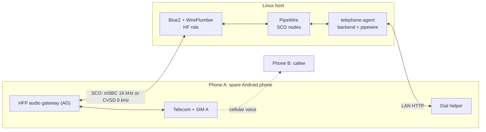
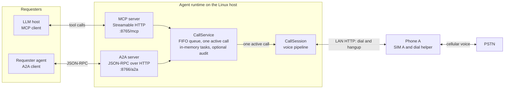
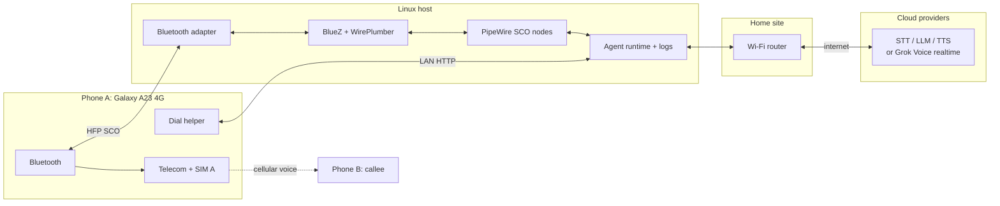
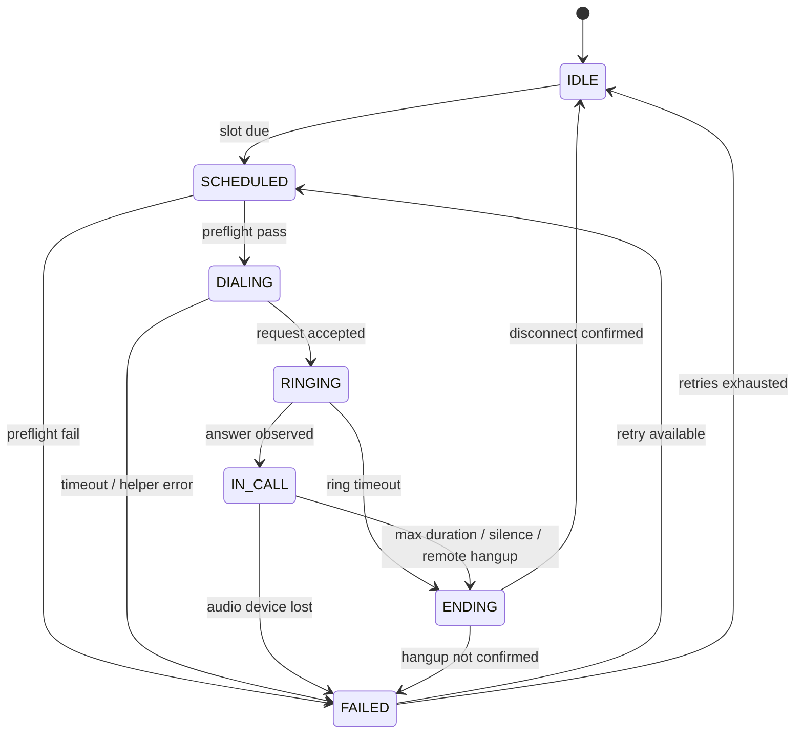

# Architecture

Status: alpha; control plane implemented, voice path scaffolded | Last updated: 2026-10-24

The [design brief](./design-brief.md) is authoritative. This document expands it and
does not add host requirements. Device-specific behavior is marked "verify on your
device".

## 1. Purpose

The system places a scheduled outbound call over the public switched telephone
network (PSTN), holds a short spoken conversation, and hangs up. The call originates
from a real SIM in a spare Android phone ("Phone A"). A Linux host pairs with that phone
as a Bluetooth Hands-Free Profile (HFP) headset. The callee ("Phone B") answers on an
ordinary phone with no app, no data connection, and no special configuration. The goals
are a genuine cellular call with a real mobile number as caller ID, no root or modem
modification, and unattended operation from a small Linux machine.

## 2. Scope

In scope:

- The Bluetooth HFP audio path between Phone A and the Linux host, in both directions.
- Scheduling, dialing, call-progress tracking, and hangup through the LAN helper.
- Capture, VAD, STT, LLM, TTS, and playback over the SCO nodes.
- Delegated outbound calls from other agents over MCP and A2A, as a control plane only.
- Network, failure handling, and observability.

Non-goals:

- Intercepting or recording a call already in progress on the owner's phone.
- Root, bootloader unlocking, custom firmware, or vendor HAL changes.
- VoIP or SIP; the call leg is cellular.
- Inbound PSTN calls in the first milestone. The opt-in v0.3 inbound mode answers them and
  has been validated once on a live call; see [Inbound calls](./inbound.md).
  Inbound control-plane tasking over MCP and A2A is in scope.
- More than one concurrent call per phone and host pair.
- USB audio devices, single-board-computer hardware, or a fixed bill of materials. That route was
  removed; see [ADR 0009](./decisions/0009-bluetooth-only-linux-host.md).
- A consumer product, enclosure design, or support contract.

## 3. The core constraint: the uplink lives in the modem

A call has a **downlink** (what the remote party says) and an **uplink** (what the
phone's microphone captures and the remote party hears). Apps can observe call metadata
and sometimes capture audio with privileged permissions, but they cannot write into
the uplink.

**Circuit-switched.** On 2G/3G, or LTE falling back to circuit-switched, the operator
allocates a dedicated circuit. The baseband digitizes the microphone, applies gain and
noise processing, encodes with a speech codec, and transmits. The application processor
is not in that path; there is no userspace PCM device for "audio to send to the far end".

**VoLTE.** Speech is RTP over an IMS packet data network. The modem runs the IMS stack
and terminates the RTP inside its own PDN, which is not the application processor's
network namespace. The packets never appear on `wlan0`, `rmnet*`, or a normal socket.
The modem still converts PCM to codec internally; VoLTE changes the transport, not the
ownership of the uplink.

**Root.** Root removes permission checks for `CAPTURE_AUDIO_OUTPUT`, `VOICE_CALL`,
`VOICE_UPLINK`, and `VOICE_DOWNLINK`, so capture may work on some devices. It does not
create an uplink endpoint; if the vendor HAL does not expose the voice path, the result
is silence. `/dev/diag` can sometimes tap modem traffic on rooted Qualcomm devices but
cannot inject. Qualcomm `Incall_Music` is a lottery: an ADSP mixer on some older
platforms, device-specific, frequently broken, sometimes local-only, and absent on most
recent devices.

## 4. The inversion: become the phone's Bluetooth headset

Instead of entering the modem, the Linux host becomes an accessory Android already routes
calls to. A headset has a microphone for the uplink and a speaker for the downlink; if the
host is the headset, it owns both directions.

**Bluetooth HFP.** HFP is the standard profile Android uses for car kits and headsets. The
host advertises the Hands-Free Profile **hands-free unit (HF)** role and Phone A is the
**audio gateway (AG)**. Android routes call audio to the host over a synchronous SCO
link. WirePlumber enables the role with the fragment in
[`config/wireplumber/51-bt-headset.conf`](../config/wireplumber/51-bt-headset.conf).



While a call is active, PipeWire creates two nodes for the phone's Bluetooth address:

| Direction | Node | Factory | Media class | Agent action |
|---|---|---|---|---|
| Callee to agent (downlink) | `bluez_input.<address>.<id>` | `api.bluez5.sco.source` | `Stream/Output/Audio` | Capture with `pw-record` |
| Agent to callee (uplink) | `bluez_output.<address>.<id>` | `api.bluez5.sco.sink` | `Stream/Input/Audio` | Play with `pw-play` |

The direction is direct: capture from the SCO source is the remote party, and playback to
the SCO sink is the agent's voice. SCO nodes exist only during a call or SCO link; the
backend waits up to `node_timeout_s` for them. The `.<id>` suffix is a SPA object id and
can change per connection, so the agent discovers nodes by `api.bluez5.address` and
`factory.name`.

**No telephony control over HFP.** Dialing, SIM selection, answering, and hangup stay in
Android. A helper app on Phone A calls `TelecomManager.placeCall()` after a LAN request;
on dual-SIM it must pass the agent SIM's phone account handle or One UI may show a SIM
picker. See [Dial helper](./dial-helper.md). HFP AT commands are not implemented, so the
phone must be reachable on the LAN.

**User-session coupling.** The host must run the agent in the same user session as
PipeWire and WirePlumber, normally a systemd user service with lingering. A system-level
service running as another user does not share that session and cannot see the SCO nodes.
See [Bluetooth HFP](./bluetooth-hfp.md) and
[ADR 0006](./decisions/0006-use-bluetooth-hfp-audio.md).

This path was validated end to end on a Linux laptop with a Samsung Galaxy A23 4G over
outbound PSTN calls: mSBC at 16 kHz in both directions, with the Grok Voice realtime
adapter holding a five-turn conversation. A single inbound PSTN call was validated on the
same host and phone on 2026-10-24: the helper answered after the watcher's 1 s delay, and
the Grok Voice session ran four turns in 39.0 s before a model-requested hangup. The link
was weak (RSSI about -87 dBm), and the first outbound call dropped Bluetooth during setup
and needed a manual reconnect; Bluetooth was manually reconnected before the inbound test.
Latency measurements and HFP call control remain unvalidated. The cellular codec still
caps fidelity.

**One long-lived daemon.** The deployment runs `telephone-agent daemon` as
`telephone-agent-daemon.service` in the PipeWire user session. It owns the audio path and
the single-call executor. `run` is a client: it submits one outbound call over a local Unix
socket and waits for the result. The inbound watcher runs in the same process and submits
each answered call to the same executor, so inbound and outbound calls are serialized and
the outbound timer can stay enabled. `inbound` and `run --direct` are foreground debug
commands, not deployment units, and must not run while the daemon is active. A request
that arrives while another call is active is rejected as busy rather than opening a second
audio path.

## Control plane: MCP and A2A

The voice path above is real-time. A separate asynchronous control plane lets other
agents and LLM hosts delegate outbound calls without blocking for the call. It is an
alternative to the daemon's Unix-socket control plane, not a companion process: `serve`
opens the audio path itself, so it must not run at the same time as `daemon`. Both
protocol adapters are thin front ends over one `CallService`: a single FIFO task queue,
one active call (one SIM and one audio path), in-memory task state, and an optional JSONL
audit log. The control plane is implemented in the reference runtime. It is alpha: it
does not yet enforce a destination allowlist, budgets, per-requester identity, or rate
limits.



One process runs one `CallService` and two listeners. MCP over Streamable HTTP is at
`/mcp`; A2A JSON-RPC is at `/a2a`. The A2A Agent Card is at
`/.well-known/agent-card.json`, and both listeners expose `GET /health`. MCP exposes
`place_call`, `get_call`, `answer_call`, `cancel_call`, and `list_calls`; `place_call`
returns a task id immediately and never blocks for the call. A2A uses the `a2a-sdk`
protocol 1.0 methods `SendMessage`, `SendStreamingMessage`, `GetTask`, `CancelTask`,
and `SubscribeToTask` (the 0.3 aliases such as `message/send` are not enabled).

A2A maps one task to one call. The A2A task moves through `TASK_STATE_SUBMITTED` to
`TASK_STATE_WORKING` as the call is queued, dialing, or in conversation; it becomes
`TASK_STATE_INPUT_REQUIRED` during a mid-call consultation and finally
`TASK_STATE_COMPLETED`, `TASK_STATE_CANCELED`, or `TASK_STATE_FAILED`. A completed call
publishes one `call-summary` artifact with a JSON summary and transcript; raw audio is
never exposed.

Both listeners use one shared bearer token. `/health` and the A2A Agent Card are public;
the MCP and A2A RPC endpoints require the token. The listeners bind to loopback by
default; a non-loopback bind also requires `[server].public_url`. The token is
admin-level: there is no requester identity or per-token scoping, so any holder can
read, answer, or cancel any task. A remote objective is untrusted input, but no technical
policy boundary stops the model from acting on it yet. Tasks are in memory and do not
survive a restart. Without bundled STT/TTS adapters, delegated calls use placeholder
transcripts and log replies instead of speaking; the control plane is usable for call
control, not a natural voice conversation out of the box. See
[Interoperability](./interop.md) and
[ADR 0007](./decisions/0007-expose-agent-over-mcp-and-a2a.md).

## 5. Component view



Phone A charges from its own charger; the host runs from mains power. The Bluetooth link
carries call audio, and the LAN carries call control. Either the LAN or the Bluetooth
link can fail independently, so a reachable phone does not prove audio is available and
a connected Bluetooth link does not prove the helper can dial.

## 6. A scheduled call, end to end

```mermaid
sequenceDiagram
    participant SCH as Systemd user timer
    participant DIA as Dialer
    participant HLP as Helper app
    participant TEL as TelecomManager
    participant MOD as Modem / PSTN
    participant CAL as Callee
    participant AGE as Agent audio loop
    participant STT as STT
    participant LLM as LLM
    participant TTS as TTS

    SCH->>DIA: scheduled slot due
    DIA->>HLP: POST /call (E.164, call_id, token)
    HLP->>TEL: placeCall(tel:+91..., account)
    TEL->>MOD: set up voice call
    MOD->>CAL: alerting
    CAL-->>MOD: answer
    MOD-->>AGE: call audio over HFP SCO, pw-record
    AGE->>STT: 16 kHz mono frames
    STT-->>AGE: partial and final transcripts
    AGE->>LLM: transcript and context
    LLM-->>AGE: streamed tokens
    AGE->>TTS: sentence chunks
    TTS-->>AGE: streamed audio
    AGE-->>MOD: pw-play to SCO sink, then uplink
    MOD-->>CAL: agent speech
    Note over AGE: Barge-in stops playback; endpointing 300-500 ms
    AGE->>HLP: optional end request, or timeout
    HLP-->>TEL: endCall when permitted
    TEL->>MOD: hang up
```

The scheduler is a systemd user timer. Call-progress events are best effort: the helper
can report that `placeCall()` was accepted, but a normal app does not reliably receive
every telecom transition. The agent treats the first downlink speech as evidence that the
callee answered, and continued silence as ringing until the ring timeout. The dialer
records the slot, destination, and attempt number before sending and does not resend
while the attempt is unresolved. SCO nodes appear after the call is answered, not while
it is ringing.

## 7. Audio direction

Bluetooth HFP does not invert the direction as a USB audio route would. The SCO source is the
downlink that Phone A would play in its earpiece, and the SCO sink is the uplink Phone A
would take from its microphone. `pw-record` and `pw-play` map directly to capture and
playback.

| Direction | PipeWire node | Agent command | Phone A path | Result |
|---|---|---|---|---|
| Callee to agent | `bluez_input.<address>.<id>` (`api.bluez5.sco.source`) | `pw-record --target <node>` | Earpiece / downlink | Agent hears the remote party |
| Agent to callee | `bluez_output.<address>.<id>` (`api.bluez5.sco.sink`) | `pw-play --target <node>` | Microphone / uplink | Remote party hears the agent |

The codec is mSBC at 16 kHz or CVSD at 8 kHz. PipeWire resamples between the stream and
the SCO link; the pipeline resamples the downlink to 16 kHz mono for STT and TTS output to
the SCO rate for playback. The SCO rate is a transport format, not a promise of wideband
speech; the cellular codec sets the bandwidth. If a direction is silent, confirm the
phone routes call audio to Bluetooth, check **Calls and audio** for the host, and verify
the node mapping with `scripts/bluetooth-check.sh` and
`scripts/bluetooth-audio-test.sh` during a call.

## 8. Call state machine



- **IDLE** has no call; **SCHEDULED** runs preflight (helper, Bluetooth adapter and phone
  connection, ledger, provider health, SIM registration if available); **DIALING** means
  the request is with the helper; **RINGING** means the helper accepted and the network is
  alerting or early media; **IN_CALL** runs the audio loop once the SCO nodes appear;
  **ENDING** stops playback and waits for disconnect; **FAILED** records the cause. If
  `endCall()` is not permitted, ENDING plays a closing prompt and waits for the remote
  party to hang up.

Timeouts are configuration, not protocol constants. Starting values:

| Timer | Value | Action |
|---|---|---|
| Dialing | 10 s | Treat as failed; retry or abort |
| Ringing | 45 s | Cancel; treat as no answer |
| Maximum call duration | 10 min | Stop audio and end |
| Prolonged silence | 30 s total | Closing prompt, then end |
| Retry backoff | 5 min, then 15 min | At most two retries |

A retry starts only after the previous attempt is confirmed finished or has timed out.
An answered call that ended normally is not retried, and a callee who asked not to be
called again is not redialed.

## 9. Trust and failure boundaries

No component is assumed available, and failures are separated so one dependency
cannot silently corrupt call state.

| Boundary | Crosses | Fails independently when | Detection |
|---|---|---|---|
| Phone, SIM, carrier | Dial requests, audio, registration | Reboot, helper killed, no credit, no coverage, SIM picker, routing change | Helper heartbeat, failed dial, missing audio |
| Bluetooth link | SCO audio | Pairing lost, adapter reset, phone out of range, profile not connected, SCO missing | `scripts/bluetooth-check.sh`, `pw-dump`, missing audio |
| Linux host | Audio, scheduling, provider calls | Kernel or PipeWire fault, disk full, power loss | Host watchdog, missing heartbeat, journal errors |
| LAN and Wi-Fi | Helper API, provider traffic | Router outage, 2.4 GHz congestion, firewall change | Preflight failure, provider timeouts |
| Cloud providers | Audio and transcripts | Outage, quota, latency spike, expired credential | Health check, TTFT/TTFA, error rate |

The phone is the authority for call placement; the host cannot force a call if the phone
refuses, is unregistered, or has no credit. The helper should expose a minimal API,
bind only to the private LAN, require a bearer token, and reject destinations outside
an allowlist. Never port-forward it.

Cloud providers receive call audio and, on the text path, transcripts; this is a
deliberate trade-off in [ADR 0004](./decisions/0004-cloud-voice-stack-first.md).
The optional Grok Voice realtime adapter sends audio to xAI instead and is covered
by [ADR 0008](./decisions/0008-use-grok-voice-realtime-adapter.md). The reference
pipeline does not persist audio. Operational logs should redact full numbers and omit
transcripts; the opt-in local transcript described in section 12 is a separate file that
contains full detail.

A power cut is asymmetric: Phone A survives on its battery, but the host and router stop
unless they have their own backup, so a call in progress fails.

## 10. Alternatives considered

### Root with Xposed or a custom ROM

Root grants signature permissions and Xposed can hook framework methods, which might
enable recording or rerouting on a compatible device. It does not create a writable
uplink PCM endpoint: the vendor HAL and modem still own transmit. It requires unlocking
the bootloader, breaks across OTA updates, weakens security, and varies by model.

### SIP or VoIP

A SIP trunk or cloud telephony API would remove the phone and SIM and scale to many
calls. It would replace the caller ID with a VoIP number, require a provider account,
and depend on the callee accepting a VoIP-originated call. Many callees screen unknown
VoIP numbers, and the premise is a real mobile number to an ordinary phone.

### GSM gateway or SIM box

A GSM gateway holds SIMs and exposes them to a SIP PBX. It solves origination without
an Android phone, but it is expensive and bulky and subject to licensing and
interconnect rules that vary by country; in India, GSM gateways and SIM boxes are
regulated and may not be lawful here.

### Acoustic coupling

Acoustic coupling would avoid Bluetooth, root, and pairing, but it is the least
deterministic option: levels drift, the phone's noise suppression and echo cancellation
interfere, room noise enters both directions, and speakerphone mode may be required.

### USB audio route (removed)

A USB Audio Class device was the earlier design. It required the host to act as a USB
device, a data-capable USB port on the phone, and a powered hub, and it was never
validated on hardware. The route, its scripts, and its hardware documentation were
removed on 2026-10-24. See [ADR 0009](./decisions/0009-bluetooth-only-linux-host.md).

## 11. Capacity and limits

- **One call at a time per phone and host pair.** One SIM, radio, audio link, and audio
  loop; concurrency needs more pairs, not threads. Inbound and outbound calls share the
  same call slot and are serialized: the helper rejects `/call` while a call is ringing or
  active.
- **Bluetooth HFP is the narrowest link.** mSBC carries 16 kHz and CVSD carries 8 kHz;
  either is enough for the cellular codec, but Bluetooth adds a shared 2.4 GHz link and
  SCO retransmission to the latency budget.
- **The telephony codec caps fidelity.** AMR-NB is 8 kHz, AMR-WB is 16 kHz, EVS adapts.
  The SCO link cannot add cellular bandwidth.
- **The host is network-bound.** Audio, resampling, and VAD are small next to cloud STT,
  LLM, and TTS. Local speech models need more CPU and RAM than the reference laptop and
  remain a stretch goal.
- **Duration and retries are bounded.** A hard maximum call duration, a silence timeout,
  and at most two retries prevent a stuck call or unbounded provider cost.

## 12. Observability

The agent emits structured events with a UTC ISO 8601 timestamp, a monotonic duration,
a `call_id`, and the state transition. Each records the slot, attempt number, and a
redacted destination. Provider events record TTFT and TTFA without storing audio.

Every call ends with one outcome: `answered_and_completed`, `no_answer`, `busy`,
`rejected`, `failed_setup`, `failed_audio`, `provider_error`, or `timeout`. The outcome
goes to the ledger and the daily heartbeat; a missing heartbeat is itself an alert.
The heartbeat reports helper reachability, Bluetooth adapter and SCO availability, call
duration, and the last outcome.

Audio is not persisted. Local transcripts are opt-in with `[transcript].enabled = true`:
one timestamped JSONL file per call, created with mode `0600` in a directory with mode
`0700`, under `runtime/transcripts` by default. When enabled they contain full personal
data: full E.164 numbers where known (inbound calls have no caller ID), verbatim callee and
agent text, and call metadata. They are not redacted and are not the same as the
operational stdout/journald logs, which remain masked. Keep them on-device and apply a
retention or deletion policy. Audio debug captures are opt-in, time-bounded, and deleted
after review. [Runbook](./runbook.md) covers weekly log review and the monthly battery
check.

## 13. Open questions

Carried from the [design brief](./design-brief.md); status as of 2026-10-24.

1. **Language.** Malayalam, English, or code-mixed; Sarvam supports Malayalam, but
   code-mixed quality varies by vendor and needs evaluation.
2. **Helper app.** Reference Kotlin app or Tasker/MacroDroid for the first milestone.
3. **Local fallback models.** A larger Linux host with Whisper.cpp and Piper, or
   cloud-only.
4. **Call content and persona.** Briefing, check-in, or reminder; prompt design is out of scope.
5. **Inbound calls. Implemented and validated once.** The helper exposes
   `GET /state` and `POST /answer`; the daemon's inbound watcher polls and answers every
   ringing call, then runs one Grok Voice session in the same process that serves `run`
   requests. One live inbound PSTN call succeeded on
   2026-10-24: four turns in 39.0 s, with a model-requested hangup through the helper.
   Locked-screen answering and vendor restrictions on `acceptRingingCall()` remain
   unverified. Bluetooth carries audio only, so the SCO nodes appear after the answer,
   not while ringing. There is no caller-ID filter. See
   [Inbound calls](./inbound.md).

## 14. Related documents

[Design brief](./design-brief.md), [Bluetooth HFP](./bluetooth-hfp.md),
[Inbound calls](./inbound.md), [Android setup](./android-setup.md),
[dial helper](./dial-helper.md), [voice agent](./voice-agent.md),
[interoperability](./interop.md), [latency budget](./latency-budget.md),
[operations](./operations.md), [runbook](./runbook.md), [glossary](./glossary.md), and
the [ADRs](./decisions/0009-bluetooth-only-linux-host.md).
