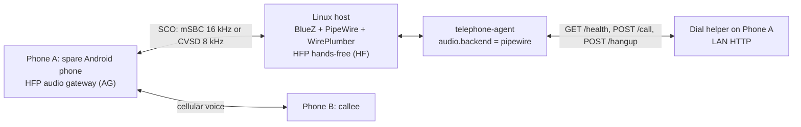

# Bluetooth HFP Audio

This is the primary host and audio guide. The Linux host advertises itself as a Bluetooth
Hands-Free Profile (HFP) **hands-free unit (HF)** and Phone A acts as the **audio
gateway (AG)**. Android routes call audio to the host over a synchronous SCO link, and
PipeWire exposes both directions to the agent. Bluetooth HFP is the only supported audio
transport; the earlier Pi-based and USB audio route was removed by
[ADR 0009](./decisions/0009-bluetooth-only-linux-host.md).

Status: validated end to end with a Linux laptop (BlueZ 5.85, PipeWire 1.6.2,
WirePlumber 0.5.13) and a Samsung Galaxy A23 4G (SM-A235F) on the onboard adapter.
Outbound PSTN calls were placed through the LAN helper, audio ran over HFP SCO at mSBC
16 kHz in both directions, and the Grok Voice realtime adapter held a real conversation.
Inbound answering was validated once on a live PSTN call on 2026-10-24: the helper
answered after the watcher's 1 s delay and the Grok Voice session ran four turns in 39.0 s
before a model-requested hangup. Locked-screen answering and vendor restrictions on
`acceptRingingCall()` remain unverified, and latency has not been measured.

## 1. Topology



Bluetooth carries audio only. Dialing and hangup stay in the helper app, so Phone A must
still be reachable on the LAN. HFP AT commands for dialing and hangup are not implemented
by the agent.

During a call, PipeWire creates two nodes:

| Direction | Node name | Factory | Media class | Agent action |
|---|---|---|---|---|
| Callee to agent (downlink) | `bluez_input.<address>.<id>` | `api.bluez5.sco.source` | `Stream/Output/Audio` | Capture with `pw-record` |
| Agent to callee (uplink) | `bluez_output.<address>.<id>` | `api.bluez5.sco.sink` | `Stream/Input/Audio` | Play with `pw-play` |

The `.<id>` suffix is a SPA object id, not a stable identifier. It can change on the next
connection. Discover nodes by `api.bluez5.address` and `factory.name`, never by a
hard-coded `.0` or `.1`.

## 2. What was validated

| Item | Result |
|---|---|
| Host | Linux laptop (MSI GL738SE), Ubuntu, BlueZ 5.85, PipeWire 1.6.2, WirePlumber 0.5.13 |
| Phone | Samsung Galaxy A23 4G (SM-A235F) |
| Adapter | Onboard Bluetooth adapter |
| Adapter roles | Headset (UUID 0x1108) and Handsfree (UUID 0x111e) advertised |
| Phone UI | **Calls and audio** enabled for the host |
| HFP link | `/Profile/HFPHF`, `AT+CLIP`, `AT+CCWA`, `AT+CMEE`, `AT+CLCC`, `AT+VGS`, `AT+VGM`; AG indicators for call, call setup, service, signal, and battery |
| Audio path | Bidirectional over SCO during outbound PSTN calls; a Grok Voice realtime conversation completed 5 turns in 68.1 s |
| Call control | Call placed through the LAN helper; the model requested `end_call` and `POST /hangup` returned `202` |
| Codec | mSBC, 16 kHz; `api.bluez5.profile = "headset-audio-gateway"`, `media.role = Communication` |
| SCO nodes | `bluez_input...` source for the downlink, `bluez_output...` sink for the uplink |
| Tools | `pw-record` captured the SCO source; `pw-play` injected a test tone into the SCO sink |
| Link quality | RSSI about -87 dBm; the first call dropped the Bluetooth link during setup and needed a manual reconnect, later calls were stable |
| Inbound call | Helper answered a ringing PSTN call after the watcher's 1 s delay; the Grok Voice session ran 4 turns in 39.0 s, the model requested hangup at 22:01:59, the helper accepted `/hangup`, and the phone was idle at 22:02:05 |
| Inbound transcript | 10 timestamped JSONL events: `call_start` (`direction=inbound`, empty number), four callee transcripts, four agent replies, `call_end` (`state=idle`, `reason=completed`, `turns=4`, `duration_s≈39.0`); mode 0600 |
| Not validated | HFP call control from Linux; end-to-end latency; locked-screen answering and vendor `acceptRingingCall()` restrictions |

The cellular codec still caps fidelity. mSBC gives a 16 kHz link between the phone and the
host, but an AMR-NB network leg remains 8 kHz.

### Inbound calls

The HFP link also carries inbound audio, but Bluetooth exposes no ringing signal or caller
ID to user space. The helper is the signaling path: `GET /state` reports `ringing`,
`offhook`, `idle`, or `unknown`, and `POST /answer` asks Telecom to answer. PipeWire creates
the SCO source and sink only **after** the call is answered, so the watcher answers first
and then starts audio; `[realtime].greeting` is spoken once those nodes are ready.

Auto-answer has no caller-ID filter. The helper does not request `READ_CALL_LOG`, and
`/state` returns only a phase. Inbound and outbound calls are mutually exclusive: the
helper rejects `/call` while a call is ringing or active, and the watcher waits for `idle`
before re-arming. The daemon is unit-tested and the helper endpoints are implemented. One
live inbound PSTN call was validated on 2026-10-24: the helper answered after the watcher's
1 s delay, the SCO nodes appeared, the Grok Voice session opened and requested the
configured opening greeting at 22:01:27, and the call ran four turns in 39.0 s before a
model-requested hangup. Locked-screen answering and vendor restrictions on
`acceptRingingCall()` remain unverified. See [Inbound calls](./inbound.md).

## 3. Host prerequisites

| Item | Requirement |
|---|---|
| Operating system | Linux with BlueZ, PipeWire, and WirePlumber in the same user session |
| Bluetooth | A working adapter; onboard Bluetooth is sufficient for the validated setup |
| Phone | Phone A paired and trusted, with **Calls and audio** enabled for the host |
| Tools | `bluetoothctl`, `wpctl`, `pw-dump`, `pw-record`, `pw-play`, and `python3` |
| Privileges | No root for the Bluetooth scripts or the agent; WirePlumber configuration is per-user |
| Agent | A runtime with the PipeWire audio backend, configured for `backend = "pipewire"` |
| Call control | The LAN helper reachable at `dialer.url`; Bluetooth does not replace it |
| Network | Phone and host on the same private LAN for `/health`, `/call`, and `/hangup` |

Check the versions and tools:

```bash
bluetoothctl --version
pipewire --version
wireplumber --version
command -v wpctl pw-dump pw-record pw-play python3
```

The validated versions are listed above. Other recent BlueZ, PipeWire, and WirePlumber
releases are expected to work, but the role names and configuration syntax can differ;
verify on your host. On Debian and Ubuntu, the relevant packages include `bluez`,
`pipewire-bin`, and `wireplumber`; a graphical session normally starts PipeWire and
WirePlumber for you.

Run the commands in this guide from the repository root as your normal user. The
Bluetooth scripts and the agent must not run as root: they need the user's PipeWire and
WirePlumber session.

The agent must run as the same user that owns the PipeWire and WirePlumber session. A
system service does not share that session, so it will not see the SCO nodes. See
section 10.

## 4. Install the WirePlumber fragment

The repository fragment is
[`config/wireplumber/51-bt-headset.conf`](../config/wireplumber/51-bt-headset.conf):

```text
# Make this Linux host an HFP Hands-Free (HF) headset for Phone A.
#
# In this direction Phone A is the Audio Gateway (AG). The host offers the
# headset side of HFP/HSP so PipeWire creates SCO nodes for call audio. The
# roles below also keep A2DP sink available for ordinary media playback.
#
# This is a per-user WirePlumber drop-in. Install it as:
#   ${XDG_CONFIG_HOME:-$HOME/.config}/wireplumber/wireplumber.conf.d/51-bt-headset.conf
# Then restart the user service:
#   systemctl --user restart wireplumber
#
# SCO nodes exist only while a call is active. The adapter should advertise
# Headset (UUID 0x1108) and Handsfree (UUID 0x111e) after WirePlumber restarts.
monitor.bluez.properties = {
  bluez5.roles = [ hfp_hf hsp_hs a2dp_sink ]
  bluez5.hfphsp-backend = native
  bluez5.enable-msbc = true
  bluez5.enable-hw-volume = true
}
```

Install it with the [setup script](../scripts/bluetooth-setup.sh):

```bash
./scripts/bluetooth-setup.sh
```

The script writes `${XDG_CONFIG_HOME:-$HOME/.config}/wireplumber/wireplumber.conf.d/51-bt-headset.conf`,
backs up an existing file, and restarts the user WirePlumber service. It refuses
to run as root because the configuration belongs to the user session. `--uninstall`
removes only that file and leaves backups alone.

The manual equivalent is:

```bash
install -Dm644 config/wireplumber/51-bt-headset.conf \
  "${XDG_CONFIG_HOME:-$HOME/.config}/wireplumber/wireplumber.conf.d/51-bt-headset.conf"
systemctl --user restart wireplumber
systemctl --user status wireplumber --no-pager
```

The manual command assumes the fragment is not already installed; `install`
overwrites without a backup. Prefer the script on a host that may already have a
local WirePlumber fragment.

The user path is the validated one. A system-wide fragment under
`/etc/wireplumber/wireplumber.conf.d/` also works on many distributions, but it applies to
every user and can be overridden by a user fragment. Do not install both unless you are
sure which one wins.

## 5. Pair and trust Phone A

Put Phone A in pairing mode (open **Settings > Connections > Bluetooth**) and use
`bluetoothctl` on the host. Replace the example address with Phone A's address:

```bash
bluetoothctl
```

At the `[bluetooth]#` prompt:

```text
power on
agent on
default-agent
scan on
pair AA:BB:CC:DD:EE:FF
trust AA:BB:CC:DD:EE:FF
connect AA:BB:CC:DD:EE:FF
scan off
info AA:BB:CC:DD:EE:FF
quit
```

The `info` output should show `Paired: yes`, `Trusted: yes`, and `Connected: yes`. If the
phone is already paired from an earlier attempt, `trust` and `connect` are enough.

On the phone, open the gear icon next to the host in the Bluetooth device list and enable
**Calls and audio**. Samsung uses that label; other vendors may call it **Call audio**,
**Phone calls**, or similar. Without it, the phone may connect for media but keep call
audio on the earpiece or speaker.

If the host was paired before the WirePlumber fragment was installed, remove the pairing on
both sides and pair again. A stale bond can keep the old profile set.

## 6. Verify the adapter and the HFP link

Confirm that the local adapter advertises the headset roles:

```bash
bluetoothctl show | grep -iE 'Headset|Handsfree|1108|111e'
```

Look for the Headset service with UUID `00001108-...` and the Handsfree service with UUID
`0000111e-...`. If they are missing, the fragment is not loaded: check the path, restart
WirePlumber, and read `journalctl --user -u wireplumber -b --no-pager`.

Confirm the phone's side of the link:

```bash
bluetoothctl info AA:BB:CC:DD:EE:FF
```

The phone should expose the Headset AG and Handsfree Audio Gateway services while
connected. The exact list varies by phone and firmware.

For the HFP service-level connection, enable WirePlumber debug logging temporarily, place
a short call, and inspect the journal:

```bash
wpctl set-log-level D
# Place a call on Phone A with Calls and audio enabled.
journalctl --user -u wireplumber -b --no-pager | \
  grep -iE 'Profile/HFPHF|AT\+(CLIP|CCWA|CMEE|CLCC|VGS|VGM)|AG indicator'
wpctl set-log-level -
```

The debug output is verbose. Disable it with the last command after collecting what you
need. On a system where `wpctl set-log-level` is unavailable, set `WIREPLUMBER_DEBUG=D` in
the user service environment and restart WirePlumber instead.

During a call, the check script prints the negotiated codec for both SCO nodes:

```bash
./scripts/bluetooth-check.sh AA:BB:CC:DD:EE:FF | grep -E 'node:|codec:'
```

You can also inspect the node directly. `wpctl status` lists the active streams;
pass the stream's numeric id to `wpctl inspect`:

```bash
wpctl status
wpctl inspect <node-id> | grep api.bluez5.codec
```

mSBC is the wideband result (16 kHz). CVSD is the narrowband fallback (8 kHz) and still
carries intelligible speech. The codec is negotiated by the phone and adapter; the host
cannot force mSBC if the phone does not offer it.

## 7. Verify the SCO nodes during a call

The SCO nodes exist only while a call or SCO link is active. With the phone idle, their
absence is normal.

Place a call, answer it, and confirm on the phone that the audio route is Bluetooth rather
than the earpiece or speaker. Then run:

```bash
pw-dump | grep -E 'bluez_(input|output)\.|api\.bluez5\.sco|Stream/(Output|Input)/Audio'
```

`wpctl status` also lists the nodes under **Streams** while the call is active. Expect one
`bluez_input...` node and one `bluez_output...` node for Phone A's address. The suffix
after the address is not stable.

The repository's [Bluetooth check script](../scripts/bluetooth-check.sh) wraps the adapter,
device, and node checks:

```bash
./scripts/bluetooth-check.sh --idle AA:BB:CC:DD:EE:FF
# During a call:
./scripts/bluetooth-check.sh AA:BB:CC:DD:EE:FF
```

The `--idle` form checks only the adapter roles and the phone state. The full form also
requires both SCO nodes and fails when either is missing. If you omit the address, set
`BT_ADDRESS=AA:BB:CC:DD:EE:FF` or the script lists connected devices and exits 2. The
output includes the node name, address, codec, profile, `media.role`, and `media.class`
for each direction. A failure exits 1; a usage error exits 2.

## 8. Test the audio path

Run these commands during an active call, as the PipeWire user. The
[audio test script](../scripts/bluetooth-audio-test.sh) discovers the SCO nodes by address
and factory name, so the `.<id>` suffix does not matter.

```bash
./scripts/bluetooth-audio-test.sh list
./scripts/bluetooth-audio-test.sh record 10 /tmp/bluetooth-downlink.wav
./scripts/bluetooth-audio-test.sh tone 2
```

`list` shows the discovered source and sink, codec, profile, and `media.role`, and exits 1
when no call is active. `record` captures the downlink to WAV; the default is 10 seconds
and it refuses to overwrite an existing file. `tone` injects a quiet 440 Hz tone into the
uplink for two seconds by default. The remote party should hear the tone. It is routed to
the SCO sink, not the host speaker, so do not expect to hear it locally.

To play a recording or another WAV into the uplink instead of a tone:

```bash
./scripts/bluetooth-audio-test.sh play /tmp/bluetooth-downlink.wav
```

Set `BT_ADDRESS` when more than one phone has SCO nodes:

```bash
BT_ADDRESS=AA:BB:CC:DD:EE:FF ./scripts/bluetooth-audio-test.sh list
```

Direction reminder:

- `bluez_input.*` is the SCO source and carries the downlink. Recording it captures Phone
  A's earpiece, meaning the remote party's voice, not the host microphone.
- `bluez_output.*` is the SCO sink and carries the uplink. Playing to it sends audio
  toward Phone A's microphone path; the remote party hears it and the host does not.

The audio test script records and generates the tone at 16 kHz mono. `play` sends the WAV
as-is, and PipeWire resamples between the stream and the SCO link (16 kHz with mSBC, 8 kHz
with CVSD).

## 9. Configure the agent

Set the PipeWire backend in `config/config.toml`:

```toml
[audio]
backend = "pipewire"
bluetooth_address = "AA:BB:CC:DD:EE:FF"
node_timeout_s = 30.0
sample_rate = 16000
channels = 1
frame_ms = 20
```

`bluetooth_address` is Phone A's address, in the same form as `bluetoothctl info`.
`node_timeout_s` bounds the wait for SCO nodes after the call is placed; the default is
30 seconds. `sample_rate`, `channels`, and `frame_ms` describe the pipeline format; the
Bluetooth backend handles the SCO link rate.

The equivalent environment overrides are:

```bash
export TELEPHONE_AGENT_AUDIO__BACKEND=pipewire
export TELEPHONE_AGENT_AUDIO__BLUETOOTH_ADDRESS=AA:BB:CC:DD:EE:FF
export TELEPHONE_AGENT_AUDIO__NODE_TIMEOUT_S=30
```

Check the configuration:

```bash
cd agent
. .venv/bin/activate
telephone-agent --config ../config/config.toml doctor
```

For `backend = "pipewire"`, `doctor` checks that `pw-record`, `pw-play`, and `pw-dump`
exist, then looks for the SCO nodes. During an idle period it prints that the SCO nodes
are not present and does not treat that as a failure. During a call it prints the downlink
and uplink node names. The helper's `/health` check is independent and still runs.

Run the audio self-test during an active call:

```bash
telephone-agent --config ../config/config.toml selftest
```

`selftest` records two seconds from the downlink and reports frames, duration, RMS, dBFS,
and peak. With the Bluetooth backend it waits up to `node_timeout_s` for the SCO link. If
no call is active, it waits and then exits with an error; place a call first. Digital
silence means the phone is not routing call audio to Bluetooth, the wrong node was
selected, or the call is muted.

`dial` and `run` are unchanged:

```bash
telephone-agent --config ../config/config.toml dial --number +15555550100
telephone-agent --config ../config/config.toml run --number +15555550100
```

The helper places the call over the LAN, then the Bluetooth backend waits for the SCO
nodes and starts the audio loop. Dialing does not use HFP AT commands.

## 10. Run in the PipeWire user session

PipeWire and WirePlumber run per user. The agent must run as that same user so it can
reach the PipeWire socket and the session bus. A system-level service running as another
user does not share that session.

The repository ships user units:

- `scripts/systemd/telephone-agent-bluetooth.service`
- `scripts/systemd/telephone-agent-bluetooth.timer`

They use `%h` for the home directory, assume the repository is at
`~/android-telephone-agent`, and use the `agent/.venv` console script. Edit the `%h`-based
paths (`WorkingDirectory`, `EnvironmentFile`, and `ExecStart`) if yours is elsewhere.
Review the timer's `OnCalendar` value for your slot. The shipped timer uses
`Persistent=false` to match the operations policy: a missed slot is skipped rather than
called late. Set it to `true` only if catch-up is acceptable. Install them as user units
and enable the timer:

```bash
mkdir -p ~/.config/systemd/user
install -m644 scripts/systemd/telephone-agent-bluetooth.service \
  ~/.config/systemd/user/
install -m644 scripts/systemd/telephone-agent-bluetooth.timer \
  ~/.config/systemd/user/
sudo loginctl enable-linger "$USER"
systemctl --user daemon-reload
systemctl --user enable --now telephone-agent-bluetooth.timer
systemctl --user list-timers telephone-agent-bluetooth.timer
journalctl --user -u telephone-agent-bluetooth.service -n 100 --no-pager
```

The service is `Type=oneshot` and must not restart automatically; a restart would redial.
It runs after `pipewire.service` and `wireplumber.service` and has `WantedBy=default.target`.

`loginctl enable-linger` is important on a headless host. Without it, the user manager and
PipeWire stop when the last session ends, and the timer does not fire reliably.

Do not enable both an outbound timer and the inbound watcher for the same phone and call
slot. Choose one mode and one scheduler. To run a supervised call instead of the timer:

```bash
systemctl --user start telephone-agent-bluetooth.service
journalctl --user -u telephone-agent-bluetooth.service -f
```

## 11. Troubleshooting

| Symptom | Likely cause | Check | Fix |
|---|---|---|---|
| `bluetoothctl show` has no Headset or Handsfree UUID | Fragment not loaded, wrong path, or overridden | `systemctl --user status wireplumber`, `journalctl --user -u wireplumber -b`, confirm the fragment path | Copy the fragment to `~/.config/wireplumber/wireplumber.conf.d/`, restart WirePlumber, re-check |
| Phone connects but **Calls and audio** is missing or off | Phone did not enable the HFP profile, or the bond is stale | Phone Bluetooth device details, `bluetoothctl info <address>` | Enable **Calls and audio**, toggle Bluetooth, or forget the device on both sides and pair again |
| Call audio stays on the earpiece or speaker | Phone selected the wrong route, or HFP is not connected | Phone call screen, `bluetoothctl info <address>`, `pw-dump` | Select Bluetooth on the call screen, reconnect, confirm the toggle, retry the call |
| `doctor` says `SCO nodes: not present` | No call is active, or the call is not routed to Bluetooth | Place a call, check the phone route, rerun during the call | Expected while idle; fix the route or pairing if it persists during a call |
| `pw-record` or `pw-play` not found | PipeWire command-line tools are not installed | `command -v pw-record pw-play pw-dump` | Install the distribution's PipeWire tools package (for example `pipewire-bin` on Debian and Ubuntu) |
| `pw-dump` fails or cannot connect to PipeWire | Agent runs as root or as a different user; no user session | `id`, `systemctl --user status pipewire`, `echo "$XDG_RUNTIME_DIR"` | Run the agent as the PipeWire user, use a user service, and enable lingering |
| Node target not found after reconnect | The `.<id>` suffix changed | `pw-dump`, `wpctl status` | Rediscover by address and factory; do not hard-code `.0` or `.1` |
| One direction is silent | Wrong node for the direction, or the phone route is wrong | Play the tone and record the downlink separately; check `media.class` | Downlink is `bluez_input` source; uplink is `bluez_output` sink; fix the route or target |
| Choppy audio, dropouts, or high latency | 2.4 GHz Wi-Fi coexistence, distance, or SCO retransmission | `pw-top`, `iw dev wlan0 link`, distance to the phone | Move the host and phone closer, change the Wi-Fi channel, reduce 2.4 GHz load |
| Logs show CVSD instead of mSBC | Phone or adapter did not negotiate wideband | `./scripts/bluetooth-check.sh <mac>` during a call, or `wpctl inspect <node-id>` | No fix if the phone does not support it; the call still works at 8 kHz |
| Agent reports an audio error when the call ends | SCO nodes disappeared with the call | Agent log, `pw-dump` after hangup | Expected; end the session cleanly and let the next call rediscover the nodes |
| Service not running for inbound | Helper is reachable but the agent never answers | `systemctl --user status telephone-agent-inbound.service`, `journalctl --user -u telephone-agent-inbound.service -n 100` | Start or fix the unit; it must run in the PipeWire user session and use `realtime.kind = "grok"` |
| Phone rings but no SCO nodes appear | SCO exists only after the call is answered, or the phone kept audio on the earpiece | `curl` the helper's `/state`, phone call screen, `pw-dump` | Answer through `POST /answer` first; confirm **Calls and audio** and the Bluetooth route during the call |
| `/answer` returns `403` | `ANSWER_PHONE_CALLS` is missing, or Android denied `acceptRingingCall()` | Helper log, app permissions | Grant the permission and unlock the phone; answering as a non-default dialer is best effort |
| `/answer` returns `409` | The call stopped ringing, was answered manually, or the state is unreadable | `GET /state` | Expected race or state failure; do not retry, wait for the next call |
| `/answer` returns `500` | Android threw while trying to answer | Helper log, `adb logcat -s DialHelper` | Unlock the phone, check vendor restrictions, and retry a supervised call |
| Pairing is lost after a phone reboot | Device not trusted, or the phone did not reconnect | `bluetoothctl info <address>` | Trust the device, connect manually once, and verify before the next scheduled call |

## 12. Limitations

- **Bluetooth only.** HFP is the only supported audio transport. The earlier Pi-based and
  USB audio route was removed, and its scripts and hardware documentation no longer exist.
  See [ADR 0009](./decisions/0009-bluetooth-only-linux-host.md).
- **Inbound is validated once.** One live inbound PSTN call succeeded through the helper:
  the helper answered after the watcher's 1 s delay, the SCO nodes appeared, and the Grok
  Voice session ran four turns in 39.0 s before a model-requested hangup. Locked-screen
  answering and vendor restrictions on `acceptRingingCall()` remain unverified, and
  Bluetooth still cannot signal a ringing call, so the helper must answer before SCO nodes
  exist.
- **Weak links drop.** The validated run had RSSI around -87 dBm. The first call dropped
  the Bluetooth link during setup and needed a manual reconnect, although later calls were
  stable. Treat a drop during setup as a known failure mode rather than a code bug.
- **Latency is unmeasured.** Turn-taking worked in the realtime conversation, but no
  end-to-end latency measurement was recorded against the budget.
- **No HFP call control.** The agent does not send `ATD`, `ATA`, or `CHUP`. Dialing,
  answering, and hangup still require the LAN helper and a reachable phone.
- **SCO nodes are call-scoped.** They do not exist while the phone is idle. The agent waits
  up to `node_timeout_s`; if the nodes never appear, the call fails before audio starts.
- **User-session coupling.** The agent must run as the PipeWire user. A system service or a
  different account does not share that session, so it cannot see the SCO nodes.
- **Codec limits.** mSBC is 16 kHz. The cellular codec still caps the call, and a fallback
  to CVSD reduces the host link to 8 kHz.
- **One phone, one call.** HFP is point-to-point in this design; inbound and outbound share
  the same call slot, and concurrency needs another host and phone pair.
- **Reconnection is best effort.** Pairing and trust help, but a reboot, adapter reset, or
  WirePlumber restart can leave the phone disconnected.

## Related documents

- [Architecture](./architecture.md), sections 4, 7, and 10.
- [ADR 0006: Bluetooth HFP](./decisions/0006-use-bluetooth-hfp-audio.md).
- [ADR 0009: Bluetooth-only Linux host](./decisions/0009-bluetooth-only-linux-host.md).
- [Android setup](./android-setup.md) for the phone-side settings.
- [Dial helper](./dial-helper.md) for `/health`, `/call`, and `/hangup`.
- [Inbound calls](./inbound.md) for the answer watcher and privacy limits.
- [Troubleshooting](./troubleshooting.md) and [FAQ](./faq.md).
