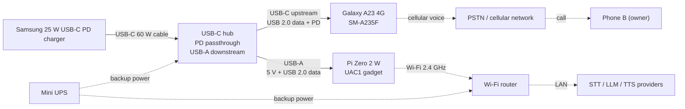

# Hardware

Status: design complete, pre-implementation
Last updated: 2026-10-24

This guide covers the physical build: bill of materials, hub selection, phone checks, Phase 0
validation, wiring, assembly, power, and thermal notes for Kerala. Software setup is in
[raspberry-pi-setup.md](raspberry-pi-setup.md) and [android-setup.md](android-setup.md). The
[design brief](design-brief.md) is authoritative; if the two disagree, the brief wins.

## 1. Purpose

The Pi Zero 2 W presents itself to the Galaxy A23 4G as a USB Audio Class 1 headset, so the
phone routes call audio to the Pi. The hub keeps the phone charged while the phone acts as
USB host, without making the phone power the Pi. A mini UPS keeps the Pi and router alive
through short outages; the phone runs on its own battery.

One phone, one SIM, one Pi, one call at a time. This is a reference build, not a certified
product: no lightning protection, no redundant Pi, and no battery management beyond the
phone's own charging logic.

## 2. Prerequisites

- A dedicated Samsung Galaxy A23 4G (SM-A235F), unlocked, with a working SIM and call credit.
  The phone is excluded from the budget.
- A Samsung 25 W USB-C PD charger and a USB-C to USB-C cable. The brief assumes the charger is
  already owned; another USB PD charger of at least 25 W is acceptable. Verify the profile.
- A 2.4 GHz Wi-Fi network with internet access and a known password. The Pi Zero 2 W has no
  Ethernet port; the Pi 4 alternative adds one.
- A computer with a microSD reader and Raspberry Pi Imager (or `dd`), a second phone or
  voicemail number, and a dry, ventilated location with a mains outlet.
- Basic Linux shell skills (`systemctl`, `dmesg`, `arecord`, `ssh`) and a record of the phone
  build number, One UI version, and hub, charger, and cable models.
- No root. Root, Magisk, and Xposed are out of scope.

Buy the hub and USB-C headset first and run Phase 0 (section 6) before buying the Pi. The
headset costs about ₹500 and confirms the phone can charge and route USB call audio at the
same time. If it fails, the build will not work as designed.

## 3. Bill of materials

Prices are indicative INR ranges, not quotes. Verify current prices with the named sellers. A
seller being named does not imply stock or availability. Sources: ThinkRobotics (Kochi),
Robu.in, Amazon.in, Element14 India. The same data is in [bom.csv](bom.csv).

| Item | Qty | Purpose | Indicative price (INR) | Source | Required | Notes |
|---|---:|---|---:|---|---|---|
| Raspberry Pi Zero 2 W | 1 | UAC1 gadget and agent runtime | ₹1,800–2,400 | ThinkRobotics (Kochi); Robu.in; Element14 India | Required | 512 MB RAM; 2.4 GHz Wi-Fi; micro-USB OTG. Verify board revision. |
| 32 GB microSD, A1/A2 | 1 | Raspberry Pi OS Lite 64-bit boot medium | ₹400–800 | Amazon.in; Robu.in | Required | A1/A2 rating; reputable brand; 32 GB is sufficient. |
| USB-C hub with PD passthrough and at least one USB-A port | 1 | Power and data path for phone and Pi | ₹800–2,000 | Amazon.in; Robu.in | Required | Must pass data while powered; see section 4. Avoid charge-only splitters. |
| USB-C to USB-C 60 W cable | 1 | Charger to hub PD input | ₹250–600 | Amazon.in; Robu.in | Required | Short, data-rated, strain-relieved. |
| USB-A to micro-USB cable | 1 | Hub downstream port to Pi OTG port | ₹150–350 | Amazon.in; Robu.in | Required | Data-rated and short; not a charge-only cable. |
| Phone stand | 1 | Holds the phone upright with the port clear | ₹150–500 | Amazon.in | Required | Stable, open back, cable clearance. |
| Mini UPS, 5 V output | 1 | Backup for hub and Wi-Fi router | ₹1,200–2,500 | Amazon.in; Robu.in | Required | Check router voltage and hub input; see section 9 and power-and-thermal.md. |
| USB-C earphones with microphone | 1 | Phase 0 routing test before the Pi | ₹400–800 (about ₹500) | Amazon.in | Optional | Recommended before the Pi; digital USB-C audio, not 3.5 mm or a passive adapter. |
| Raspberry Pi 4 Model B 2 GB | 1 | Alternative to the Zero 2 W: Ethernet and headroom | ₹4,500–6,000 | ThinkRobotics (Kochi); Element14 India; Robu.in | Optional | Adds about ₹3,000 over the Zero 2 W. Power via GPIO; Pi 5 not supported. |
| Raspberry Pi 4 5 V/3 A PSU and GPIO power cable | 1 | Powers the Pi 4 while USB-C is the gadget port | ₹700–1,200 | ThinkRobotics (Kochi); Robu.in; Amazon.in | Optional | Only for the Pi 4 path. Verify polarity and connector. |

Required items total approximately ₹7,000 at the midpoint of the ranges, excluding the phone,
SIM, charger, and optional items. The headset adds about ₹500–800; the Pi 4 path adds about
₹3,000 for the board plus the optional PSU and cable. Verify current prices.

The Pi 4 Model B 2 GB is supported. It adds Ethernet and more CPU and RAM for local speech
experiments. Power it through the GPIO header with a 5 V/3 A supply so USB-C stays free for
gadget mode; verify 5 V and GND before connecting.

The Pi 5 cannot do USB device mode. Do not substitute it: it cannot present the UAC1 gadget.
The Zero 2 W remains canonical: quad Cortex-A53, 512 MB RAM, 2.4 GHz Wi-Fi only, no Ethernet.
It is sufficient for the audio bridge and cloud pipeline; local models are a stretch goal.

## 4. USB-C hub selection

The hub is the most failure-prone part of the build. It must be a USB hub with PD
passthrough, not a charging splitter.

1. **PD passthrough.** A dedicated USB-C PD input, separate from the upstream port, that
   accepts the charger and passes power to the phone while data flows. A 5 V-only hub cannot provide the 25 W profile.
2. **At least one USB-A downstream port.** The Pi connects with a USB-A to micro-USB cable.
   USB 2.0 is sufficient for UAC1 audio; USB 3.0 is acceptable but not required.
3. **Data while powered.** With the charger connected, the hub must still enumerate the Pi.
   Test with a USB flash drive or keyboard before the Pi arrives. Some hubs disconnect
   downstream ports when PD is present, or pass power only.
4. **Avoid charge-only OTG splitters.** Y-cables and "OTG plus charging" adapters parallel
   VBUS, skip PD, confuse role detection, and may back-feed the phone. They are not hubs.
5. **Prefer a powered or known-brand hub.** A documented controller and ventilated case are preferable to
   an unbranded unit; a 5 V powered hub is a fallback only if it does not back-feed VBUS.
6. **Port layout.** The upstream cable must reach the phone without tension; labeled PD IN
   and UPSTREAM ports reduce misconnection, and a short captive cable is easier to strain-relieve.
7. **Power and heat.** The hub must supply the Pi (under 0.5 A at 5 V) and pass up to 25 W to
   the phone. Overhead is typically 0.5–1.5 W. Prefer a metal or vented case and keep it out
   of direct sun.

### Why the hub powers both devices

The charger feeds the hub PD input. The hub upstream port feeds the phone: the hub is the
source, the phone is a sink. The hub USB-A port supplies 5 V to the Pi, which is bus-powered.
The phone is the USB data host, but it does not power the Pi.

This is standard laptop-dock behavior. If the phone powered the Pi directly, it would run in
OTG host-power mode, drain its battery, and may current-limit the Pi or stop charging. A
proper hub also preserves the phone's PD contract while data flows; a charge-only splitter
may force 5 V or stop charging when the gadget enumerates. Verify on your device.

### Quick hub test before the Pi

With the charger connected, plug a USB flash drive or keyboard into the hub and connect it to
the phone. Confirm the phone sees the device while charging. Repeat after a reboot. If the
device appears only when the charger is disconnected, the hub fails criterion 3. Phase 0 is
still required to prove audio routing; verify on your device.

## 5. Samsung Galaxy A23 4G (SM-A235F)

| Specification | Value | Consequence for this build |
|---|---|---|
| Model | SM-A235F (4G) | Canonical phone; verify the exact model in Settings, About phone. |
| USB port | USB-C 2.0 | Enough for UAC1 audio; no USB 3 speeds. |
| OTG | Supported | The phone can act as a USB host for the Pi gadget. |
| Wired charging | Up to 25 W with a compatible PD charger | The hub must pass the profile; actual rate varies. |
| Battery | 5000 mAh | Runs the phone during outages; cap charging for longevity. |
| Wireless charging | None | The cable is the only power path; strain relief matters. |
| Software | One UI on Android | Protect battery, USB audio routing, battery optimization settings. |
| Root | Not required, not supported | The helper app uses public APIs. |

Verify on your device:

- **OTG and charging at the same time.** The brief specifies OTG and 25 W charging, but
  simultaneous operation is a device and firmware behavior, not a guarantee. Phase 0 is the
  test. Verify on your device.
- **Charger and cable.** Use the Samsung 25 W charger or another USB PD charger that supports
  the phone's profile, and a 60 W cable. A 5 V/3 A charger works but not at 25 W. "Charging"
  may mean 5 V; measure if it matters.
- **One UI settings.** Protect battery ON (80–85%); Stay awake while charging ON; Disable USB
  audio routing OFF; auto restart OFF; software update auto-download OFF; Play Store
  auto-update OFF; default calls = agent SIM; VoLTE ON; helper app Unrestricted. Labels vary
  by One UI version.
- **Record the build number and One UI version.** A software update can change charging or
  audio routing. Disable auto-update and retest after a manual update.

## 6. Phase 0: USB audio and charging test

Phase 0 answers one question: with the hub and charger connected, does the A23 route call
audio to a USB headset in both directions while the battery charges? If no, stop. Do not buy
the Pi.

Equipment: phone, charger, hub, a digital USB-C headset with microphone, and a second phone
or voicemail number. If the hub has only USB-A ports, add a USB-C female to USB-A male data
adapter and test it direct first; charge-only adapters and 3.5 mm passive adapters do not count.

### Test A: headset direct to the phone

1. Charge the phone to 40–60%, unlock it, and confirm Developer options, Disable USB audio
   routing is OFF.
2. Plug the headset in, wait five seconds, check for a USB audio notification, and play media; confirm sound comes from the headset, not the speaker.
3. Call the second phone or voicemail. Confirm you hear the remote side in the headset and the
   remote side hears you through its microphone. Confirm any mute switch is off.
4. Unplug and replug, then repeat. If audio does not route reliably direct, try another digital headset before involving the hub.

### Test B: headset through the hub while charging

1. End the call. Connect the charger to the hub PD input with the 60 W cable; confirm the hub
   power LED. Connect the hub upstream to the phone and confirm charging. If it does not
   charge, stop: the hub is not passing power.
2. Connect the headset to a downstream data port, using the USB-C to USB-A adapter if needed.
   Confirm the phone still sees the USB audio device.
3. Call the second phone. Confirm both directions and keep the call open for 15 minutes. If
   that is impractical, use a loopback or voicemail number and keep the audio path active.
4. Record battery percentage and charging label at start and end. A net increase passes. If
   Protect battery is on and the phone is at its cap, the percentage may not rise; test below
   80% and look for a stable or rising value, not a fall.
5. Repeat with the screen on and Wi-Fi on (the deployment state), after a phone reboot, and
   after unplugging and replugging the hub. Do this three times.
6. Watch for USB disconnect/reconnect notifications. One reconnect may be tolerable if audio
   recovers; repeated reconnects fail unattended use.
7. Record hub, charger, headset, and adapter models; phone build and One UI version; battery
   start and end; charging label; disconnects; audio notes.

Pass: two-way audio for 15 minutes, net charge or a stable value at the cap, no repeated USB
reconnects, and the same result after a reboot. Fail: no audio through the hub, the phone
discharges, charging stops when the gadget enumerates, or the hub disconnects under load. Do
not buy the Pi until the failure is understood.

Interpretation: direct works but the hub fails means the hub or adapter is at fault; try
another hub, never a charge-only splitter. Hub works but the phone does not charge means the
hub does not pass PD or the phone refuses to sink while hosting. Works at 5 V only is usable
but slow; a single disconnect is marginal for a prototype, not unattended use.

Inspect the phone's USB-C port for lint and looseness. A worn port causes reconnects that
look like software faults. Use a known-good cable; do not scrape the port with metal.

## 7. Wiring

Solid arrows are USB cables; dotted arrows are wireless, network, or backup paths. The phone
is the USB host; the hub is the power source.

- Charger USB-C output to hub PD input (USB-C to USB-C 60 W). Use the PD input, not upstream.
- Hub upstream to phone USB-C (captive or 60 W data cable). The phone is host and sink.
- Hub USB-A to Pi micro-USB OTG port (USB-A to micro-USB data cable). Not PWR.
- Pi PWR (fallback only) to a 5 V/2 A supply. See the back-feed note.
- UPS to hub and router, with the outputs your UPS provides. Size per power-and-thermal.md.

Wiring notes: the OTG port is data and the PWR port is power-only. Do not connect the Pi
directly to the phone; the phone would source VBUS and may stop charging. If you use PWR while
the OTG port is connected to a powered hub, use a data-only cable with VBUS disconnected or
verify the hub does not back-feed; otherwise two 5 V sources are tied. Keep the charger and
hub off the floor and out of standing water; use a drip loop near windows.

## 8. Assembly procedure

Complete Phase 0 first. The steps assume the Pi image and gadget configuration are ready;
follow [raspberry-pi-setup.md](raspberry-pi-setup.md) for the software side.

1. Flash the microSD with Raspberry Pi OS Lite 64-bit. Set hostname, user, Wi-Fi country (IN),
   SSID, password, and SSH in Imager; boot on the bench, configure dwc2/UAC1, and shut down.
2. Label the hub ports (PD IN, UPSTREAM, USB-A 1) and both ends of each cable. Photograph the
   layout for your own records; do not commit images to the repository. Connect the charger to
   the hub PD input and confirm the power LED. Do not connect the phone yet.
3. Connect the hub upstream to the phone. Confirm the phone shows charging, unlock it, and
   accept any USB prompt. If it does not charge, stop and revisit Phase 0 and the hub criteria.
4. Connect the hub USB-A to the Pi OTG port with the USB-A to micro-USB cable. Confirm the Pi
   boots (green LED activity). Wait 60 seconds, SSH in, and run
   `cat /sys/class/udc/*/state`. It should read `configured`. If it reads `not attached`,
   check the cable, the OTG port, and the gadget service.
5. On the phone, confirm the USB audio device is present. Place a test call and confirm the
   audio route. Run the loopback test from the Pi setup guide before a real call.
6. Mount the phone upright in the stand with the case removed. Keep the USB-C port at the
   bottom, leave slack in the cable, and keep the screen out of direct sun. Strain-relieve both
   ends: anchor the USB-C cable to the stand and the micro-USB cable near the Pi, leaving a
   slack loop. Do not hang the phone from the cable or kink it.
7. Place the Pi, hub, and charger on a dry, ventilated surface with at least 5 cm clearance.
   Do not stack them on the router. Keep them above floor level and away from window spray.
   Connect the UPS per [power-and-thermal.md](power-and-thermal.md) and verify transfer with a
   real mains pull, not just the UPS indicator.
8. Burn in for 24 hours. Place test calls at intervals and check `vcgencmd get_throttled`,
   `vcgencmd measure_temp`, `dmesg` for undervoltage, phone battery temperature, and connector
   warmth. Record the results before handing off to the software setup.

## 9. Power budget

| Load | Typical | Peak | Basis |
|---|---:|---:|---|
| Phone A charging | 10–25 W | 25 W | PD; depends on state of charge and temperature. Net battery charge near 0 W at the 80–85% cap. |
| Pi Zero 2 W | 0.75–1.5 W (150–300 mA at 5 V) | about 2 W (400 mA) | Brief values; Wi-Fi and UAC1 active. |
| Hub overhead | 0.5–1.5 W | about 2 W | Controller and conversion; varies by model. |
| Cable and connector loss | 0.2–0.5 W | about 1 W | Short good cables; cheap cables are worse. |
| Total with phone charging | 11–28 W | about 30 W | Sum. The 25 W charger is the limit, so the phone charges slower at peak. |
| Total without phone charging | 1.5–4 W | about 5 W | Pi and hub. This is the UPS load in the worked example. |

The charger's 25 W rating is total output, not phone-only. With the Pi and hub drawing 2–4 W,
the phone can receive at most about 21–23 W, less conversion losses; expect a slightly slower
charge. A 45 W PD charger is an optional upgrade, not in the BOM because the brief assumes the
25 W charger is owned. The hub's PD rating must be at least the charger's.

At the 80–85% cap the phone stops charging and runs from the charger; that is the best state
for 24/7 operation. The UPS covers the hub (and therefore the Pi) and the router; the phone has
its own battery. A 10 Wh unit gives roughly 26–32 minutes at a 15 W load, depending on
assumptions. Verify with a real outage and measure actual values with an inline meter.

## 10. Thermal and enclosure notes for Kerala

- **Ambient.** Expect 30 °C or more for much of the year, with high monsoon humidity. Design
  for a ventilated spot at or below about 35 °C and keep the build out of direct sun; sunlight
  through glass can push the phone well above ambient.
- **Phone.** Remove the case. Stand the phone upright so heat rises away from the back and the
  charging port stays accessible. Do not place it on a bed, sofa, paper, or other insulator,
  and keep it away from the charger and router, which also produce heat.
- **Pi.** Monitor `vcgencmd measure_temp` and `vcgencmd get_throttled`. The SoC begins soft
  throttling around 80 °C and hard-throttles around 85 °C on typical Raspberry Pi firmware;
  verify on your device. A small heatsink helps, but airflow matters more. The Zero 2 W has no
  fan.
- **Hub and charger.** Warm is normal; hot, a burning smell, or discolored plastic is a
  failure. Replace the unit and do not cover it with cloth or paper.
- **Enclosure.** Do not use a closed plastic box. Use an open frame or vented enclosure, keep
  the phone outside it, and leave at least 5 cm around the Pi, hub, and charger. If you add a
  fan, power it from a separate 5 V supply, not the Pi's USB port, to avoid brownout.
- **Battery.** Check monthly for swelling: remove the case, place the phone on a flat table, and
  look for a screen lift, a bulging back, or a rock. Stop charging if swollen; replace it.
- **Monsoon and cables.** Keep everything above floor level and away from window spray, use
  drip loops, and put the UPS on a dry shelf. Inspect connectors monthly for corrosion and
  heat; hot or discolored is a failure. A surge protector helps, but a UPS is not lightning protection.

## 11. Known limitations

- **One call at a time.** One phone, one SIM, one modem. The agent cannot place or hold a
  second call in parallel. Inbound calls are out of scope for v0.
- **USB 2.0, 2.4 GHz Wi-Fi, no Ethernet.** The phone port, hub path, and Pi OTG port are USB
  2.0; the Zero 2 W is 2.4 GHz Wi-Fi only and has no Ethernet. Congested 2.4 GHz bands,
  microwave ovens, and distant access points add latency and jitter. The Pi 4 alternative adds
  Ethernet.
- **Hub quality variance.** The same model can behave differently. Some hubs do not pass PD
  while data is active, some back-feed, and some drop the Pi under load. Test the exact unit
  and keep a spare if the build is unattended.
- **Phone-specific behavior and audio routing.** OTG plus charging is not guaranteed by
  Android or USB-C, and the A23 may behave differently across One UI builds. Android may route
  media to USB but calls to the earpiece, depending on the app and headset. Verify on your
  device; the loopback test is mandatory.
- **Charging.** 25 W requires a compatible charger, cable, and hub path, and the hub may reduce
  the rate. The phone has no wireless charging, so the cable is the only power path.
- **UAC1 does not improve call fidelity.** The cellular codec (AMR-NB, AMR-WB, or EVS) caps
  audio quality regardless of the gadget's 48 kHz rate. Optimize for latency and turn-taking.
- **Pi 5 is unsupported; Pi 4 needs GPIO power.** The Pi 5 cannot do USB device mode. The Pi 4
  requires GPIO power so the USB-C port stays free for the gadget.
- **No product certification.** There is no surge, lightning, ingress, or battery
  certification. The build is a prototype for personal use. Follow local telecom and
  electrical safety rules.

## 12. Verification checklist

- [ ] Phone is SM-A235F; build number and One UI version recorded. Protect battery ON; Stay
      awake while charging ON; Disable USB audio routing OFF; agent SIM default; VoLTE ON.
- [ ] Phase 0 passed: direct headset audio and microphone work, and two-way audio through the
      hub runs for 15 minutes with net charge or a stable value at the Protect battery cap.
- [ ] Hub model and PD rating recorded; data works while the charger is connected.
- [ ] Pi boots from the 32 GB A1 microSD; `uname -a` and `vcgencmd measure_temp` look sane.
- [ ] Pi enumerates as a UAC1 gadget; `/sys/class/udc/*/state` reads `configured`; the phone
      shows the USB audio device.
- [ ] Loopback test passes in both directions; a test call through the helper or wireless
      debugging has two-way audio and ends cleanly.
- [ ] Charger to hub to phone and hub to Pi power paths verified; phone net-charges under the
      real workload.
- [ ] No undervoltage: `vcgencmd get_throttled` is 0x0 and `dmesg` is clean after 24 hours.
- [ ] Phone is upright, case off, cable strain-relieved; Pi, hub, and charger are ventilated
      and out of direct sun.
- [ ] UPS covers the hub and router; runtime measured with a real mains pull; recovery steps
      rehearsed.
- [ ] 24-hour burn-in complete: no repeated USB disconnects, no thermal throttling, no hot
      connectors, no battery swelling.
- [ ] Heartbeat and logs configured; monthly battery and connector checks scheduled; Pi 5 not
      used and Pi 4, if used, powered via GPIO.

## Related documents

- [Design brief](design-brief.md): authoritative architecture and constraints.
- [Power and thermal](power-and-thermal.md): power roles, measurement, UPS sizing, thermal limits.
- [Bill of materials](bom.csv): machine-readable bill of materials.
- [Raspberry Pi setup](raspberry-pi-setup.md): Pi image and gadget setup.
- [Android setup](android-setup.md): phone configuration and helper app.
- [Troubleshooting](troubleshooting.md): enumeration, audio, and power faults.
