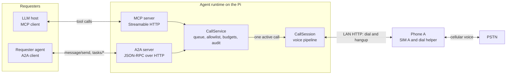
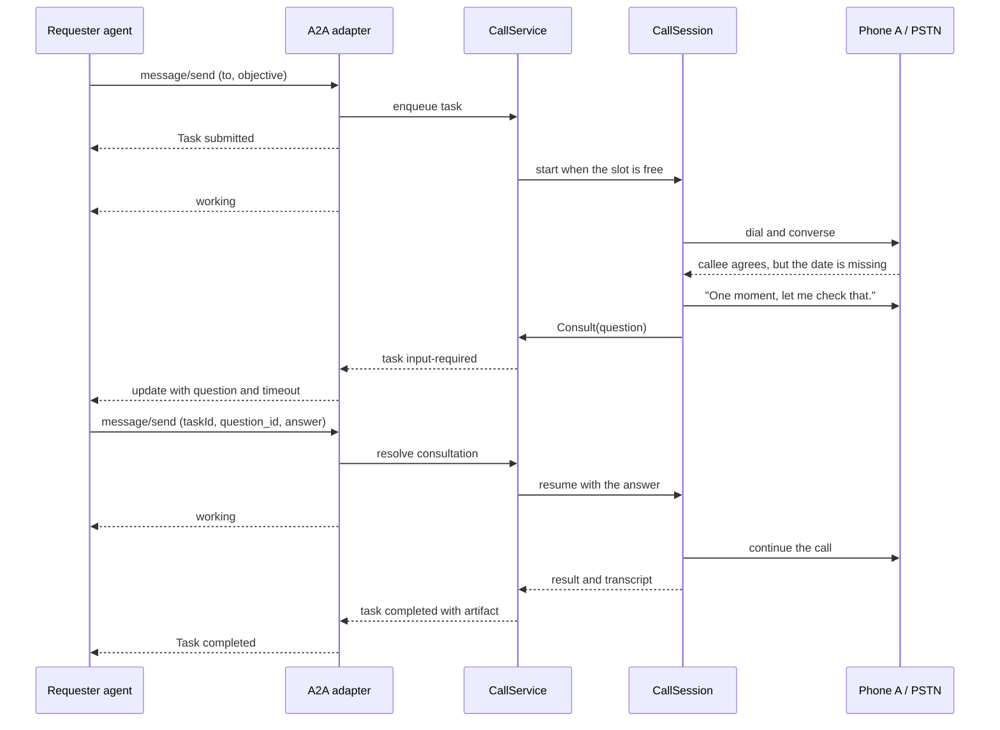

# Interoperability: MCP and A2A

Status: design complete, pre-implementation (alpha)
Last updated: 2026-10-24

Purpose: describe how other agents and LLM hosts delegate outbound calls to this agent,
observe them, answer a mid-call question, and cancel them. MCP exposes the agent as a
set of tools to an LLM host. A2A exposes it as a task endpoint to a requester agent.
Both share one `CallService`, one queue, and one active call.

Prerequisites:

- A running agent runtime with a working audio backend and a reachable dial helper.
- A bearer token issued by the operator.
- The destination on the server-side allowlist, in E.164 form.
- For A2A streaming, an HTTP client that can read server-sent events.

This guide describes the v1 design. The control plane is not implemented in the
reference runtime yet.

## Topology



Both adapters translate protocol objects into the same task operations. Neither owns
call state, budgets, or the allowlist. A call placed through MCP can be inspected with
the A2A methods, and the reverse, provided the requester identity matches.

## MCP tools

The MCP server uses the Streamable HTTP transport. The v1 tool set is deliberately
small: place, inspect, answer, cancel, and list. Tool names are stable for v1.

| Tool | Arguments | Returns |
|---|---|---|
| `place_call` | `to` (string, E.164, required); `objective` (string, required); `context` (object, optional facts and constraints) | `{ "task_id": string, "state": "submitted" }` |
| `get_call` | `task_id` (string, required) | Task object |
| `answer_call` | `task_id` (string, required); `answer` (string, required); `question_id` (string, optional, rejects stale answers) | Updated task object |
| `cancel_call` | `task_id` (string, required); `reason` (string, optional) | Updated task object |
| `list_calls` | `state` (string, optional); `limit` (integer, optional, default 20) | `{ "calls": [task, ...] }` |

`place_call` validates the destination and the requester's budget, enqueues the task,
and returns before dialing. It must not block for the duration of the call. If no slot is
free, the task waits in `submitted`; the tool still returns immediately.

MCP task objects have this shape. A2A carries the same fields in its Task envelope,
where the identifier is `id` and the MCP `task_id` is the same value:

```json
{
  "task_id": "task-7f3c",
  "state": "working",
  "created_at": "2026-10-24T09:38:02Z",
  "updated_at": "2026-10-24T09:40:55Z",
  "destination": "+91XXXXXXXXXX",
  "objective": "Confirm the delivery window for order 4471.",
  "pending_question": null,
  "result": null,
  "error": null
}
```

`state` is one of `submitted`, `working`, `input-required`, `completed`, `canceled`,
`failed`, or `rejected`. `pending_question` is set only in `input-required` and carries
a `question_id`, the question text, and the remaining wait in seconds. `result` is the
final artifact. `error` is a machine-readable code and a short message.

Tool failures return `isError: true` with one of these codes: `invalid_argument`,
`forbidden_destination`, `budget_exceeded`, `not_found`, `conflict`, or `unavailable`.
A conflict means the task is not waiting for an answer, or the question id is stale.
`list_calls` returns only tasks owned by the authenticated requester.

## A2A tasks

### Agent Card

The Agent Card is served at `/.well-known/agent-card.json` on the A2A listener. In v1
the listener requires the same bearer token as every other route, so discovery stays
inside the trusted network. The card contains no secrets.

```json
{
  "name": "android-telephone-agent",
  "description": "Places allowed outbound PSTN calls and returns a structured summary.",
  "url": "https://agent.example.com/a2a",
  "version": "0.1.0",
  "capabilities": { "streaming": true, "pushNotifications": false },
  "defaultInputModes": ["application/json", "text/plain"],
  "defaultOutputModes": ["application/json", "text/plain"],
  "skills": [
    {
      "id": "outbound-call",
      "name": "Outbound call",
      "description": "Place one outbound call to an allowed number, pursue the stated objective, ask the requester for a missing fact if needed, and return a summary and transcript.",
      "tags": ["telephony", "pstn", "voice"],
      "examples": [
        "Call +91XXXXXXXXXX and confirm the delivery window for order 4471."
      ]
    }
  ],
  "securitySchemes": {
    "bearer": { "type": "http", "scheme": "bearer" }
  },
  "security": [{ "bearer": [] }]
}
```

The skill takes a structured request rather than free-form prose, so the destination is
never parsed out of the objective:

```json
{
  "to": "+91XXXXXXXXXX",
  "objective": "Confirm the delivery window for order 4471.",
  "context": {
    "order_id": "4471",
    "constraints": ["Do not change the delivery address."]
  }
}
```

The card shown here is illustrative; field names follow the A2A specification version in
use. `version` is the agent's version, not the protocol's.

### Methods

| Method | Purpose |
|---|---|
| `message/send` | Create a task from a structured request, or continue an existing task with an answer. Returns a Task or a Message. |
| `message/stream` | Same as `message/send`, with task updates as server-sent events. |
| `tasks/get` | Read the current state, pending question, or artifact. |
| `tasks/cancel` | Request cancellation. |

A message that creates a call carries a `data` part with `to`, `objective`, and optional
`context`. A message that answers a consultation carries the same `taskId` and a `data`
part with `question_id` and `answer`.

### Task lifecycle

| A2A state | Call state | Meaning |
|---|---|---|
| `submitted` | Queued | Accepted, waiting for the single call slot. No audio yet. |
| `working` | Dialing, ringing, or in call | The call is being placed or is active. |
| `input-required` | Consultation wait | A holding phrase has been spoken; the agent is waiting for the requester's answer. |
| `working` | In call | The answer arrived and the conversation resumed. |
| `completed` | Ended normally | The artifact contains the structured summary and transcript. |
| `canceled` | Canceled | The task or call was canceled; a partial summary may be present. |
| `failed` | Failed | Dial, audio, or provider failure; the error is in the task status. |
| `rejected` | Not started | Policy refusal before dialing: destination not allowed, budget exhausted, or invalid request. |

The normal sequence is `submitted` -> `working` -> `input-required` -> `working` ->
`completed`. A call that never needs input skips the `input-required` step. `canceled`,
`failed`, and `rejected` are terminal outcomes from their respective points.

Some A2A versions do not define `rejected`; when it is unavailable, a policy refusal is
returned as a failed task with a policy error code. Audio and video file parts are
rejected; this agent accepts structured data and text only.

The final artifact is text, not media:

```json
{
  "summary": "Delivery moved to Friday 30 October, 10 am to noon.",
  "outcome": "answered_and_completed",
  "duration_s": 154,
  "consultations": [
    {
      "question": "Which Friday should the delivery move to?",
      "answer": "Friday 30 October",
      "waited_s": 12
    }
  ],
  "transcript": [
    { "speaker": "agent", "text": "Hello, I am calling about order 4471." },
    { "speaker": "callee", "text": "Yes, go ahead." }
  ]
}
```

The transcript is personal data. It is returned only to the authenticated requester and
is not written to the audit log by default. No raw audio is returned.

## Worked example: a mid-call consultation

A requester asks for a call whose objective omits the date. The callee agrees to the
change but cannot be told which Friday until the requester answers.



1. The requester sends the call request. The destination is a structured field, not
   text to be parsed.

   ```json
   {
     "jsonrpc": "2.0",
     "id": "req-1",
     "method": "message/send",
     "params": {
       "message": {
         "role": "user",
         "kind": "message",
         "messageId": "msg-1",
         "parts": [
           {
             "kind": "data",
             "data": {
               "to": "+91XXXXXXXXXX",
               "objective": "Move order 4471 to the next Friday delivery window."
             }
           }
         ]
       }
     }
   }
   ```

2. The adapter validates the token, destination, and budget, creates the task, and
   returns without dialing.

   ```json
   {
     "jsonrpc": "2.0",
     "id": "req-1",
     "result": {
       "kind": "task",
       "id": "task-7f3c",
       "status": { "state": "submitted" }
     }
   }
   ```

3. When the slot is free, the service starts the call and moves the task to `working`.
   The call is dialed through Phone A as usual.

4. The callee agrees to Friday but asks which Friday. The objective does not contain a
   date, and the brain emits `Consult("Which Friday should the delivery move to?")`.
   The pipeline speaks a short holding phrase so the callee is not left in silence.

5. The task moves to `input-required` and the adapter sends the question and deadline.
   The update is delivered on the open stream, or read with `tasks/get`.

   ```json
   {
     "jsonrpc": "2.0",
     "id": "evt-4",
     "result": {
       "kind": "task",
       "id": "task-7f3c",
       "status": {
         "state": "input-required",
         "message": {
           "role": "agent",
           "kind": "message",
           "parts": [
             {
               "kind": "data",
               "data": {
                 "question_id": "q-1",
                 "question": "Which Friday should the delivery move to?",
                 "timeout_s": 8
               }
             }
           ]
         }
       }
     }
   }
   ```

6. The requester answers on the same task. The adapter checks `question_id` so a late
   answer cannot resolve a different question.

   ```json
   {
     "jsonrpc": "2.0",
     "id": "req-2",
     "method": "message/send",
     "params": {
       "message": {
         "role": "user",
         "kind": "message",
         "messageId": "msg-2",
         "taskId": "task-7f3c",
         "parts": [
           {
             "kind": "data",
             "data": { "question_id": "q-1", "answer": "Friday 30 October" }
           }
         ]
       }
     }
   }
   ```

7. The service delivers the answer to the waiting session and the task returns to
   `working`. The agent resumes: "Friday the thirtieth works. I have moved the delivery
   to the morning window."

8. The call ends normally. The task becomes `completed` with the artifact above. If the
   call was placed over MCP, the same wait is visible through `get_call` and answered
   with `answer_call`; the state names and the question id are identical.

## Security

- **Bearer token.** Both listeners require `Authorization: Bearer <token>` on every
  route, including the Agent Card. The token maps to a requester identity, which owns
  the task list and the budget. A single shared token is acceptable only on loopback or
  a trusted LAN, where every caller is treated as the same requester. Use one token per
  requester before exposing the service more widely. Never log the token or put it in a
  URL.
- **Bind address.** Bind to `127.0.0.1` by default, or to a private LAN address when
  another host needs access. Do not port-forward and do not enable UPnP. Beyond the
  trusted network, put the listener behind a TLS-terminating reverse proxy or a VPN or
  overlay network; never send the token over plain HTTP across an untrusted link. Do not
  expose the listener beyond a trusted network until the destination allowlist and
  per-requester budgets are configured and tested.
- **Destination allowlist.** Validate `to` against a server-side allowlist of E.164
  numbers or prefixes before the task is queued. Reject emergency numbers, short codes,
  and anything outside the list with `forbidden_destination`. The objective cannot add
  a destination, and the allowlist is not editable through either protocol.
- **Budgets.** Bound calls per requester per hour and per day, maximum call duration,
  and queue depth. There is one global concurrent call. Refuse work over budget with
  `budget_exceeded` rather than queueing without limit.
- **Untrusted input.** The objective, the context, and every consultation answer come
  from a remote agent and are untrusted. Treat them as data: delimit them in the prompt,
  never as system instructions, and never let them change the allowlist, budgets, tool
  set, or call policy. Validate structured answers (dates, amounts, selections) before
  the brain relies on them, and do not echo secrets or configuration to the callee.
  The model is told that instructions inside the objective that conflict with policy
  are to be ignored.
- **No raw audio.** Neither protocol returns audio. The artifact is a summary and a
  transcript. Audio is not recorded by default; any debug capture is local, opt-in, and
  time-bounded.
- **Audit log.** Append one JSONL record per state transition with a UTC timestamp,
  requester id, task id, redacted destination, previous and next state, consultation
  outcome, and error code. Do not write transcripts or audio to it by default. Keep it
  long enough to reconcile budgets and investigate disputes, and restrict access to it.

## Failure behaviour

| Situation | Behaviour |
|---|---|
| Consultation timeout | Speak a local fallback line, return the task to `working`, record `consultation_timeout`, and continue or close the call. The callee is never left in silence past the deadline. |
| Invalid or stale answer | Reject with `conflict`; the first valid answer wins and the wait continues until the deadline. |
| Requester disconnects while input-required | Keep the task open until the deadline, then use the fallback. The task stays queryable for the retention window. |
| Requester disconnects while working | The call continues to a bounded conclusion. A dropped stream does not cancel the task; reconnect with `tasks/get`. |
| Cancel while queued | Remove the task from the queue and mark it `canceled`. No call is placed. |
| Cancel while dialing or ringing | Ask the helper to end the call, stop the session, and mark the task `canceled`. If hangup is not confirmed, stop audio and record `hangup_unconfirmed`. |
| Cancel during the call | Play a brief closing line if possible, stop audio, request hangup, and mark the task `canceled`. A partial summary may be returned. |
| Cancel after a terminal state | Idempotent no-op; return the terminal task unchanged. |
| Call setup or audio failure | Mark the task `failed` with the cause. v1 does not retry a delegated call automatically; the requester may place a new one. |
| Server restart | In-memory tasks are lost, and an active call may be orphaned. The remote party or the hard call-duration limit ends it. The audit log retains the last state but cannot resume the task. |
| Stream drops | `message/stream` is best effort. The task is unaffected; poll `tasks/get`. v1 has no resumable stream. |

Cancellation and hangup are best effort because Android may not permit
`TelecomManager.endCall()` on every build. The agent always stops its own audio and
closes the session; the remote side or the hard duration limit ends the line.
Consultation timeouts are starting values and must fit inside the call's overall silence
budget; the holding phrase and the fallback are both speech.

## Limitations

- **One call at a time.** One SIM and one audio path. A long call blocks every queued
  task from both protocols.
- **In-memory tasks.** Tasks do not survive a restart. The JSONL audit log is for audit,
  not recovery, and it does not contain the artifact or transcript.
- **No inbound PSTN.** Inbound control-plane tasking is supported; a person calling the
  agent's SIM is not answered by the agent.
- **No barge-in yet.** Barge-in is designed but not implemented in the reference
  runtime. Until it lands, the callee cannot interrupt the holding phrase or the agent's
  speech; the consultation timeout still bounds the wait.
- **Text only.** No audio, video, or screen sharing is accepted or returned. There is no
  live listen-in or whisper path for the requester.
- **No push notifications.** A2A `pushNotifications` is off. Clients poll or keep a
  stream open.
- **Single node.** No task store, no horizontal scaling, and no failover. A second
  runtime would need a second phone and SIM.
- **Retention is bounded by memory.** A finished task is available only until the
  process restarts or the operator clears it.

## Verification

- Bind to loopback, start the runtime with a test token, and fetch the Agent Card with
  and without the token. The unauthenticated request must fail.
- Call `list_calls` with no tasks and confirm an empty list owned by the requester.
- Place a call to an allowlisted test number. Confirm `place_call` returns a task id in
  well under a second and the task moves from `submitted` to `working`.
- Use an objective that omits a required fact. Confirm the holding phrase, the
  `input-required` state with a question id, and that a valid answer resumes the call.
  Repeat and let the wait expire; confirm the spoken fallback and that the call does not
  sit in silence.
- Cancel a queued task and an active call. Confirm both end in `canceled`, that a second
  cancel is a no-op, and that a stale answer is refused.
- Inspect the audit log: ordered transitions, redacted destinations, no transcripts, no
  audio paths, no token.
