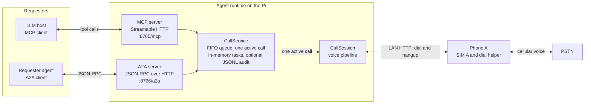
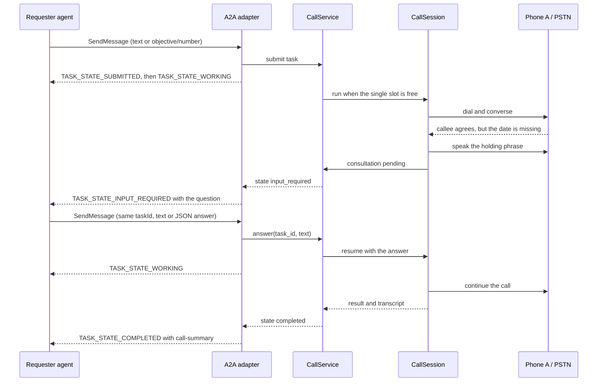

# Interoperability: MCP and A2A

Status: implemented (alpha)
Last updated: 2026-10-24

Purpose: describe how other agents and LLM hosts delegate outbound calls to this agent,
observe them, answer a mid-call question, and cancel them. MCP exposes the agent as a
set of tools to an LLM host. A2A exposes it as a task endpoint to a requester agent.
Both share one `CallService`, one FIFO queue, and one active call.

Prerequisites:

- The optional server dependencies: `pip install -e ".[server]"` from `agent/`.
- A working audio backend and a reachable dial helper. Without them, `serve` starts
  and accepts requests, but a call fails when the session tries to dial or open audio.
- A bearer token in `[server].token` (or `TELEPHONE_AGENT_SERVER__TOKEN`). `serve`
  refuses to start without one.
- A destination in E.164 form. There is no destination allowlist in v1, so the
  operator is responsible for what the token holder may dial.
- For A2A, a client that speaks protocol 1.0 and sends `A2A-Version: 1.0`.

## What is not in v1

- **No destination allowlist.** Any holder of the shared token can ask the agent to
  dial any syntactically valid E.164 number. Emergency numbers and short codes normally
  fail the E.164 format check, but no policy list is applied.
- **No budgets, quotas, rate limits, or queue-depth limit.** A caller can enqueue
  work without bound. `max_minutes` only bounds one call's duration; it is validated
  for being finite and positive, not against any policy.
- **No requester identity or per-token scoping.** The token is admin-level: every
  caller can list, read, answer, and cancel every task.
- **No STT or TTS adapters are bundled.** Delegated calls use placeholder transcripts
  and log replies instead of speaking until adapters are wired in
  `_build_session_factory`. The control plane is usable for call control, not a
  natural voice conversation out of the box.
- **No push notifications.** A2A `pushNotifications` is off.
- **Tasks are in memory.** They do not survive a restart. The optional audit log is
  for audit, not recovery.
- **No A2A timeout update.** If a consultation times out while an A2A task is
  `TASK_STATE_INPUT_REQUIRED`, the task stays in that state until the requester sends
  another message. See [A2A consultation timeout](#a2a-consultation-timeout).
- **No inbound PSTN calls, barge-in, or raw audio over either protocol.**

Until allowlists, budgets, requester identity, and rate limits exist, keep the
listeners on loopback or a trusted network. Do not port-forward them.

## Topology



One process runs one `CallService` and two listeners. The service owns the queue,
call lifecycle, consultation waits, in-memory task state, and the optional JSONL
audit log. Neither adapter owns call state. An A2A-created call appears in MCP
`list_calls` and `get_call` under its CallService task id. The reverse is not true: an
MCP-created call has no A2A task, and an A2A task id is a separate identifier from the
CallService task id. Neither protocol partitions tasks by requester.

The service starts at most one `CallSession` at a time. A task submitted while a call
is active waits in `queued`. There is no queue-depth limit, no budget check, and no
destination allowlist.

## Endpoints

| Listener | Default URL | Authentication |
|---|---|---|
| MCP Streamable HTTP | `http://127.0.0.1:8765/mcp` | `Authorization: Bearer <server.token>` |
| A2A JSON-RPC | `http://127.0.0.1:8766/a2a` | `Authorization: Bearer <server.token>` |
| A2A Agent Card | `http://127.0.0.1:8766/.well-known/agent-card.json` | Public |
| Health, both listeners | `http://127.0.0.1:<port>/health` | Public |

`[server].host` defaults to `127.0.0.1`. A non-loopback host also requires
`[server].public_url`; `serve` refuses to start otherwise. `public_url` is used in the
A2A Agent Card and is added to the MCP transport's allowed hosts so a reverse proxy
can forward the public `Host` header. The A2A listener has no host-header allowlist.

With a bearer token, every protected route returns `401` with
`{"error": "unauthorized"}` and `WWW-Authenticate: Bearer` when the header is missing
or wrong. The token is compared in constant time. `serve` never prints it.

## MCP tools

The MCP server uses the Streamable HTTP transport. Tool names are stable for v1.

| Tool | Input | Returns |
|---|---|---|
| `place_call` | `objective: str`, `number: str \| None = None`, `max_minutes: float \| None = None` | `{"task_id": str, "state": str}` |
| `get_call` | `task_id: str` | Full task snapshot with a masked destination |
| `answer_call` | `task_id: str`, `answer: str` | `{"task_id": str, "accepted": bool, "state": str}` |
| `cancel_call` | `task_id: str` | `{"task_id": str, "canceled": bool, "state": str}` |
| `list_calls` | none | Array of summaries, newest first |

`place_call` validates the objective, destination, and optional duration, records the
task, enqueues it, and returns before the call starts. `state` is `queued`.

- `number` defaults to the top-level `phone_number` from configuration. If neither is
  set, the tool fails validation.
- `max_minutes` is converted to seconds and stored on the task. It overrides
  `[agent].max_call_seconds` for that call. There is no policy cap; any finite positive
  value is accepted.
- `objective` is trimmed, must be non-empty, and is limited to 4000 characters.

`get_call` returns this mapping:

| Key | Value |
|---|---|
| `task_id` | Task identifier |
| `objective` | Trimmed objective |
| `number` | Masked destination, for example `*******0100` |
| `state` | `queued`, `dialing`, `in_call`, `input_required`, `completed`, `failed`, or `canceled` |
| `created_at` | Monotonic seconds when the task was submitted |
| `max_call_seconds` | Per-task limit, or `null` when not supplied |
| `started_at` | Monotonic seconds when the worker started, or `null` |
| `ended_at` | Monotonic seconds at a terminal state, or `null` |
| `turns` | Final turn count; remains `0` while the call is active |
| `result` | `null`, or `{state, reason, duration_s, turns}` |
| `error` | Error text when the call failed with an exception, otherwise `null`; call-level failures are recorded in `result.reason` |
| `pending_question` | Consultation question while `input_required`, otherwise `null` |
| `transcript` | `[{"role": "callee" \| "agent", "text": ...}]` |

The `state` values above are the service's snake_case values. A2A serialises its own
protobuf enum names, so do not pass one protocol's spelling to the other.

A completed task looks like this. The example was placed with `max_minutes=5`, so
`max_call_seconds` is `300.0`. The timestamps are monotonic seconds from an arbitrary
process origin, not Unix time and not ISO strings.

```json
{
  "task_id": "4f8c2d1e9a7b4c6d8e0f1a2b3c4d5e6f",
  "objective": "Confirm the delivery window for order 4471.",
  "number": "*******0100",
  "state": "completed",
  "created_at": 48213.417,
  "max_call_seconds": 300.0,
  "started_at": 48214.002,
  "ended_at": 48267.913,
  "turns": 3,
  "result": {
    "state": "idle",
    "reason": "completed",
    "duration_s": 53.5,
    "turns": 3
  },
  "error": null,
  "pending_question": null,
  "transcript": [
    { "role": "agent", "text": "Hello, I am calling about order 4471." },
    { "role": "callee", "text": "Yes, go ahead." },
    { "role": "agent", "text": "Can you confirm the delivery window?" },
    { "role": "callee", "text": "It is Friday from ten to noon." },
    { "role": "agent", "text": "Thank you. Goodbye." },
    { "role": "callee", "text": "Goodbye." }
  ]
}
```

`result.state` is the call session's state, not the task state. A normal end is
`state: "idle"` with `reason: "completed"`; the task state is `completed`. Other
reasons include `silence_timeout`, `max_duration`, `audio_ended`, `turn_failed`,
`hangup_failed`, and `interrupted`. A task failed by an exception also carries `error`;
a call that returned a failed result may have `error: null`, so read `result.reason`.

While a consultation is pending, the same snapshot has `state: "input_required"`,
`pending_question` set to the question text, and `result` and `error` null.

`answer_call` returns `accepted: true` only when the task is `input_required` and the
answer reaches the call before its timeout. A late answer, a blank answer, or a task
that is not waiting returns `accepted: false`; a live call is unaffected and continues.
There is no question id.

`cancel_call` returns `canceled: true` for a queued or active task. A terminal task
returns `canceled: false` with its current state. Cancellation is cooperative: a
queued task is canceled immediately, while an active call stops at the next audio-frame
or turn boundary.

`list_calls` takes no arguments. It returns every task, newest first, with only
`task_id`, `state`, `objective`, `created_at`, and `pending_question`. The destination
is omitted, not masked. There is no state filter and no limit.

Unknown task ids raise a tool error with the text `unknown task`. Validation failures
raise a tool error with the validation message. There are no separate error codes such
as `forbidden_destination` or `budget_exceeded`; those controls do not exist.

## A2A tasks

### Agent Card

The Agent Card is served at `/.well-known/agent-card.json` on the A2A listener. It is
public: no token is required. It contains no destination number and no credential.

This is the card produced by `build_agent_card(url="http://127.0.0.1:8766/a2a")`:

```json
{
  "name": "telephone-agent",
  "description": "Places real outbound PSTN calls, asks the requester for a missing fact while the call is live, and reports back a structured summary and transcript.",
  "supportedInterfaces": [
    {
      "url": "http://127.0.0.1:8766/a2a",
      "protocolBinding": "JSONRPC",
      "protocolVersion": "1.0"
    }
  ],
  "version": "0.1.0",
  "capabilities": {
    "streaming": true,
    "pushNotifications": false
  },
  "defaultInputModes": [
    "text/plain",
    "application/json"
  ],
  "defaultOutputModes": [
    "text/plain",
    "application/json"
  ],
  "skills": [
    {
      "id": "place_phone_call",
      "name": "Place a phone call",
      "description": "Accept an objective in natural language, place one outbound call, pause mid-call to ask the requester for a missing fact when needed, and return a structured summary and transcript.",
      "tags": [
        "telephony",
        "voice",
        "outbound-call"
      ],
      "examples": [
        "Call the clinic and ask whether the 3 pm slot is free.",
        "Call the courier and reschedule tomorrow's pickup."
      ],
      "inputModes": [
        "text/plain",
        "application/json"
      ],
      "outputModes": [
        "text/plain",
        "application/json"
      ]
    }
  ]
}
```

`version` is the agent version, not the protocol version. `supportedInterfaces` carries
the protocol binding and protocol version.

### Methods

The card advertises protocol 1.0. `a2a-sdk` 1.2.3, the version tested here, dispatches
the protocol 1.0 method names. Send `A2A-Version: 1.0`; the SDK treats a missing header
as 0.3 and rejects the request.

Before relying on the examples below, read
[Known issue with a2a-sdk 1.2.3](#known-issue-with-a2a-sdk-123). With the installed
version, a new task currently fails before the SDK stores a `Task`; discovery and
authentication are unaffected.

| Method | Purpose |
|---|---|
| `SendMessage` | Create a task from a text or data part, or continue a task with an answer |
| `SendStreamingMessage` | Same as `SendMessage`, with status and artifact updates as server-sent events |
| `GetTask` | Read a task's state, status message, and artifacts |
| `CancelTask` | Ask the service to cancel the call and mark the A2A task canceled |
| `ListTasks` | List A2A tasks in the SDK task store; MCP-created calls are not included |
| `SubscribeToTask` | Subscribe to updates for an existing task |

The SDK's 0.3 compatibility layer is not enabled by `create_a2a_app`, so the older
aliases `message/send`, `message/stream`, `tasks/get`, and `tasks/cancel` return
`-32601 Method not found`. The push-notification configuration methods exist in the
SDK, but `pushNotifications` is false and this runtime does not use them.

A new task carries either a plain text part with the objective, or a data part with
`objective` and optional `number` (alias `to`). There is no `context` object and no
schema beyond those fields. If both are present, the data `objective` wins. The
destination defaults to the configured `phone_number`; if neither is set, the request
fails validation. The objective is trimmed, must be non-empty, and is limited to 4000
characters. Only text and data parts are used; other part kinds are ignored.

```json
{
  "jsonrpc": "2.0",
  "id": "req-1",
  "method": "SendMessage",
  "params": {
    "message": {
      "messageId": "msg-1",
      "role": "ROLE_USER",
      "parts": [
        {
          "text": "Confirm the delivery window for order 4471."
        }
      ]
    }
  }
}
```

```json
{
  "jsonrpc": "2.0",
  "id": "req-2",
  "method": "SendMessage",
  "params": {
    "message": {
      "messageId": "msg-2",
      "role": "ROLE_USER",
      "parts": [
        {
          "data": {
            "objective": "Confirm the delivery window for order 4471.",
            "number": "+15555550100"
          }
        }
      ]
    }
  }
}
```

A successful `SendMessage` returns a task envelope. The SDK emits
`TASK_STATE_SUBMITTED` and `TASK_STATE_WORKING` immediately, so a non-streaming response
usually shows the later state: `TASK_STATE_INPUT_REQUIRED` when the call asks a question,
or a terminal state when it finishes. Use `SendStreamingMessage` to see intermediate
status.

```json
{
  "jsonrpc": "2.0",
  "id": "req-1",
  "result": {
    "task": {
      "id": "task-7f3c",
      "contextId": "ctx-7f3c",
      "status": {
        "state": "TASK_STATE_WORKING"
      }
    }
  }
}
```

To answer a consultation, send a new message on the same A2A task. The answer can be a
text part or a data part with `answer`:

```json
{
  "jsonrpc": "2.0",
  "id": "req-3",
  "method": "SendMessage",
  "params": {
    "message": {
      "messageId": "msg-3",
      "taskId": "task-7f3c",
      "role": "ROLE_USER",
      "parts": [
        {
          "data": {
            "answer": "Friday 30 October"
          }
        }
      ]
    }
  }
}
```

There is no `question_id`. The service accepts an answer only while the call is in its
consultation wait. A late or stale answer is simply not accepted; the executor moves the
task back to `TASK_STATE_WORKING` and keeps observing the live call until the next
consultation or a terminal state. It does not fail the A2A task.

`GetTask` takes `{"id": "<A2A task id>"}`. `CancelTask` takes the same. An A2A task id
is not a CallService task id. A later message on a stored task with no in-process call
mapping fails with the text `This call is no longer active.`

### Task lifecycle

The A2A card's states are protobuf enums. They are serialised on the wire with their
enum names, not as lowercase hyphenated strings.

| A2A state | CallService state | Meaning |
|---|---|---|
| `TASK_STATE_SUBMITTED` | `queued` or `dialing` | A2A task accepted; the executor immediately starts work |
| `TASK_STATE_WORKING` | `queued`, `dialing`, or `in_call` | Queued behind another call, dialing, or in conversation |
| `TASK_STATE_INPUT_REQUIRED` | `input_required` | A holding phrase was spoken (or logged); the question is in the status message |
| `TASK_STATE_COMPLETED` | `completed` | The call ended normally; the artifact is attached |
| `TASK_STATE_CANCELED` | `canceled` | The call or A2A task was canceled |
| `TASK_STATE_FAILED` | `failed` | A dial, audio, brain, or hangup failure; the error is in the status message |
| `TASK_STATE_REJECTED` | none | The request had no objective; no call was created |

`TASK_STATE_SUBMITTED` and `TASK_STATE_WORKING` are emitted back to back, so a client
may only see `TASK_STATE_WORKING`. That A2A state covers queued, dialing, and in call;
the service's finer states are visible through MCP `get_call` or the audit log.

### Completion artifact

A completed call publishes one artifact named `call-summary`. It has one text part
whose media type is `application/json` and whose text is a JSON document:

```json
{
  "artifactId": "9b1c0e6a4f2d",
  "name": "call-summary",
  "parts": [
    {
      "text": "{\n  \"objective\": \"Confirm the delivery window for order 4471.\",\n  \"result\": {\n    \"duration_s\": 53.5,\n    \"reason\": \"completed\",\n    \"state\": \"idle\",\n    \"turns\": 3\n  },\n  \"state\": \"completed\",\n  \"task_id\": \"4f8c2d1e9a7b4c6d8e0f1a2b3c4d5e6f\",\n  \"transcript\": [\n    {\n      \"role\": \"callee\",\n      \"text\": \"It is Friday from ten to noon.\"\n    },\n    {\n      \"role\": \"agent\",\n      \"text\": \"Thank you. Goodbye.\"\n    }\n  ]\n}",
      "mediaType": "application/json"
    }
  ]
}
```

The embedded document has exactly these keys:

```json
{
  "objective": "Confirm the delivery window for order 4471.",
  "result": {
    "duration_s": 53.5,
    "reason": "completed",
    "state": "idle",
    "turns": 3
  },
  "state": "completed",
  "task_id": "4f8c2d1e9a7b4c6d8e0f1a2b3c4d5e6f",
  "transcript": [
    {
      "role": "callee",
      "text": "It is Friday from ten to noon."
    },
    {
      "role": "agent",
      "text": "Thank you. Goodbye."
    }
  ]
}
```

The destination is omitted from the artifact. There is no raw audio. The transcript is
personal data and is returned only to whoever holds the token; there is no per-requester
access control.

The A2A task id in the envelope and the artifact's `task_id` are different identifiers.
The first belongs to the A2A task store; the second is the CallService call task, which
is also the id used by MCP `get_call`.

A failed call sets `TASK_STATE_FAILED` with the text `The call failed: <error>`, where
`<error>` is the task's error text or `unknown error` when the failure came from a call
result rather than an exception. A canceled call sets `TASK_STATE_CANCELED` with
`The call was canceled.` A canceled call does not publish a summary artifact.

### A2A consultation timeout

A consultation is bounded by `[agent].consult_timeout_s` (default `8.0` seconds) or a
per-consult `timeout_s` requested by the model. The timeout is not exposed in the A2A
task. When it expires, the pipeline speaks (or logs) the brain's fallback line and the
call continues in `in_call`; the service state leaves `input_required`.

The A2A task does not receive a server-initiated timeout update. It stays
`TASK_STATE_INPUT_REQUIRED` until the requester sends another message on the task.
That message moves the task to `TASK_STATE_WORKING` and resumes observation; it reaches
`TASK_STATE_COMPLETED`, `TASK_STATE_FAILED`, or `TASK_STATE_CANCELED` when the call does.
This is a v1 limitation, not a permanent design.

## Worked example: a mid-call consultation

This path requires `[brain].action_mode = "json"` with `[brain].kind = "http"`. The
default `"text"` mode wraps the reply brain in `BrainActionAdapter` and never initiates
a consultation. The JSON brain returns one action per turn:

```json
{ "action": "consult", "question": "Which Friday should the delivery move to?" }
```

The other actions are `{"action": "speak", "text": "..."}` and
`{"action": "hangup", "reason": "..."}`. A reply with no JSON object is spoken as-is.
A consult cannot immediately request another consult.

The pipeline speaks `[agent].holding_phrase` before it blocks; without a synthesizer it
logs the line instead. A requester answers over either protocol; there is no question
id.



1. The requester sends the call request. The destination is a structured field or the
   configured default; it is not parsed out of the objective.

2. The adapter submits the task. A2A moves through `TASK_STATE_SUBMITTED` to
   `TASK_STATE_WORKING`; the service may still be `queued` behind another call. A
   non-streaming `SendMessage` waits until the call asks for input or reaches a terminal
   state; use `SendStreamingMessage` if you need progress before that.

3. When the slot is free, the service moves the call to `dialing` and then `in_call`.
   The call is dialed through Phone A as usual.

4. The callee agrees to Friday but asks which Friday. The objective does not contain a
   date, and the JSON brain emits a `consult` action. The pipeline speaks (or logs) the
   holding phrase so the callee is not left in silence.

5. The service sets `input_required` and puts the question in the A2A status message.
   There is no deadline, question id, or structured question payload; the text is the
   question.

   ```json
   {
     "jsonrpc": "2.0",
     "id": "evt-4",
     "result": {
       "task": {
         "id": "task-7f3c",
         "contextId": "ctx-7f3c",
         "status": {
           "state": "TASK_STATE_INPUT_REQUIRED",
           "message": {
             "messageId": "msg-q1",
             "role": "ROLE_AGENT",
             "parts": [
               {
                 "text": "Which Friday should the delivery move to?"
               }
             ]
           }
         }
       }
     }
   }
   ```

6. The requester answers on the same task with a text part or a data part
   `{"answer": "Friday 30 October"}`. The adapter calls `answer(task_id, text)`. A
   `False` result means the wait expired or another answer won; the executor does not
   fail the task.

7. The service returns the task to `in_call`, the pipeline resumes with the answer, and
   the agent continues the conversation.

8. When the call ends, the task becomes `completed` and publishes the artifact above.
   The underlying call is also visible through MCP `list_calls` and `get_call` under its
   CallService task id, and can be answered with `answer_call` while it is
   `input_required`; the state names differ only in their protocol casing.

## Security

### Enforced today

- **Shared bearer token.** `[server].token` is required by `serve`, must be at least
  eight characters when set, and is checked on the MCP endpoint and the A2A JSON-RPC
  endpoint. It is compared in constant time and never printed.
- **Public and private routes.** `/health` on both listeners and the A2A Agent Card are
  public. Everything else on those listeners requires the token.
- **Loopback by default.** `[server].host` defaults to `127.0.0.1`. A non-loopback bind
  is refused unless `[server].public_url` is set.
- **Host handling.** The MCP transport applies DNS-rebinding protection and adds the
  `public_url` host and origin when configured. The A2A listener has no host-header
  allowlist.
- **Number masking.** MCP `get_call` returns a masked destination, `list_calls` omits
  it, and the A2A artifact omits it. The audit log masks it. Free text such as the
  objective or a transcript is not scrubbed.
- **Audit redaction.** Each record has `ts`, `at`, `kind`, `task_id`, and `data`; there
  is no requester id. `kind` is `state`, `transcript`, `reply`, `consultation`, `error`,
  or `finished`. The final `finished` record drops `objective` and `transcript`, and the
  destination is masked. The audit log is not transcript-free: each `transcript` and
  `reply` event records the utterance or reply text, and consultation events record the
  question and answer. Restrict access and apply a retention rule.
- **No raw audio.** Neither protocol returns audio. The artifact is text.

### Not enforced today

- **No destination allowlist.** Any valid E.164 destination is accepted. There is no
  prefix list, no emergency-number policy beyond the E.164 format check, and no
  operator-managed allowlist.
- **No budgets, quotas, rate limits, or queue-depth limit.** A token holder can enqueue
  unlimited tasks and keep the single call slot occupied. `max_minutes` bounds one
  call only.
- **No requester identity or token scoping.** The token is admin-level. Any holder can
  list every task, read every transcript, answer any consultation, and cancel any call.
  Use one token for one trusted operator, not for multiple tenants.
- **No TLS.** The listeners speak plain HTTP. Put a TLS-terminating reverse proxy or a
  VPN in front if the token crosses an untrusted link. The token is a bearer credential;
  plain HTTP exposes it.
- **No per-token revocation.** Rotating `[server].token` and restarting the process is
  the only way to invalidate a token.

The objective, the optional data fields, and every consultation answer are untrusted
input from a remote agent. Delimit them in prompts and treat them as data. The model is
told to ignore instructions that conflict with policy, but no technical control stops a
model from acting on a malicious objective. Do not let remote text change the tool set,
configuration, or call policy. Validate structured answers before the brain relies on
them, and do not echo secrets or configuration to the callee.

Keep the listener on a trusted network until allowlists, budgets, requester identity,
and rate limits exist. See [SECURITY.md](../SECURITY.md).

## Failure behaviour

| Situation | Behaviour |
|---|---|
| Invalid objective or destination | MCP returns a tool error. A2A returns a request error; no call is created. |
| Missing objective on A2A | `TASK_STATE_REJECTED` with `An objective is required.` |
| MCP unknown task id | Tool error `unknown task`. |
| A2A unknown task id | `GetTask` returns the SDK's task-not-found error. |
| Consultation timeout | The holding phrase was spoken (or logged without TTS). The fallback line is spoken or logged, the service returns to `in_call`, and the call continues. MCP sees the new state; A2A stays `TASK_STATE_INPUT_REQUIRED` until the next message. |
| Late or stale answer | MCP returns `accepted: false`; A2A ignores the answer. The call continues. |
| Cancel while queued | The task is marked `canceled` immediately and never dials. |
| Cancel while dialing or in call | Cooperative: the stop flag is checked between audio frames, so the task becomes `canceled` at the next frame or turn boundary. |
| Cancel after a terminal state | The service returns `False`; MCP reports `canceled: false` and the current state. A2A `CancelTask` on a terminal A2A task returns the SDK's task-not-cancelable error. |
| Dial, audio, brain, or hangup failure | The task becomes `failed`. An exception sets `error` and A2A reports `The call failed: <error>`; a failed call result may leave `error: null` and A2A reports `The call failed: unknown error`. Read `result.reason`. |
| Call ends by silence, max duration, or audio end | The task becomes `completed` unless hangup cannot be confirmed; the result reason records `silence_timeout`, `max_duration`, or `audio_ended`. |
| Restart | In-memory tasks are lost, and an active call may be orphaned until the remote party or carrier ends it. If the A2A task store still has a task but the executor has no call mapping, a later message fails with `This call is no longer active.` |
| A2A stream drops | The call is unaffected. Poll `GetTask` or subscribe again; there is no durable stream. |

Hangup is best effort because Android may not permit `TelecomManager.endCall()` on every
build. The agent always stops its own audio and closes the session; the remote side or
the hard duration limit ends the line. For an otherwise normal call, a hangup that
cannot be confirmed marks the task `failed` with reason `hangup_failed`.

## Limits

- **One call at a time.** One SIM and one audio path. A long call blocks every queued
  task from both protocols.
- **In-memory tasks.** Tasks and A2A task state do not survive a restart. The audit log
  is for audit, not recovery, and the final record omits the objective and full
  transcript.
- **No inbound PSTN.** A person calling the agent's SIM is not answered by the agent.
  Inbound control-plane tasking is the only inbound direction.
- **No barge-in.** Playback blocks capture. The callee cannot interrupt the holding
  phrase or the agent's speech.
- **Text only.** No audio, video, or screen sharing is accepted or returned. There is
  no live listen-in or whisper path.
- **No push notifications.** Clients poll or keep a stream open.
- **Single node.** No durable task store, no horizontal scaling, and no failover. A
  second runtime would need a second phone and SIM.
- **Scaffold voice path.** With no STT/TTS adapters, the transcript is a placeholder
  and replies are logged instead of spoken. The control plane still places, tracks,
  and cancels the call.

## Verification

These checks cover the implemented control plane. They do not assume an allowlist, a
budget, or a speech adapter. The A2A task-creation check is expected to hit the known
alpha issue described above.

1. With the `agent/.venv` environment active, install the server extra and set a token:

   ```bash
   cd agent
   pip install -e ".[server]"
   cd ..
   test -f config/config.toml || cp config/config.example.toml config/config.toml
   export TELEPHONE_AGENT_SERVER__TOKEN='replace-with-a-long-random-token'
   telephone-agent --config config/config.toml serve
   ```

   Confirm the process prints both endpoints and does not print the token. Stop it and
   run the command with an empty token; it must refuse to start with a configuration
   error.

   ```bash
   TELEPHONE_AGENT_SERVER__TOKEN='' telephone-agent --config config/config.toml serve
   ```

2. Check both health endpoints and the public card:

   ```bash
   curl -s http://127.0.0.1:8765/health
   curl -s http://127.0.0.1:8766/health
   curl -s http://127.0.0.1:8766/.well-known/agent-card.json
   ```

   Health returns `{"status": "ok", "service": "telephone-agent", "version": "0.1.0"}`
   on both ports. The card returns `name: "telephone-agent"` and
   `skills[0].id: "place_phone_call"`.

3. Check that the private routes reject an unauthenticated request:

   ```bash
   curl -s -o /dev/null -w '%{http_code}\n' \
     -X POST http://127.0.0.1:8765/mcp \
     -H 'Content-Type: application/json' -d '{}'
   curl -s -o /dev/null -w '%{http_code}\n' \
     -X POST http://127.0.0.1:8766/a2a \
     -H 'Content-Type: application/json' -d '{}'
   ```

   Both must print `401`.

4. List tools and tasks over MCP. With the `mcp` client and `httpx2` installed by the
   server extra:

   ```python
   import asyncio, os
   import httpx2
   from mcp import ClientSession
   from mcp.client.streamable_http import streamable_http_client

   async def main():
       headers = {"Authorization": f"Bearer {os.environ['TELEPHONE_AGENT_SERVER__TOKEN']}"}
       async with httpx2.AsyncClient(headers=headers) as http:
           async with streamable_http_client(
               "http://127.0.0.1:8765/mcp", http_client=http
           ) as streams:
               async with ClientSession(streams[0], streams[1]) as session:
                   await session.initialize()
                   tools = await session.list_tools()
                   print([tool.name for tool in tools.tools])
                   result = await session.call_tool("list_calls", {})
                   print(result.structured_content)

   asyncio.run(main())
   ```

   The tool names are `place_call`, `get_call`, `answer_call`, `cancel_call`, and
   `list_calls`. `list_calls` starts empty.

5. Place a call to a number you control, then inspect and cancel it. This dials a real
   number; use a test destination. No STT/TTS is needed to verify the state machine.

   ```python
   import asyncio, os
   import httpx2
   from mcp import ClientSession
   from mcp.client.streamable_http import streamable_http_client

   async def main():
       headers = {"Authorization": f"Bearer {os.environ['TELEPHONE_AGENT_SERVER__TOKEN']}"}
       async with httpx2.AsyncClient(headers=headers) as http:
           async with streamable_http_client(
               "http://127.0.0.1:8765/mcp", http_client=http
           ) as streams:
               async with ClientSession(streams[0], streams[1]) as session:
                   await session.initialize()
                   placed = await session.call_tool(
                       "place_call",
                       {"objective": "Confirm the test call.", "max_minutes": 1},
                   )
                   print(placed.structured_content)  # task_id and state
                   task_id = placed.structured_content["task_id"]
                   await asyncio.sleep(1)
                   task = await session.call_tool("get_call", {"task_id": task_id})
                   print(task.structured_content)
                   canceled = await session.call_tool("cancel_call", {"task_id": task_id})
                   print(canceled.structured_content)

   asyncio.run(main())
   ```

   Confirm the destination is masked, the state moves from `queued` to `dialing` or
   `in_call`, and `cancel_call` returns `canceled: true`. Wait until `get_call` reports
   `canceled`, then confirm a second `cancel_call` returns `canceled: false`; cancellation
   of an active call is cooperative.

6. Exercise the consultation state machine without audio. The service and adapter tests
   use a fake session that calls `ConsultationBroker.ask`:

   ```bash
   python3 -m pytest agent/tests/test_service.py agent/tests/test_mcp_server.py \
     agent/tests/test_a2a_server.py -q
   ```

   To exercise it end to end, wire STT/TTS adapters, set `[brain].kind = "http"` and
   `[brain].action_mode = "json"`, and use an objective that omits a fact the callee
   will ask for. Confirm `get_call` shows `input_required` and a `pending_question`,
   then call `answer_call`. Confirm `accepted: true` and poll `get_call` until the
   state leaves `input_required` and returns to `in_call`. Let a second consultation
   time out; confirm the fallback is spoken (or logged without TTS) and the call does
   not stay `input_required`.

7. Check the audit log if `[server].audit_log` is set. Each line is one JSON object with
   `ts`, `at`, `kind`, `task_id`, and `data`. Confirm the destination is masked, the
   final `finished` record has no `objective` or `transcript`, and the per-turn
   `transcript` and `reply` records do contain text. Confirm no token appears.

8. For A2A, check discovery and authentication as above. A protocol 1.0 client must send
   `A2A-Version: 1.0` and use the method names in [Methods](#methods). Send one
   `SendMessage` with a text or data part and confirm it returns a task in
   `TASK_STATE_SUBMITTED` or `TASK_STATE_WORKING`, then reaches a terminal state.

## Related documents

- [Architecture](./architecture.md), control plane section.
- [Design brief](./design-brief.md), sections 1, 2, 10, and 12.
- [ADR 0007](./decisions/0007-expose-agent-over-mcp-and-a2a.md).
- [Agent runtime README](../agent/README.md).
- [Voice agent](./voice-agent.md) and [dial helper](./dial-helper.md).
