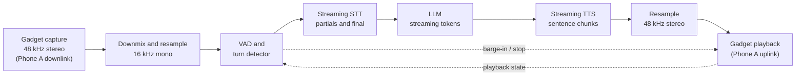

# Voice Agent

Status: design complete, pre-implementation (alpha)
Last updated: 2026-10-24

Purpose: turn the duplex audio stream exposed by the USB gadget into a natural
spoken conversation. This document defines the reference pipeline, timing rules,
and failure behavior. It assumes the audio path in
[architecture](./architecture.md), the gadget setup in
[Raspberry Pi setup](./raspberry-pi-setup.md), and the runtime layout in
[agent/README](../agent/README.md).

## Pipeline

`arecord` receives what Phone A would play in its earpiece, the remote party;
`aplay` sends audio to Phone A's microphone input, which the remote party hears.
Confirm this inversion with the loopback test before connecting the agent.

Use 20 ms frames end to end: 960 samples at 48 kHz, 320 at 16 kHz. Resample with
an anti-alias filter; without one, aliasing above 8 kHz folds into speech. Keep
capture, network, and playback in separate buffers so no call blocks the ALSA
callback. Target a 40–80 ms playback jitter buffer; larger buffers hide Wi-Fi
jitter but add latency. Timestamp frames with a monotonic clock at capture and
playback; see [latency budget](./latency-budget.md).

## VAD and turn detection

Start with an energy detector:

1. Compute RMS energy over each 20 ms frame of the 16 kHz stream.
2. Maintain an adaptive noise floor over 1–2 seconds of non-speech.
3. Mark speech when energy exceeds the floor by 6–10 dB.
4. Require two of the last three frames to agree before speech onset.
5. Declare end of speech after 300–500 ms below the threshold.
6. Reject segments shorter than 200–300 ms as clicks, tones, or line noise.

Adapt the floor slowly during silence and freeze it during speech; a fixed
threshold fails when gain changes. WebRTC VAD is a cheap GMM detector that works
after an energy gate; Silero VAD is an ONNX model with better noise performance
but higher CPU cost.

The end-of-turn window is 300–500 ms: 300 ms for clean, fast speech; 400–500 ms
for elderly speakers, dictated details, or noise. Reset the timer on new speech.
Do not end on a breath, cough, or single syllable. Suppress false triggers with a
minimum speech duration and, where available, a speech probability score. During
playback, require 100–150 ms of speech before treating sound as barge-in.

End-of-turn detection dominates perceived latency. A natural gap is roughly
200 ms; past about one second, callers say "hello?" or repeat themselves. STT,
LLM, and TTS can be fast and the call still feels slow if the endpointer waits.
Streaming cannot hide this: partials arrive during speech, but the final
transcript and LLM request wait for the boundary. Every 100 ms added to the
window is added to every response; tune on scripted calls.

## Speech-to-text

Use one streaming STT session per call, not one request per utterance. It keeps
acoustic context and avoids a TLS handshake and model warm-up each turn.

- Send 20 ms frames, or aggregate to 100 ms if the provider requires it.
- Consume partials for tracing and early intent; never use a partial for a tool
  call or an irreversible action.
- On end of turn, request finalization if supported and wait at most 200–250 ms.
- If the final is late, use the latest partial and mark the turn degraded.
- Align provider endpointing with the local endpointer; two detectors produce
  empty or split turns.

Automatic punctuation helps readability and TTS chunking but is not semantic. Do
not parse commas and question marks as reliable structure. Normalize digits,
currency, and units before sending text to the LLM.

Confidence is provider-specific. A low-confidence short answer should trigger
confirmation, and a low-confidence tool argument must never be accepted silently.
If no score is exposed, treat empty or implausible text as low confidence.

Malayalam-English code-mixing ("Manglish") is the hardest language case. A
speaker may switch mid-sentence, use English nouns with Malayalam inflection, or
write Malayalam in Latin script. Set the hint to Malayalam (`ml-IN`) and allow
English where supported. Output may be Malayalam script, Romanized Malayalam, or
English; normalize with a reviewed lexicon, not blind transliteration. Vendor
claims about "Indian languages" often mean monolingual Malayalam, not code-mixed
speech. Confirm names, times, and actions, and mark Malayalam samples for native
review (see [prompts](./prompts.md)).

An empty final is normal on a noisy line. Handle it once, not in a loop: use a
plausible partial; otherwise re-prompt with a shorter question; if the second
attempt is empty, use the hearing-trouble fallback and end the call.

## Language model

The LLM turns the transcript and context into a short spoken reply. It is not a
general chatbot. The system prompt in [prompts](./prompts.md) defines identity,
goal, brevity, privacy, and tools; keep it stable across a call so provider-side
prompt caching can work.

Context should contain the system prompt, the call briefing (who, why, approved
facts), a summary of older turns, the last 6–10 turns verbatim, and relevant tool
results. Do not send raw audio or the full transcript when a summary plus recent
turns is enough; a smaller context reduces time to first token and cost.

- One or two sentences per turn, normally under 25 words.
- Ask one question at a time, then stop.
- Prefer concrete wording over filler: "Is the 4 pm call still on?"
- No lists, markdown, emojis, URLs, parentheticals, or abbreviations that TTS
  may read badly.

The reference tools are `end_call`, `note`, and optionally `lookup_briefing`.
Tool calls add a round trip; call one only when the result changes what the agent
says or records. Do not let the model claim a tool succeeded before the result
returns. Schemas are in [prompts](./prompts.md).

Use temperature 0.2–0.4. Cap output at 80–120 tokens per turn; the cap is a
latency control, not only a cost control. Target 300–600 ms to first token, with
a soft timeout at 800 ms and a hard cancel at 2 s. Cap total generation at 6 s,
then cancel and use a fallback line. Cancel immediately on barge-in; do not
finish a sentence the callee has interrupted.

The model must not invent facts to keep the conversation going. When it does not
know something, it says so and offers a note or callback. When a request is
outside the call's purpose, it declines briefly and redirects. When asked whether
it is a person, it discloses that it is an automated assistant. Safety rules are
in [prompts](./prompts.md).

## Text-to-speech

Optimize TTS for first-audio latency (target 150–300 ms): a plain voice at
200 ms beats a better voice at 1.5 s.

- Use the streaming or bidirectional endpoint, not batch synthesis.
- Split LLM output into sentence chunks as tokens arrive; send the first chunk as
  soon as it is a complete short sentence.
- Target 40–80 characters for the first chunk. Never split a name, number, time,
  or currency amount across chunks.
- Start playback when the first audio arrives; do not wait for the full reply.
- Request PCM or µ-law. Decode 8 kHz µ-law to linear PCM and resample to 48 kHz;
  resample 24 kHz PCM and duplicate mono to both gadget channels.

Choose a voice intelligible on a phone speaker, not one that is expressive in a
studio demo, and use the same voice for Malayalam and English. Prefer a documented
pronunciation lexicon. Expand numbers, currency, dates, and times before
synthesis: "₹1,250" becomes "one thousand two hundred and fifty rupees"; "4:30"
becomes "four thirty"; phone numbers are grouped. Test names common in the
callee's circle and have a native speaker review Malayalam. Speaking rate
0.95–1.05 of the default.

TTS must be cancellable at every layer: stop writing PCM within one to three
frames (20–60 ms), clear the playback ring buffer, cancel the request and close
the stream, drop unsynthesized LLM text, and mark the turn interrupted. Do not
pause and resume the same stream after barge-in; the queued audio is stale.
Generate a new short reply after the new turn is finalized.

## Barge-in

Barge-in is mandatory. People interrupt, correct themselves, and answer before
the question ends. An agent that talks over them feels like an IVR and can stop
the callee from saying something important.

Run VAD continuously on capture while TTS plays; do not disable capture during
playback. Require 100–150 ms of speech above the floor before declaring barge-in,
and ignore the first 150–250 ms after playback starts plus a short tail after it
stops. If speech continues past the guard, treat it as a real interruption even
if the transcript is not final.

On detection, stop playback immediately (target under 100 ms), discard the rest
of the TTS response and queued text, and optionally send a short "Go ahead" if
the callee has paused. Do not fill every interruption. Wait for the callee's end
of turn, then respond to the new content. If the trigger was a cough, say "Sorry,
please continue" only if the callee is waiting; never replay the old reply.

## Echo and self-hearing

In the intended routing, the USB path is electrical, not acoustic. The Pi sends
playback to Phone A's microphone input; Phone A sends downlink audio to the Pi.
The phone's speaker and microphone are not in the loop, so there is no acoustic
echo path between agent output and agent input.

Echo can still occur. The far end may be on speakerphone, or the PSTN hybrid may
reflect the agent's voice after a delay. Phone A may keep its own speaker or
microphone active alongside the headset, creating an acoustic path; verify actual
routing rather than assuming it from the gadget's presence. Electrical crosstalk
in a hub, charger, or cable can cause TTS bleed into capture.

Keep a 150–250 ms guard after playback starts; do not trigger barge-in during the
guard, but treat energy that persists afterward as speech. A correlation check
against recent playback can suppress a known network echo. Do not enable acoustic
echo cancellation by default: it costs CPU and can distort speech.

## Call lifecycle and timeouts

| State | Entry | Timeout | Action on timeout |
|---|---|---|---|
| Preflight | Slot reached | 10 s | Abort, log, alert |
| Dialing | Helper accepted | 10 s | Retry or abort |
| Ringing | Helper reports dialing | 30–45 s | Hang up, log no answer |
| Answered | Speech onset on downlink | 3 s | Prompt once, then end |
| Greeting | Answer detected | 8 s | Re-prompt or end |
| Conversing | Greeting done | 10 min | Warn, goodbye, hang up |
| Closing | `end_call` requested | 5 s | Hang up |

- There is no reliable answering-machine detection on this path. Do not build the
  flow around a carrier AMD score. Use speech onset on the downlink as the answer
  signal, then apply voicemail heuristics.
- If the line is silent after answer, prompt once: "Hello, can you hear me?" If
  there is still no speech, end the call.
- Do not talk over a voicemail greeting. If it is clearly a mailbox and policy
  allows, leave a message under 15 s, then hang up. Otherwise log `voicemail` and
  end.
- After an agent question, wait 8 s. Re-prompt once with a shorter question; after
  another 8 s, say goodbye and end. Cap total silence at 30 s.
- Default maximum duration is 10 minutes, configurable 5–15. Warn at 8 minutes:
  "I should let you go in a moment."
- Close gracefully: summarize the note, confirm nothing is pending, say goodbye,
  wait for TTS to finish, then request hangup. If the helper cannot end the call,
  release audio, stop the session, and let the remote side hang up. Log it.
- The scheduler enforces one call per slot and at most two retries with backoff.

## Provider options

This table is a starting point, not a recommendation. Capabilities and pricing
change; verify current availability and pricing with each provider.

| Provider | Streaming STT | Streaming TTS | Indian languages | India region | Indicative pricing | Notes |
|---|---|---|---|---|---|---|
| Sarvam AI | Yes | Yes | Malayalam, Hindi, Indian English; code-mixed coverage varies | India-based; verify endpoint residency | STT about ₹0.49/min; TTS about ₹2–3 per 1,000 characters | Malayalam-focused; verify Manglish quality and streaming limits |
| Azure Speech | Yes | Yes | Malayalam and other Indian languages | Central India (`centralindia`); verify other India regions | STT about $0.017/min; neural TTS about $15 per 1M characters | Established SDK, custom lexicon, SSML; verify voice and region |
| Google Cloud | Yes | Yes | Malayalam and Indian English, model-dependent | Mumbai (`asia-south1`); verify model availability | STT about $0.016/min; TTS about $16 per 1M characters for Neural2 | Check the language/model matrix; Malayalam may not be on every Mumbai model |
| Deepgram | Yes | Yes | English (India); Malayalam not in the current Nova-3 list | No India region at time of writing | STT about $0.005–0.008/min; TTS about $0.03 per 1,000 characters | Strong latency and turn detection; verify language coverage |
| ElevenLabs | Yes (Scribe Realtime) | Yes | Malayalam in v3; list changes by model | No India region at time of writing | TTS about $0.04–0.08 per 1,000 characters; STT about $0.39/hour | Expressive voices; cross-region latency and cost are the trade-offs |
| OpenAI | Yes | Yes | Indian English strong; Malayalam depends on model | No India region at time of writing | Live transcription about $0.017/min; realtime audio per token; TTS per character | Simplest single-vendor stack; verify language and residency |

Prices are indicative, observed at the time of writing, and exclude taxes,
minimum commits, and telephony; confirm on the provider's pricing page. "Verify"
means the feature may exist but the language/model/region was not confirmed. An
India endpoint avoids the 200–250 ms RTT of a US-only endpoint.

## Realtime speech-to-speech

The runtime also ships an independent adapter for xAI's Grok Voice realtime API
(`realtime.kind = "grok"`). It is a single full-duplex WebSocket that performs
speech recognition, turn detection, the conversation model, and speech synthesis,
so it does not use the STT, brain, and TTS seams described above. Call audio is
sent as binary PCM16 at 16 kHz; server VAD handles endpointing and barge-in, and
the adapter stops local playback on speech onset. Two function tools are
available: `end_call` and, for delegated calls, `consult`.

xAI's documented realtime languages include English, Hindi, and Bengali but not
Malayalam as of 2026-10. Test Malayalam-English code-mixing before relying on
this path, and prefer the provider evaluated in the rest of this document when
Malayalam quality is the priority.

## Local fallback

Whisper.cpp plus Piper keeps audio on the LAN and removes provider outages, but
it is not a drop-in replacement for cloud services on this hardware.

- **Pi 4 Model B (2 GB or more).** Runs quantized Whisper and Piper at usable
  speed and can also act as the UAC1 gadget, but STT, TTS, and resampling compete
  for four cores. Expect higher, less predictable latency on the first turn.
- **Pi 5.** Faster, but it cannot operate in USB device mode, so it cannot be the
  gadget. It could run inference on the LAN while a Zero 2 W remains the gadget,
  adding a network hop and another failure domain.
- **Pi Zero 2 W.** Not comfortable for local Whisper plus Piper. Its 512 MB RAM
  and four small A53 cores already carry the audio bridge.

Piper coverage for Malayalam is limited, and Whisper's Malayalam accuracy is
below the better cloud models, especially on code-mixed and narrowband audio.
Treat local models as a privacy-preserving stretch goal, with cloud as fallback.

## Cost model

This is a rough per-call estimate, not a bill. It assumes 3 minutes, about 60 s of
agent speech (900–1,200 characters), 3 minutes of streamed STT audio, and 8 LLM
turns with a small context.

| Component | Assumption | Sarvam example | Azure/Google example | Premium TTS example |
|---|---|---|---|---|
| STT | 3 minutes | ₹1.47 | about $0.05 | about $0.02–0.05 |
| TTS | 1,000 characters | ₹2.00–3.00 | about $0.015–0.02 | about $0.04–0.08 |
| LLM | 12k input, 700 output tokens | ₹0.50–2.00 | about $0.01–0.03 | about $0.01–0.03 |
| **Approx. total** | | **₹4–7** | **about $0.08–0.10** | **about $0.08–0.13** |

At an assumed ₹90 per US dollar, the cloud examples are roughly ₹7–12 per call.
Realtime speech-to-speech can cost several times more because realtime audio is
metered separately. These figures exclude the SIM plan, power, and hardware
amortization; recalculate with current rates and actual usage.

## Privacy

Call audio leaves the LAN when cloud STT or TTS is used. This is a deliberate
trade-off and must be documented for users, as required by the design brief.

- Prefer providers with an India region and a data processing agreement that
  matches the deployment's legal requirements.
- Disable training on submitted audio and set the shortest retention the provider
  offers. Verify the setting in the provider console, not only in documentation.
- Do not persist audio by default. Stream it and discard buffers after the turn.
- Transcripts are personal data. If stored for debugging, set a short retention,
  restrict access, and redact phone numbers and names.
- Log metadata (timestamps, durations, provider, error codes) without transcripts
  by default. Redact caller IDs.
- Outbound calling and recording are regulated; see the
  [design brief](./design-brief.md). This project does not record calls by
  default and must not be used for spam or impersonation.

## Failure handling

Failures are expected on a Pi, a Wi-Fi link, and a cellular call. Each stage needs
a bounded retry and a spoken fallback. Never leave the agent silent while a client
library retries.

| Failure | Detection | Action | Spoken fallback |
|---|---|---|---|
| STT finalization timeout | No final within 250 ms | Use latest partial; mark degraded | None if the partial is usable |
| Empty transcript | Final empty twice | Re-prompt once, then end | "Sorry, I didn't catch that. Could you say it again?" |
| LLM first-token timeout | No token within 800 ms | Play acknowledgement; retry once with shorter context | "One moment." |
| LLM hard failure | Error or 2 s with no token | Use canned reply or end | "I'm having a little trouble on my side. I'll call you back." |
| TTS first-byte timeout | No audio within 1.5 s | Switch to backup voice or cached line | "Sorry, I'm having trouble. I'll call you back." |
| TTS stream failure | Stream closes mid-reply | Stop playback; do not resume stale audio | "Sorry, the line dropped for a moment." |
| Network loss | Provider socket closed | Reconnect once; if still down, close gracefully | "I'm losing the connection. I'll try again later." |
| Helper hangup failure | No confirmation | Release audio, stop session, log | "Thanks. Goodbye." |
| Provider rate limit | 429 or equivalent | Back off once; switch provider if configured | "One moment, please." |

At most two retries per stage per turn, then degrade or end. Never retry a tool
call with side effects unless it is idempotent. If no audio can be produced, hang
up rather than leave an open line.

## Verification

Test offline, with scripted live calls, and in production sampling.

- **Offline harness.** Feed fixed WAV fixtures through resampling, VAD, and the STT
  adapter and assert transcripts; mock providers and inject delays and errors.
- **Barge-in.** Play a synthetic TTS stream and inject a speech fixture at a known
  offset. Assert that playback stops within 100 ms and queued chunks are discarded.
- **Scripted live calls.** Use a test phone and a written script to verify
  turn-taking, barge-in, note confirmation, and hangup. Include one Malayalam and
  one Manglish call reviewed by a native speaker. Record only with consent.
  Test voicemail, wrong number, silent answer, and a mid-sentence hangup.
- **Transcript diffing.** Compare normalized transcripts against fixtures, not
  punctuation. Track word error rate separately for English and Malayalam, and
  inspect code-mixed errors manually. A single WER hides errors in names, times,
  and numbers.
- **Latency tracing.** Repeat the script 20 times and compute p50 and p95 for the
  response gap using [latency budget](./latency-budget.md). Do not accept a good
  p50 with a bad p95.

## Known limitations

Manglish accuracy varies by provider; answering-machine detection relies on
speech onset and voicemail heuristics; the cellular codec caps fidelity; the Zero
2 W may not fit Silero VAD or local STT; provider pricing changes; echo settings
are device-specific.
